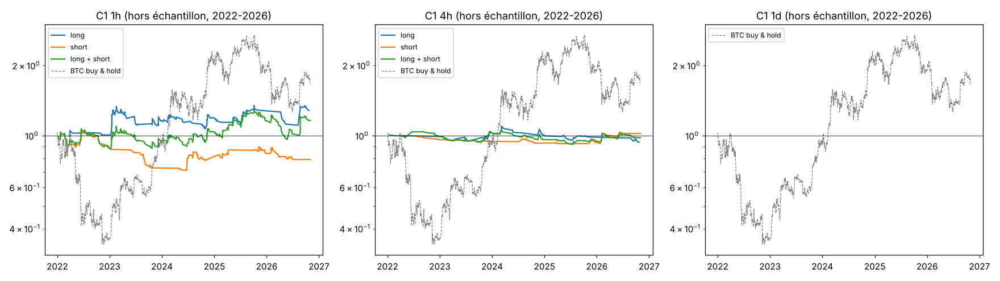
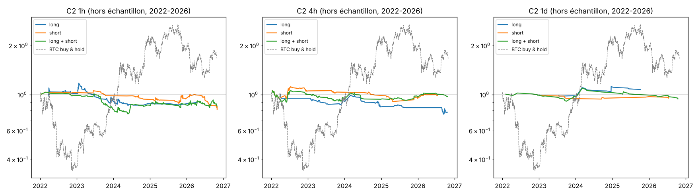

# Rapport Phase 2 : C1 (cassure de tendance) et C2 (repli dans la tendance), BTC et ETH

Protocole : `PROTOCOLE_PHASE2.md` (committé avant le calcul). Validation hors échantillon en walk-forward du 2022-01-01 au 2026-10-31. Tous les chiffres sont nets de frais (taker 0,05 %), de slippage (modèle ATR + volume) et du funding réel. Risque 1 % par trade.

## Verdict

**Aucun groupe ne passe les critères 1 à 8. Aucun candidat C1 ou C2 sur BTC et ETH.**

- Groupes à espérance hors échantillon positive : 4 sur 18.
- Essais comptés : 225 dans cette phase (153 variantes de la grille + 72 pour l'ablation du volume), **457 au total** avec les 232 hérités.
- Test SPA de Hansen (toutes les variantes de la grille contre « rester à plat », rendements journaliers 2022-2026) : p = 0,974 (p inférieur = 0,764, supérieur = 0,983). On ne peut pas exclure que la meilleure variante soit due au hasard du choix parmi toutes celles testées.
- Résultats suspects (règle 6) : aucun.

## Classement hors échantillon (walk-forward)

| Groupe | Trades | E[R] | IC 95 % | PF | Gagnants | Sharpe | DD max | Coûts × 1,5 | Hasard p95 | Voisines + | DSR | Critères ratés | Statut |
|---|---|---|---|---|---|---|---|---|---|---|---|---|---|
| C1 1h long + short | 392 | +0,063 | [-0,121 ; +0,260] | 1,11 | 29,1 % | 0,25 | 26,2 % | +0,022 | +0,100 | 100 % | 0,01 | IC 95 % > 0; SPA p < 0,05; DSR > 0,95; > 95e centile hasard | **non concluant** |
| C1 1h long | 221 | +0,142 | [-0,130 ; +0,466] | 1,24 | 30,3 % | 0,37 | 19,8 % | +0,097 | +0,169 | 100 % | 0,01 | IC 95 % > 0; SPA p < 0,05; DSR > 0,95; > 95e centile hasard; stabilité annuelle | **non concluant** |
| C1 1h short | 227 | -0,087 | [-0,274 ; +0,125] | 0,83 | 27,3 % | -0,33 | 32,2 % | -0,127 | +0,141 | 7 % | 0,00 | IC 95 % > 0; SPA p < 0,05; DSR > 0,95; > 95e centile hasard; coûts × 1,5 > 0; voisines ≥ 75 %; stabilité annuelle | **pas d'edge** |
| C1 4h long + short | 117 | -0,009 | [-0,265 ; +0,270] | 0,98 | 27,4 % | -0,01 | 13,0 % | -0,031 | +0,311 | 93 % | 0,00 | IC 95 % > 0; SPA p < 0,05; DSR > 0,95; > 95e centile hasard; coûts × 1,5 > 0; stabilité annuelle | **pas d'edge** |
| C1 4h long | 76 | -0,065 | [-0,391 ; +0,291] | 0,89 | 23,7 % | -0,15 | 14,6 % | -0,088 | +0,652 | 86 % | 0,00 | ≥ 100 trades; IC 95 % > 0; SPA p < 0,05; DSR > 0,95; > 95e centile hasard; coûts × 1,5 > 0; stabilité annuelle | **pas d'edge** |
| C1 4h short | 44 | +0,057 | [-0,333 ; +0,515] | 1,13 | 31,8 % | 0,10 | 7,5 % | +0,037 | +0,462 | 100 % | 0,00 | ≥ 100 trades; IC 95 % > 0; SPA p < 0,05; DSR > 0,95; > 95e centile hasard; stabilité annuelle | **non concluant** |
| C1 1d long + short | 0 | – | [– ; –] | – | – | – | 0,0 % | – | – | – | – | ≥ 100 trades; IC 95 % > 0; SPA p < 0,05; DSR > 0,95; > 95e centile hasard; coûts × 1,5 > 0; voisines ≥ 75 %; stabilité annuelle | **pas d'edge** |
| C1 1d long | 0 | – | [– ; –] | – | – | – | 0,0 % | – | – | – | – | ≥ 100 trades; IC 95 % > 0; SPA p < 0,05; DSR > 0,95; > 95e centile hasard; coûts × 1,5 > 0; voisines ≥ 75 %; stabilité annuelle | **pas d'edge** |
| C1 1d short | 0 | – | [– ; –] | – | – | – | 0,0 % | – | – | – | – | ≥ 100 trades; IC 95 % > 0; SPA p < 0,05; DSR > 0,95; > 95e centile hasard; coûts × 1,5 > 0; voisines ≥ 75 %; stabilité annuelle | **pas d'edge** |
| C2 1h long + short | 299 | -0,047 | [-0,186 ; +0,109] | 0,89 | 33,8 % | -0,27 | 26,3 % | -0,099 | +0,033 | 0 % | 0,00 | IC 95 % > 0; SPA p < 0,05; DSR > 0,95; > 95e centile hasard; coûts × 1,5 > 0; voisines ≥ 75 %; stabilité annuelle | **pas d'edge** |
| C2 1h long | 193 | -0,046 | [-0,200 ; +0,124] | 0,89 | 29,5 % | -0,21 | 26,9 % | -0,087 | +0,081 | 19 % | 0,00 | IC 95 % > 0; SPA p < 0,05; DSR > 0,95; > 95e centile hasard; coûts × 1,5 > 0; voisines ≥ 75 %; stabilité annuelle | **pas d'edge** |
| C2 1h short | 144 | -0,139 | [-0,329 ; +0,066] | 0,72 | 29,9 % | -0,55 | 23,0 % | -0,199 | +0,116 | 6 % | 0,00 | IC 95 % > 0; SPA p < 0,05; DSR > 0,95; > 95e centile hasard; coûts × 1,5 > 0; voisines ≥ 75 %; stabilité annuelle | **pas d'edge** |
| C2 4h long + short | 171 | -0,003 | [-0,230 ; +0,266] | 0,99 | 29,2 % | -0,01 | 15,0 % | -0,030 | +0,212 | 19 % | 0,00 | IC 95 % > 0; SPA p < 0,05; DSR > 0,95; > 95e centile hasard; coûts × 1,5 > 0; voisines ≥ 75 %; stabilité annuelle | **pas d'edge** |
| C2 4h long | 112 | -0,207 | [-0,433 ; +0,054] | 0,65 | 26,8 % | -0,64 | 24,3 % | -0,239 | +0,624 | 33 % | 0,00 | IC 95 % > 0; SPA p < 0,05; DSR > 0,95; > 95e centile hasard; coûts × 1,5 > 0; voisines ≥ 75 %; stabilité annuelle | **pas d'edge** |
| C2 4h short | 111 | -0,000 | [-0,291 ; +0,355] | 1,00 | 30,6 % | 0,01 | 19,1 % | -0,027 | +0,474 | 89 % | 0,00 | IC 95 % > 0; SPA p < 0,05; DSR > 0,95; > 95e centile hasard; coûts × 1,5 > 0; stabilité annuelle | **pas d'edge** |
| C2 1d long + short | 48 | -0,099 | [-0,661 ; +0,673] | 0,87 | 22,9 % | -0,12 | 14,0 % | -0,121 | +0,878 | 72 % | 0,00 | ≥ 100 trades; IC 95 % > 0; SPA p < 0,05; DSR > 0,95; > 95e centile hasard; coûts × 1,5 > 0; voisines ≥ 75 %; stabilité annuelle | **pas d'edge** |
| C2 1d long | 17 | +0,485 | [-0,949 ; +2,639] | 1,61 | 17,6 % | 0,23 | 5,6 % | +0,461 | +1,791 | 94 % | 0,00 | ≥ 100 trades; IC 95 % > 0; SPA p < 0,05; DSR > 0,95; > 95e centile hasard; stabilité annuelle | **non concluant** |
| C2 1d short | 12 | -0,399 | [-1,012 ; +0,305] | 0,48 | 25,0 % | -0,49 | 6,1 % | -0,601 | +0,903 | 6 % | 0,00 | ≥ 100 trades; IC 95 % > 0; SPA p < 0,05; DSR > 0,95; > 95e centile hasard; coûts × 1,5 > 0; voisines ≥ 75 %; stabilité annuelle | **pas d'edge** |

E[R] = gain moyen par trade en multiples du risque, après tous les coûts. Hasard p95 = 95e centile de l'espérance d'entrées aléatoires avec les mêmes stops, la même sortie et les mêmes coûts. Voisines + = part des variantes à paramètres ±20 % qui restent positives. DSR = Deflated Sharpe Ratio, probabilité que le Sharpe soit réel compte tenu des 457 essais.

## Référence : détention passive sur la même période

| Référence | Rendement | Sharpe | Drawdown max |
|---|---|---|---|
| BTC buy & hold | 67,8 % | 0,46 | 66,9 % |
| Panier BTC+ETH | 10,2 % | 0,32 | 68,3 % |

## Détail par groupe

### C1 1h long + short : non concluant

Variante retenue par fenêtre : 2022-01 → direction-both_entry_n-100_tf-1h_trail-donchian; 2022-07 → direction-both_entry_n-100_tf-1h_trail-donchian; 2023-01 → direction-both_entry_n-20_tf-1h_trail-chandelier; 2023-07 → direction-both_entry_n-100_tf-1h_trail-donchian; 2024-01 → direction-both_entry_n-100_tf-1h_trail-donchian; 2024-07 → direction-both_entry_n-100_tf-1h_trail-donchian; 2025-01 → direction-both_entry_n-100_tf-1h_trail-donchian; 2025-07 → direction-both_entry_n-100_tf-1h_trail-donchian; 2026-01 → direction-both_entry_n-100_tf-1h_trail-donchian; 2026-07 → direction-both_entry_n-100_tf-1h_trail-donchian.

- 392 trades, espérance +0,063 R, profit factor 1,11, 29,1 % de gagnants, Sharpe 0,25, Sortino 0,65, drawdown max 26,2 % (durée 773 jours), plus longue série de pertes 29, durée moyenne 1,1 jours, rendement 16,1 %, coûts = 70 % du gain brut.
- Hasard (même sortie) : médiane -0,034 R, 95e centile +0,100 R ; le groupe est au 89e centile.
- Ablation du filtre volume relatif > 1,2 : 391 trades, espérance +0,073 R (sans filtre : +0,063 R) → le filtre améliore le résultat.
- Par année : 2022 -10,2 R (78); 2023 +9,0 R (94); 2024 +10,9 R (80); 2025 +12,2 R (81); 2026 +2,9 R (59).
- Par paire : BTCUSDT +0,137 R (192); ETHUSDT -0,008 R (200).
- Par sens : long +0,151 R (224); short -0,054 R (168).
- Par sortie : end -0,320 R (2); stop -1,070 R (131); trail +0,639 R (259).
- Par régime à l'entrée : range +0,555 R (41); tendance +0,006 R (351) ; forte volatilité : non +0,132 R (343); oui -0,419 R (49).
- Par trimestre (somme de R) : 2022Q1 -3,5; 2022Q2 +9,2; 2022Q3 -3,6; 2022Q4 -12,4; 2023Q1 +16,9; 2023Q2 -7,4; 2023Q3 -5,6; 2023Q4 +5,1; 2024Q1 +2,8; 2024Q2 -5,0; 2024Q3 +6,9; 2024Q4 +6,1; 2025Q1 +4,0; 2025Q2 +3,0; 2025Q3 +12,1; 2025Q4 -6,9; 2026Q1 -4,4; 2026Q2 -7,3; 2026Q3 +19,0; 2026Q4 -4,4.

### C1 1h long : non concluant

Variante retenue par fenêtre : 2022-01 → direction-long_entry_n-55_tf-1h_trail-donchian; 2022-07 → direction-long_entry_n-100_tf-1h_trail-donchian; 2023-01 → direction-long_entry_n-20_tf-1h_trail-donchian; 2023-07 → direction-long_entry_n-55_tf-1h_trail-donchian; 2024-01 → direction-long_entry_n-100_tf-1h_trail-donchian; 2024-07 → direction-long_entry_n-100_tf-1h_trail-donchian; 2025-01 → direction-long_entry_n-100_tf-1h_trail-donchian; 2025-07 → direction-long_entry_n-100_tf-1h_trail-donchian; 2026-01 → direction-long_entry_n-100_tf-1h_trail-donchian; 2026-07 → direction-long_entry_n-100_tf-1h_trail-donchian.

- 221 trades, espérance +0,142 R, profit factor 1,24, 30,3 % de gagnants, Sharpe 0,37, Sortino 1,14, drawdown max 19,8 % (durée 960 jours), plus longue série de pertes 21, durée moyenne 1,2 jours, rendement 28,3 %, coûts = 51 % du gain brut.
- Hasard (même sortie) : médiane -0,028 R, 95e centile +0,169 R ; le groupe est au 92e centile.
- Ablation du filtre volume relatif > 1,2 : 203 trades, espérance +0,182 R (sans filtre : +0,142 R) → le filtre améliore le résultat.
- Par année : 2022 +0,9 R (14); 2023 +16,8 R (77); 2024 +4,2 R (59); 2025 +8,1 R (43); 2026 +1,5 R (28).
- Par paire : BTCUSDT +0,265 R (112); ETHUSDT +0,017 R (109).
- Par sens : long +0,142 R (221).
- Par sortie : stop -1,081 R (83); trail +0,878 R (138).
- Par régime à l'entrée : range +0,990 R (27); tendance +0,025 R (194) ; forte volatilité : non +0,158 R (209); oui -0,134 R (12).
- Par trimestre (somme de R) : 2022Q1 +5,1; 2022Q2 -2,6; 2022Q3 +0,5; 2022Q4 -2,2; 2023Q1 +24,2; 2023Q2 -11,1; 2023Q3 -0,5; 2023Q4 +4,2; 2024Q1 +2,8; 2024Q2 -3,9; 2024Q3 -0,9; 2024Q4 +6,2; 2025Q1 -4,6; 2025Q2 +0,0; 2025Q3 +12,7; 2025Q4 +0,1; 2026Q1 -0,9; 2026Q2 -12,2; 2026Q3 +19,1; 2026Q4 -4,5.

### C1 1h short : pas d'edge

Variante retenue par fenêtre : 2022-01 → direction-short_entry_n-100_tf-1h_trail-donchian; 2022-07 → direction-short_entry_n-100_tf-1h_trail-chandelier; 2023-01 → direction-short_entry_n-20_tf-1h_trail-chandelier; 2023-07 → direction-short_entry_n-20_tf-1h_trail-chandelier; 2024-01 → direction-short_entry_n-20_tf-1h_trail-chandelier; 2024-07 → direction-short_entry_n-ensemble_tf-1h_trail-chandelier; 2025-01 → direction-short_entry_n-100_tf-1h_trail-chandelier; 2025-07 → direction-short_entry_n-100_tf-1h_trail-chandelier; 2026-01 → direction-short_entry_n-100_tf-1h_trail-chandelier; 2026-07 → direction-short_entry_n-100_tf-1h_trail-donchian.

- 227 trades, espérance -0,087 R, profit factor 0,83, 27,3 % de gagnants, Sharpe -0,33, Sortino -0,73, drawdown max 32,2 % (durée 1596 jours), plus longue série de pertes 19, durée moyenne 0,7 jours, rendement -20,9 %, coûts = – du gain brut.
- Hasard (même sortie) : médiane -0,018 R, 95e centile +0,141 R ; le groupe est au 18e centile.
- Ablation du filtre volume relatif > 1,2 : 214 trades, espérance -0,068 R (sans filtre : -0,087 R) → le filtre améliore le résultat.
- Par année : 2022 -10,5 R (67); 2023 -18,5 R (35); 2024 +7,9 R (45); 2025 +7,0 R (42); 2026 -5,7 R (38).
- Par paire : BTCUSDT -0,067 R (106); ETHUSDT -0,105 R (121).
- Par sens : short -0,087 R (227).
- Par sortie : end -0,320 R (2); stop -1,064 R (43); trail +0,146 R (182).
- Par régime à l'entrée : range -0,282 R (18); tendance -0,070 R (209) ; forte volatilité : non -0,058 R (179); oui -0,195 R (48).
- Par trimestre (somme de R) : 2022Q1 -8,6; 2022Q2 +12,2; 2022Q3 -2,3; 2022Q4 -11,9; 2023Q1 -1,0; 2023Q2 -2,9; 2023Q3 -13,1; 2023Q4 -1,6; 2024Q2 +9,6; 2024Q3 -0,5; 2024Q4 -1,1; 2025Q1 +7,2; 2025Q2 +3,0; 2025Q3 -0,4; 2025Q4 -2,8; 2026Q1 -3,2; 2026Q2 -2,5; 2026Q3 -0,1; 2026Q4 +0,1.

### C1 4h long + short : pas d'edge

Variante retenue par fenêtre : 2022-01 → direction-both_entry_n-100_tf-4h_trail-donchian; 2022-07 → direction-both_entry_n-ensemble_tf-4h_trail-donchian; 2023-01 → direction-both_entry_n-100_tf-4h_trail-chandelier; 2023-07 → direction-both_entry_n-100_tf-4h_trail-chandelier; 2024-01 → direction-both_entry_n-100_tf-4h_trail-chandelier; 2024-07 → direction-both_entry_n-55_tf-4h_trail-donchian; 2025-01 → direction-both_entry_n-55_tf-4h_trail-donchian; 2025-07 → direction-both_entry_n-55_tf-4h_trail-donchian; 2026-01 → direction-both_entry_n-20_tf-4h_trail-chandelier; 2026-07 → direction-both_entry_n-100_tf-4h_trail-chandelier.

- 117 trades, espérance -0,009 R, profit factor 0,98, 27,4 % de gagnants, Sharpe -0,01, Sortino -0,03, drawdown max 13,0 % (durée 971 jours), plus longue série de pertes 14, durée moyenne 3,3 jours, rendement -2,0 %, coûts = 146 % du gain brut.
- Hasard (même sortie) : médiane +0,060 R, 95e centile +0,311 R ; le groupe est au 30e centile.
- Ablation du filtre volume relatif > 1,2 : 113 trades, espérance -0,015 R (sans filtre : -0,009 R) → le filtre n'améliore pas : retiré.
- Par année : 2022 -0,7 R (15); 2023 +4,4 R (24); 2024 -7,6 R (32); 2025 -1,4 R (20); 2026 +4,2 R (26).
- Par paire : BTCUSDT +0,079 R (59); ETHUSDT -0,099 R (58).
- Par sens : long -0,060 R (64); short +0,053 R (53).
- Par sortie : end -0,112 R (2); stop -1,039 R (24); trail +0,265 R (91).
- Par régime à l'entrée : tendance -0,009 R (117) ; forte volatilité : non +0,029 R (107); oui -0,418 R (10).
- Par trimestre (somme de R) : 2022Q1 -0,1; 2022Q2 +4,0; 2022Q3 +0,0; 2022Q4 -4,6; 2023Q1 -4,4; 2023Q2 +0,7; 2023Q3 -1,6; 2023Q4 +9,7; 2024Q1 +0,8; 2024Q2 -4,0; 2024Q3 -1,6; 2024Q4 -2,7; 2025Q1 -0,9; 2025Q2 -3,2; 2025Q3 +3,3; 2025Q4 -0,5; 2026Q1 +4,8; 2026Q2 +3,0; 2026Q3 -3,5; 2026Q4 -0,1.

### C1 4h long : pas d'edge

Variante retenue par fenêtre : 2022-01 → direction-long_entry_n-100_tf-4h_trail-donchian; 2022-07 → direction-long_entry_n-100_tf-4h_trail-donchian; 2023-01 → direction-long_entry_n-100_tf-4h_trail-chandelier; 2023-07 → direction-long_entry_n-20_tf-4h_trail-chandelier; 2024-01 → direction-long_entry_n-100_tf-4h_trail-donchian; 2024-07 → direction-long_entry_n-55_tf-4h_trail-donchian; 2025-01 → direction-long_entry_n-100_tf-4h_trail-donchian; 2025-07 → direction-long_entry_n-55_tf-4h_trail-donchian; 2026-01 → direction-long_entry_n-55_tf-4h_trail-donchian; 2026-07 → direction-long_entry_n-20_tf-4h_trail-chandelier.

- 76 trades, espérance -0,065 R, profit factor 0,89, 23,7 % de gagnants, Sharpe -0,15, Sortino -0,34, drawdown max 14,6 % (durée 962 jours), plus longue série de pertes 10, durée moyenne 3,6 jours, rendement -6,3 %, coûts = 1405 % du gain brut.
- Hasard (même sortie) : médiane +0,217 R, 95e centile +0,652 R ; le groupe est au 9e centile.
- Ablation du filtre volume relatif > 1,2 : 71 trades, espérance -0,054 R (sans filtre : -0,065 R) → le filtre améliore le résultat.
- Par année : 2022 +0,0 R (1); 2023 +3,7 R (29); 2024 -1,8 R (21); 2025 -1,9 R (14); 2026 -4,9 R (11).
- Par paire : BTCUSDT -0,024 R (40); ETHUSDT -0,111 R (36).
- Par sens : long -0,065 R (76).
- Par sortie : stop -1,046 R (20); trail +0,285 R (56).
- Par régime à l'entrée : tendance -0,065 R (76) ; forte volatilité : non -0,029 R (73); oui -0,954 R (3).
- Par trimestre (somme de R) : 2022Q1 +0,0; 2023Q1 -4,4; 2023Q2 +2,1; 2023Q3 -3,1; 2023Q4 +9,1; 2024Q1 +4,7; 2024Q2 -4,2; 2024Q3 -1,2; 2024Q4 -1,2; 2025Q1 -1,0; 2025Q2 -3,2; 2025Q3 +3,3; 2025Q4 -1,0; 2026Q3 -2,5; 2026Q4 -2,4.

### C1 4h short : non concluant

Variante retenue par fenêtre : 2022-01 → aucune (moins de 10 trades au réglage); 2022-07 → direction-short_entry_n-55_tf-4h_trail-chandelier; 2023-01 → direction-short_entry_n-100_tf-4h_trail-chandelier; 2023-07 → direction-short_entry_n-55_tf-4h_trail-chandelier; 2024-01 → direction-short_entry_n-55_tf-4h_trail-chandelier; 2024-07 → direction-short_entry_n-20_tf-4h_trail-chandelier; 2025-01 → direction-short_entry_n-55_tf-4h_trail-chandelier; 2025-07 → direction-short_entry_n-55_tf-4h_trail-chandelier; 2026-01 → direction-short_entry_n-55_tf-4h_trail-chandelier; 2026-07 → direction-short_entry_n-100_tf-4h_trail-chandelier.

- 44 trades, espérance +0,057 R, profit factor 1,13, 31,8 % de gagnants, Sharpe 0,10, Sortino 0,31, drawdown max 7,5 % (durée 1290 jours), plus longue série de pertes 5, durée moyenne 2,4 jours, rendement 2,1 %, coûts = 45 % du gain brut.
- Hasard (même sortie) : médiane +0,086 R, 95e centile +0,462 R ; le groupe est au 44e centile.
- Ablation du filtre volume relatif > 1,2 : 49 trades, espérance -0,114 R (sans filtre : +0,057 R) → le filtre n'améliore pas : retiré.
- Par année : 2022 -3,9 R (8); 2023 -1,4 R (6); 2024 -2,0 R (12); 2025 +0,9 R (6); 2026 +8,9 R (12).
- Par paire : BTCUSDT -0,076 R (20); ETHUSDT +0,169 R (24).
- Par sens : short +0,057 R (44).
- Par sortie : end -0,063 R (1); stop -1,028 R (5); trail +0,203 R (38).
- Par régime à l'entrée : tendance +0,057 R (44) ; forte volatilité : non +0,032 R (39); oui +0,260 R (5).
- Par trimestre (somme de R) : 2022Q3 -2,1; 2022Q4 -1,8; 2023Q2 -1,4; 2023Q3 -0,6; 2023Q4 +0,6; 2024Q3 -0,0; 2024Q4 -1,9; 2025Q1 -0,4; 2025Q4 +1,3; 2026Q1 +7,1; 2026Q2 +1,9; 2026Q4 -0,1.

### C1 1d long + short : pas d'edge

Variante retenue par fenêtre : 2022-01 → aucune (moins de 10 trades au réglage); 2022-07 → aucune (moins de 10 trades au réglage); 2023-01 → aucune (moins de 10 trades au réglage); 2023-07 → aucune (moins de 10 trades au réglage); 2024-01 → aucune (moins de 10 trades au réglage); 2024-07 → aucune (moins de 10 trades au réglage); 2025-01 → aucune (moins de 10 trades au réglage); 2025-07 → aucune (moins de 10 trades au réglage); 2026-01 → aucune (moins de 10 trades au réglage); 2026-07 → aucune (moins de 10 trades au réglage).

Aucun trade hors échantillon.

### C1 1d long : pas d'edge

Variante retenue par fenêtre : 2022-01 → aucune (moins de 10 trades au réglage); 2022-07 → aucune (moins de 10 trades au réglage); 2023-01 → aucune (moins de 10 trades au réglage); 2023-07 → aucune (moins de 10 trades au réglage); 2024-01 → aucune (moins de 10 trades au réglage); 2024-07 → aucune (moins de 10 trades au réglage); 2025-01 → aucune (moins de 10 trades au réglage); 2025-07 → aucune (moins de 10 trades au réglage); 2026-01 → aucune (moins de 10 trades au réglage); 2026-07 → aucune (moins de 10 trades au réglage).

Aucun trade hors échantillon.

### C1 1d short : pas d'edge

Variante retenue par fenêtre : 2022-01 → aucune (moins de 10 trades au réglage); 2022-07 → aucune (moins de 10 trades au réglage); 2023-01 → aucune (moins de 10 trades au réglage); 2023-07 → aucune (moins de 10 trades au réglage); 2024-01 → aucune (moins de 10 trades au réglage); 2024-07 → aucune (moins de 10 trades au réglage); 2025-01 → aucune (moins de 10 trades au réglage); 2025-07 → aucune (moins de 10 trades au réglage); 2026-01 → aucune (moins de 10 trades au réglage); 2026-07 → aucune (moins de 10 trades au réglage).

Aucun trade hors échantillon.

### C2 1h long + short : pas d'edge

Variante retenue par fenêtre : 2022-01 → direction-both_pivots-zigzag_pullback-structure_tf-1h; 2022-07 → direction-both_pivots-zigzag_pullback-structure_tf-1h; 2023-01 → direction-both_pivots-zigzag_pullback-structure_tf-1h; 2023-07 → direction-both_pivots-hierarchical_pullback-ema50_tf-1h; 2024-01 → direction-both_pivots-hierarchical_pullback-ema20_tf-1h; 2024-07 → direction-both_pivots-hierarchical_pullback-structure_tf-1h; 2025-01 → direction-both_pivots-hierarchical_pullback-ema50_tf-1h; 2025-07 → direction-both_pivots-hierarchical_pullback-structure_tf-1h; 2026-01 → direction-both_pivots-zigzag_pullback-ema20_tf-1h; 2026-07 → direction-both_pivots-zigzag_pullback-ema20_tf-1h.

- 299 trades, espérance -0,047 R, profit factor 0,89, 33,8 % de gagnants, Sharpe -0,27, Sortino -0,55, drawdown max 26,3 % (durée 1676 jours), plus longue série de pertes 11, durée moyenne 0,6 jours, rendement -14,9 %, coûts = 244 % du gain brut.
- Hasard (même sortie) : médiane -0,091 R, 95e centile +0,033 R ; le groupe est au 72e centile.
- Par année : 2022 -1,3 R (13); 2023 -20,2 R (61); 2024 +7,5 R (59); 2025 +0,6 R (53); 2026 -0,8 R (113).
- Par paire : BTCUSDT -0,025 R (152); ETHUSDT -0,070 R (147).
- Par sens : long -0,065 R (161); short -0,026 R (138).
- Par sortie : end +0,207 R (1); stop -1,121 R (36); trail +0,099 R (262).
- Par régime à l'entrée : range +0,140 R (29); tendance -0,067 R (270) ; forte volatilité : non -0,012 R (236); oui -0,179 R (63).
- Par trimestre (somme de R) : 2022Q1 +2,3; 2022Q2 -0,4; 2022Q3 +0,1; 2022Q4 -3,2; 2023Q1 -0,8; 2023Q2 +2,5; 2023Q3 -14,5; 2023Q4 -7,4; 2024Q1 -3,1; 2024Q2 +11,7; 2024Q3 -2,1; 2024Q4 +1,0; 2025Q1 +3,3; 2025Q2 -2,6; 2025Q3 -0,9; 2025Q4 +0,9; 2026Q1 +1,3; 2026Q2 -0,1; 2026Q3 +2,3; 2026Q4 -4,2.

### C2 1h long : pas d'edge

Variante retenue par fenêtre : 2022-01 → direction-long_pivots-hierarchical_pullback-ema20_tf-1h; 2022-07 → direction-long_pivots-hierarchical_pullback-ema20_tf-1h; 2023-01 → direction-long_pivots-hierarchical_pullback-ema20_tf-1h; 2023-07 → direction-long_pivots-hierarchical_pullback-ema20_tf-1h; 2024-01 → direction-long_pivots-hierarchical_pullback-ema20_tf-1h; 2024-07 → direction-long_pivots-hierarchical_pullback-structure_tf-1h; 2025-01 → direction-long_pivots-hierarchical_pullback-structure_tf-1h; 2025-07 → direction-long_pivots-hierarchical_pullback-structure_tf-1h; 2026-01 → direction-long_pivots-hierarchical_pullback-structure_tf-1h; 2026-07 → direction-long_pivots-hierarchical_pullback-structure_tf-1h.

- 193 trades, espérance -0,046 R, profit factor 0,89, 29,5 % de gagnants, Sharpe -0,21, Sortino -0,45, drawdown max 26,9 % (durée 1379 jours), plus longue série de pertes 14, durée moyenne 0,6 jours, rendement -10,3 %, coûts = 243 % du gain brut.
- Hasard (même sortie) : médiane -0,046 R, 95e centile +0,081 R ; le groupe est au 50e centile.
- Par année : 2022 +2,5 R (29); 2023 -10,1 R (103); 2024 -3,2 R (49); 2025 -1,7 R (8); 2026 +3,6 R (4).
- Par paire : BTCUSDT -0,023 R (98); ETHUSDT -0,070 R (95).
- Par sens : long -0,046 R (193).
- Par sortie : stop -1,090 R (19); trail +0,068 R (174).
- Par régime à l'entrée : range +0,186 R (12); tendance -0,061 R (181) ; forte volatilité : non -0,025 R (174); oui -0,243 R (19).
- Par trimestre (somme de R) : 2022Q1 +6,9; 2022Q2 -2,6; 2022Q3 -0,1; 2022Q4 -1,8; 2023Q1 +4,6; 2023Q2 -8,5; 2023Q3 -2,8; 2023Q4 -3,4; 2024Q1 -3,1; 2024Q2 -1,1; 2024Q3 -1,1; 2024Q4 +2,1; 2025Q2 -0,4; 2025Q3 -0,9; 2025Q4 -0,5; 2026Q2 +3,6.

### C2 1h short : pas d'edge

Variante retenue par fenêtre : 2022-01 → direction-short_pivots-zigzag_pullback-structure_tf-1h; 2022-07 → direction-short_pivots-zigzag_pullback-structure_tf-1h; 2023-01 → direction-short_pivots-zigzag_pullback-structure_tf-1h; 2023-07 → direction-short_pivots-zigzag_pullback-structure_tf-1h; 2024-01 → direction-short_pivots-zigzag_pullback-structure_tf-1h; 2024-07 → direction-short_pivots-hierarchical_pullback-ema50_tf-1h; 2025-01 → direction-short_pivots-hierarchical_pullback-ema50_tf-1h; 2025-07 → direction-short_pivots-zigzag_pullback-ema20_tf-1h; 2026-01 → direction-short_pivots-hierarchical_pullback-ema50_tf-1h; 2026-07 → direction-short_pivots-fractal_pullback-ema20_tf-1h.

- 144 trades, espérance -0,139 R, profit factor 0,72, 29,9 % de gagnants, Sharpe -0,55, Sortino -0,88, drawdown max 23,0 % (durée 1182 jours), plus longue série de pertes 10, durée moyenne 0,6 jours, rendement -18,7 %, coûts = – du gain brut.
- Hasard (même sortie) : médiane -0,060 R, 95e centile +0,116 R ; le groupe est au 20e centile.
- Par année : 2022 +3,0 R (6); 2023 -4,6 R (11); 2024 -5,0 R (19); 2025 +1,3 R (59); 2026 -14,7 R (49).
- Par paire : BTCUSDT -0,285 R (72); ETHUSDT +0,006 R (72).
- Par sens : short -0,139 R (144).
- Par sortie : end +0,289 R (2); stop -1,128 R (23); trail +0,045 R (119).
- Par régime à l'entrée : range -0,296 R (16); tendance -0,120 R (128) ; forte volatilité : non -0,141 R (92); oui -0,137 R (52).
- Par trimestre (somme de R) : 2022Q1 +3,4; 2022Q2 -0,1; 2022Q4 -0,3; 2023Q2 +2,7; 2023Q3 -5,1; 2023Q4 -2,1; 2024Q2 -0,4; 2024Q3 -2,9; 2024Q4 -1,7; 2025Q1 -0,3; 2025Q2 -0,7; 2025Q3 -2,7; 2025Q4 +5,0; 2026Q1 +5,8; 2026Q2 -3,2; 2026Q3 -11,8; 2026Q4 -5,5.

### C2 4h long + short : pas d'edge

Variante retenue par fenêtre : 2022-01 → direction-both_pivots-fractal_pullback-structure_tf-4h; 2022-07 → direction-both_pivots-zigzag_pullback-ema50_tf-4h; 2023-01 → direction-both_pivots-zigzag_pullback-ema50_tf-4h; 2023-07 → direction-both_pivots-zigzag_pullback-ema20_tf-4h; 2024-01 → direction-both_pivots-fractal_pullback-ema50_tf-4h; 2024-07 → direction-both_pivots-zigzag_pullback-structure_tf-4h; 2025-01 → direction-both_pivots-hierarchical_pullback-ema50_tf-4h; 2025-07 → direction-both_pivots-hierarchical_pullback-ema50_tf-4h; 2026-01 → direction-both_pivots-hierarchical_pullback-ema50_tf-4h; 2026-07 → direction-both_pivots-hierarchical_pullback-ema50_tf-4h.

- 171 trades, espérance -0,003 R, profit factor 0,99, 29,2 % de gagnants, Sharpe -0,01, Sortino -0,02, drawdown max 15,0 % (durée 1567 jours), plus longue série de pertes 11, durée moyenne 2,6 jours, rendement -2,7 %, coûts = 135 % du gain brut.
- Hasard (même sortie) : médiane +0,007 R, 95e centile +0,212 R ; le groupe est au 48e centile.
- Par année : 2022 +1,8 R (59); 2023 -6,2 R (53); 2024 -0,5 R (19); 2025 +3,4 R (23); 2026 +1,0 R (17).
- Par paire : BTCUSDT +0,058 R (88); ETHUSDT -0,068 R (83).
- Par sens : long -0,168 R (82); short +0,149 R (89).
- Par sortie : end +1,024 R (4); stop -1,064 R (39); trail +0,288 R (128).
- Par régime à l'entrée : tendance -0,003 R (171) ; forte volatilité : non +0,014 R (149); oui -0,119 R (22).
- Par trimestre (somme de R) : 2022Q1 -7,1; 2022Q2 +12,7; 2022Q3 -0,4; 2022Q4 -3,5; 2023Q1 -3,9; 2023Q2 -0,4; 2023Q3 -5,6; 2023Q4 +3,7; 2024Q1 +6,7; 2024Q2 -6,0; 2024Q3 -0,8; 2024Q4 -0,4; 2025Q1 +1,7; 2025Q2 +0,6; 2025Q3 -3,8; 2025Q4 +4,9; 2026Q1 +5,4; 2026Q2 +0,3; 2026Q3 -3,3; 2026Q4 -1,5.

### C2 4h long : pas d'edge

Variante retenue par fenêtre : 2022-01 → direction-long_pivots-fractal_pullback-structure_tf-4h; 2022-07 → direction-long_pivots-fractal_pullback-structure_tf-4h; 2023-01 → direction-long_pivots-hierarchical_pullback-ema20_tf-4h; 2023-07 → direction-long_pivots-hierarchical_pullback-ema50_tf-4h; 2024-01 → direction-long_pivots-fractal_pullback-ema50_tf-4h; 2024-07 → direction-long_pivots-fractal_pullback-ema20_tf-4h; 2025-01 → direction-long_pivots-hierarchical_pullback-ema50_tf-4h; 2025-07 → direction-long_pivots-hierarchical_pullback-ema50_tf-4h; 2026-01 → direction-long_pivots-zigzag_pullback-ema50_tf-4h; 2026-07 → direction-long_pivots-fractal_pullback-structure_tf-4h.

- 112 trades, espérance -0,207 R, profit factor 0,65, 26,8 % de gagnants, Sharpe -0,64, Sortino -1,17, drawdown max 24,3 % (durée 1676 jours), plus longue série de pertes 10, durée moyenne 2,3 jours, rendement -22,0 %, coûts = – du gain brut.
- Hasard (même sortie) : médiane +0,180 R, 95e centile +0,624 R ; le groupe est au 2e centile.
- Par année : 2022 -5,2 R (5); 2023 -3,9 R (32); 2024 -7,4 R (39); 2025 -0,9 R (10); 2026 -5,7 R (26).
- Par paire : BTCUSDT -0,111 R (67); ETHUSDT -0,349 R (45).
- Par sens : long -0,207 R (112).
- Par sortie : end -0,335 R (1); stop -1,089 R (40); trail +0,292 R (71).
- Par régime à l'entrée : tendance -0,207 R (112) ; forte volatilité : non -0,216 R (101); oui -0,116 R (11).
- Par trimestre (somme de R) : 2022Q1 -2,1; 2022Q2 -3,1; 2023Q1 -4,2; 2023Q2 -3,2; 2023Q3 -1,0; 2023Q4 +4,5; 2024Q1 +6,7; 2024Q2 -6,0; 2024Q3 -1,6; 2024Q4 -6,5; 2025Q1 +0,6; 2025Q2 +2,3; 2025Q3 -3,8; 2026Q3 -3,7; 2026Q4 -2,0.

### C2 4h short : pas d'edge

Variante retenue par fenêtre : 2022-01 → direction-short_pivots-fractal_pullback-structure_tf-4h; 2022-07 → direction-short_pivots-zigzag_pullback-ema20_tf-4h; 2023-01 → direction-short_pivots-zigzag_pullback-ema20_tf-4h; 2023-07 → direction-short_pivots-zigzag_pullback-ema20_tf-4h; 2024-01 → direction-short_pivots-zigzag_pullback-ema20_tf-4h; 2024-07 → direction-short_pivots-zigzag_pullback-ema20_tf-4h; 2025-01 → direction-short_pivots-fractal_pullback-ema50_tf-4h; 2025-07 → direction-short_pivots-hierarchical_pullback-ema50_tf-4h; 2026-01 → direction-short_pivots-hierarchical_pullback-ema50_tf-4h; 2026-07 → direction-short_pivots-hierarchical_pullback-ema20_tf-4h.

- 111 trades, espérance -0,000 R, profit factor 1,00, 30,6 % de gagnants, Sharpe 0,01, Sortino 0,03, drawdown max 19,1 % (durée 1567 jours), plus longue série de pertes 9, durée moyenne 2,5 jours, rendement -1,1 %, coûts = 127 % du gain brut.
- Hasard (même sortie) : médiane +0,128 R, 95e centile +0,474 R ; le groupe est au 24e centile.
- Par année : 2022 +6,4 R (57); 2023 -1,7 R (11); 2024 -4,4 R (10); 2025 -4,8 R (23); 2026 +4,5 R (10).
- Par paire : BTCUSDT +0,019 R (47); ETHUSDT -0,014 R (64).
- Par sens : short -0,000 R (111).
- Par sortie : end +1,024 R (4); stop -1,053 R (30); trail +0,357 R (77).
- Par régime à l'entrée : tendance -0,000 R (111) ; forte volatilité : non +0,100 R (88); oui -0,385 R (23).
- Par trimestre (somme de R) : 2022Q1 -5,0; 2022Q2 +15,8; 2022Q3 -0,9; 2022Q4 -3,5; 2023Q3 -3,4; 2023Q4 +1,7; 2024Q3 -3,0; 2024Q4 -1,4; 2025Q1 -4,4; 2025Q2 -5,3; 2025Q4 +4,9; 2026Q1 +5,4; 2026Q2 +0,3; 2026Q3 -1,3.

### C2 1d long + short : pas d'edge

Variante retenue par fenêtre : 2022-01 → direction-both_pivots-fractal_pullback-ema20_tf-1d; 2022-07 → direction-both_pivots-fractal_pullback-ema20_tf-1d; 2023-01 → direction-both_pivots-fractal_pullback-ema20_tf-1d; 2023-07 → direction-both_pivots-fractal_pullback-ema20_tf-1d; 2024-01 → direction-both_pivots-fractal_pullback-ema20_tf-1d; 2024-07 → direction-both_pivots-fractal_pullback-ema50_tf-1d; 2025-01 → direction-both_pivots-fractal_pullback-ema20_tf-1d; 2025-07 → direction-both_pivots-fractal_pullback-ema50_tf-1d; 2026-01 → direction-both_pivots-fractal_pullback-ema20_tf-1d; 2026-07 → direction-both_pivots-fractal_pullback-ema20_tf-1d.

- 48 trades, espérance -0,099 R, profit factor 0,87, 22,9 % de gagnants, Sharpe -0,12, Sortino -0,32, drawdown max 14,0 % (durée 943 jours), plus longue série de pertes 8, durée moyenne 8,3 jours, rendement -5,9 %, coûts = – du gain brut.
- Hasard (même sortie) : médiane +0,125 R, 95e centile +0,878 R ; le groupe est au 28e centile.
- Par année : 2022 +0,0 R (10); 2023 -2,6 R (14); 2024 +7,5 R (7); 2025 -3,7 R (8); 2026 -5,9 R (9).
- Par paire : BTCUSDT +0,196 R (29); ETHUSDT -0,549 R (19).
- Par sens : long +0,115 R (23); short -0,296 R (25).
- Par sortie : end +0,751 R (4); stop -1,053 R (33); trail +2,454 R (11).
- Par régime à l'entrée : tendance -0,099 R (48) ; forte volatilité : non -0,314 R (42); oui +1,405 R (6).
- Par trimestre (somme de R) : 2022Q1 -0,4; 2022Q2 +2,7; 2022Q3 -1,0; 2022Q4 -1,3; 2023Q1 -1,8; 2023Q2 -1,1; 2023Q3 -6,4; 2023Q4 +6,6; 2024Q1 +11,5; 2024Q2 -2,1; 2024Q3 -1,9; 2025Q1 +1,3; 2025Q2 -4,0; 2025Q4 -1,0; 2026Q1 -3,1; 2026Q2 +2,4; 2026Q3 -3,1; 2026Q4 -2,1.

### C2 1d long : non concluant

Variante retenue par fenêtre : 2022-01 → aucune (moins de 10 trades au réglage); 2022-07 → direction-long_pivots-fractal_pullback-ema20_tf-1d; 2023-01 → aucune (moins de 10 trades au réglage); 2023-07 → direction-long_pivots-fractal_pullback-structure_tf-1d; 2024-01 → direction-long_pivots-fractal_pullback-ema20_tf-1d; 2024-07 → direction-long_pivots-fractal_pullback-ema20_tf-1d; 2025-01 → direction-long_pivots-fractal_pullback-ema20_tf-1d; 2025-07 → direction-long_pivots-fractal_pullback-ema20_tf-1d; 2026-01 → direction-long_pivots-fractal_pullback-ema20_tf-1d; 2026-07 → aucune (moins de 10 trades au réglage).

- 17 trades, espérance +0,485 R, profit factor 1,61, 17,6 % de gagnants, Sharpe 0,23, Sortino 1,01, drawdown max 5,6 % (durée 661 jours), plus longue série de pertes 6, durée moyenne 10,0 jours, rendement 7,4 %, coûts = 30 % du gain brut.
- Hasard (même sortie) : médiane +0,411 R, 95e centile +1,791 R ; le groupe est au 53e centile.
- Par année : 2023 -1,9 R (4); 2024 +14,4 R (9); 2025 -4,2 R (4).
- Par paire : BTCUSDT +1,185 R (11); ETHUSDT -0,797 R (6).
- Par sens : long +0,485 R (17).
- Par sortie : end -0,354 R (1); stop -1,070 R (12); trail +5,360 R (4).
- Par régime à l'entrée : tendance +0,485 R (17) ; forte volatilité : non -0,172 R (13); oui +2,621 R (4).
- Par trimestre (somme de R) : 2023Q3 -2,1; 2023Q4 +0,2; 2024Q1 +11,5; 2024Q2 -2,1; 2024Q3 -1,0; 2024Q4 +6,0; 2025Q1 -1,1; 2025Q2 -2,1; 2025Q4 -1,0.

### C2 1d short : pas d'edge

Variante retenue par fenêtre : 2022-01 → aucune (moins de 10 trades au réglage); 2022-07 → aucune (moins de 10 trades au réglage); 2023-01 → direction-short_pivots-fractal_pullback-ema20_tf-1d; 2023-07 → direction-short_pivots-fractal_pullback-ema20_tf-1d; 2024-01 → direction-short_pivots-fractal_pullback-structure_tf-1d; 2024-07 → direction-short_pivots-fractal_pullback-ema20_tf-1d; 2025-01 → aucune (moins de 10 trades au réglage); 2025-07 → direction-short_pivots-fractal_pullback-ema20_tf-1d; 2026-01 → aucune (moins de 10 trades au réglage); 2026-07 → direction-short_pivots-fractal_pullback-ema20_tf-1d.

- 12 trades, espérance -0,399 R, profit factor 0,48, 25,0 % de gagnants, Sharpe -0,49, Sortino -0,63, drawdown max 6,1 % (durée 1397 jours), plus longue série de pertes 6, durée moyenne 8,8 jours, rendement -4,8 %, coûts = – du gain brut.
- Hasard (même sortie) : médiane -0,201 R, 95e centile +0,903 R ; le groupe est au 36e centile.
- Par année : 2023 -5,3 R (5); 2024 +0,4 R (3); 2025 +2,2 R (2); 2026 -2,0 R (2).
- Par paire : BTCUSDT -0,311 R (6); ETHUSDT -0,487 R (6).
- Par sens : short -0,399 R (12).
- Par sortie : end +0,670 R (1); stop -1,046 R (8); trail +0,969 R (3).
- Par régime à l'entrée : tendance -0,399 R (12) ; forte volatilité : non -0,399 R (12).
- Par trimestre (somme de R) : 2023Q1 -1,1; 2023Q3 -4,2; 2024Q3 +1,4; 2024Q4 -1,0; 2025Q4 +2,2; 2026Q3 -2,0.

## Toutes les variantes, période 2022-2026 à paramètres fixes (information, pas une validation)

| Variante | Trades | E[R] | PF | Sharpe |
|---|---|---|---|---|
| C2_direction-long_pivots-fractal_pullback-ema50_tf-1d | 11 | +0,742 | 1,85 | 0,25 |
| C1_direction-short_entry_n-100_tf-4h_trail-chandelier | 36 | +0,377 | 1,91 | 0,47 |
| C2_direction-long_pivots-fractal_pullback-ema20_tf-1d | 25 | +0,373 | 1,48 | 0,25 |
| C2_direction-long_pivots-zigzag_pullback-ema20_tf-1d | 1 | +0,358 | – | 0,45 |
| C1_direction-short_entry_n-55_tf-4h_trail-chandelier | 46 | +0,286 | 1,69 | 0,43 |
| C1_direction-long_entry_n-100_tf-1h_trail-donchian | 190 | +0,220 | 1,38 | 0,53 |
| C2_direction-short_pivots-fractal_pullback-ema50_tf-4h | 143 | +0,163 | 1,26 | 0,26 |
| C1_direction-short_entry_n-ensemble_tf-4h_trail-chandelier | 59 | +0,151 | 1,32 | 0,27 |
| C1_direction-long_entry_n-55_tf-1h_trail-donchian | 222 | +0,134 | 1,23 | 0,38 |
| C1_direction-long_entry_n-ensemble_tf-1h_trail-donchian | 276 | +0,129 | 1,22 | 0,42 |
| C2_direction-short_pivots-zigzag_pullback-ema20_tf-4h | 93 | +0,120 | 1,24 | 0,23 |
| C1_direction-both_entry_n-100_tf-4h_trail-chandelier | 97 | +0,119 | 1,26 | 0,31 |
| C1_direction-short_entry_n-100_tf-4h_trail-donchian | 35 | +0,103 | 1,19 | 0,14 |
| C1_direction-both_entry_n-100_tf-1h_trail-donchian | 355 | +0,095 | 1,16 | 0,34 |
| C2_direction-long_pivots-hierarchical_pullback-structure_tf-1h | 33 | +0,094 | 1,28 | 0,22 |
| C1_direction-both_entry_n-55_tf-4h_trail-chandelier | 119 | +0,094 | 1,21 | 0,28 |
| C2_direction-both_pivots-fractal_pullback-ema50_tf-4h | 281 | +0,078 | 1,13 | 0,22 |
| C1_direction-long_entry_n-55_tf-4h_trail-donchian | 65 | +0,077 | 1,13 | 0,14 |
| C1_direction-long_entry_n-20_tf-1h_trail-donchian | 323 | +0,071 | 1,12 | 0,28 |
| C2_direction-short_pivots-zigzag_pullback-ema50_tf-4h | 62 | +0,063 | 1,14 | 0,13 |
| C2_direction-both_pivots-zigzag_pullback-ema50_tf-4h | 137 | +0,057 | 1,13 | 0,19 |
| C1_direction-both_entry_n-100_tf-4h_trail-donchian | 89 | +0,056 | 1,09 | 0,13 |
| C2_direction-long_pivots-zigzag_pullback-ema50_tf-4h | 75 | +0,052 | 1,13 | 0,14 |
| C1_direction-long_entry_n-ensemble_tf-1h_trail-chandelier | 327 | +0,052 | 1,11 | 0,31 |
| C1_direction-long_entry_n-100_tf-1h_trail-chandelier | 223 | +0,051 | 1,11 | 0,26 |
| C1_direction-both_entry_n-55_tf-4h_trail-donchian | 110 | +0,049 | 1,08 | 0,12 |
| C2_direction-short_pivots-hierarchical_pullback-ema20_tf-4h | 70 | +0,046 | 1,10 | 0,10 |
| C1_direction-short_entry_n-20_tf-4h_trail-chandelier | 82 | +0,045 | 1,10 | 0,11 |
| C1_direction-long_entry_n-20_tf-4h_trail-donchian | 91 | +0,039 | 1,06 | 0,08 |
| C1_direction-both_entry_n-ensemble_tf-1h_trail-donchian | 510 | +0,035 | 1,06 | 0,18 |
| C1_direction-long_entry_n-20_tf-1h_trail-chandelier | 376 | +0,035 | 1,08 | 0,23 |
| C1_direction-both_entry_n-20_tf-4h_trail-chandelier | 185 | +0,034 | 1,07 | 0,13 |
| C1_direction-long_entry_n-20_tf-4h_trail-chandelier | 103 | +0,025 | 1,05 | 0,08 |
| C1_direction-long_entry_n-100_tf-4h_trail-donchian | 54 | +0,025 | 1,04 | 0,05 |
| C2_direction-both_pivots-fractal_pullback-ema20_tf-1d | 53 | +0,021 | 1,03 | 0,03 |
| C2_direction-both_pivots-zigzag_pullback-ema20_tf-4h | 198 | +0,021 | 1,04 | 0,07 |
| C1_direction-long_entry_n-55_tf-1h_trail-chandelier | 257 | +0,020 | 1,04 | 0,12 |
| C1_direction-both_entry_n-ensemble_tf-1h_trail-chandelier | 605 | +0,018 | 1,04 | 0,13 |
| C1_direction-both_entry_n-ensemble_tf-4h_trail-chandelier | 150 | +0,016 | 1,03 | 0,06 |
| C1_direction-both_entry_n-55_tf-1h_trail-donchian | 427 | +0,014 | 1,02 | 0,09 |
| C1_direction-both_entry_n-100_tf-1h_trail-chandelier | 410 | +0,013 | 1,03 | 0,08 |
| C1_direction-short_entry_n-55_tf-4h_trail-donchian | 45 | +0,009 | 1,02 | 0,01 |
| C2_direction-long_pivots-zigzag_pullback-structure_tf-4h | 17 | +0,008 | 1,02 | 0,02 |
| C2_direction-long_pivots-hierarchical_pullback-ema50_tf-1h | 195 | +0,002 | 1,00 | 0,00 |
| C1_direction-both_entry_n-20_tf-1h_trail-chandelier | 722 | -0,001 | 1,00 | -0,02 |
| C2_direction-short_pivots-hierarchical_pullback-ema50_tf-4h | 51 | -0,004 | 0,99 | -0,01 |
| C2_direction-long_pivots-fractal_pullback-structure_tf-4h | 186 | -0,005 | 0,99 | 0,01 |
| C2_direction-long_pivots-hierarchical_pullback-ema20_tf-1h | 328 | -0,007 | 0,98 | -0,03 |
| C2_direction-long_pivots-fractal_pullback-ema50_tf-4h | 138 | -0,010 | 0,98 | -0,02 |
| C2_direction-both_pivots-hierarchical_pullback-ema50_tf-1h | 367 | -0,012 | 0,97 | -0,08 |
| C2_direction-long_pivots-zigzag_pullback-ema20_tf-1h | 371 | -0,019 | 0,96 | -0,11 |
| C2_direction-both_pivots-hierarchical_pullback-ema50_tf-4h | 108 | -0,020 | 0,95 | -0,07 |
| C1_direction-short_entry_n-ensemble_tf-1h_trail-chandelier | 278 | -0,023 | 0,95 | -0,13 |
| C1_direction-both_entry_n-55_tf-1h_trail-chandelier | 485 | -0,024 | 0,95 | -0,18 |
| C1_direction-both_entry_n-20_tf-1h_trail-donchian | 624 | -0,025 | 0,96 | -0,10 |
| C2_direction-both_pivots-hierarchical_pullback-ema20_tf-1h | 597 | -0,025 | 0,94 | -0,19 |
| C1_direction-long_entry_n-55_tf-4h_trail-chandelier | 73 | -0,028 | 0,94 | -0,08 |
| C2_direction-short_pivots-hierarchical_pullback-ema50_tf-1h | 172 | -0,028 | 0,93 | -0,10 |
| C1_direction-short_entry_n-100_tf-1h_trail-chandelier | 187 | -0,033 | 0,93 | -0,15 |
| C1_direction-long_entry_n-100_tf-4h_trail-chandelier | 61 | -0,033 | 0,93 | -0,08 |
| C1_direction-short_entry_n-ensemble_tf-4h_trail-donchian | 57 | -0,033 | 0,94 | -0,07 |
| C2_direction-long_pivots-hierarchical_pullback-ema50_tf-4h | 57 | -0,035 | 0,92 | -0,09 |
| C1_direction-both_entry_n-20_tf-4h_trail-donchian | 170 | -0,036 | 0,94 | -0,11 |
| C2_direction-short_pivots-fractal_pullback-ema20_tf-1h | 587 | -0,036 | 0,94 | -0,23 |
| C1_direction-short_entry_n-20_tf-1h_trail-chandelier | 346 | -0,040 | 0,91 | -0,25 |
| C2_direction-both_pivots-zigzag_pullback-ema20_tf-1h | 693 | -0,041 | 0,91 | -0,35 |
| C2_direction-short_pivots-hierarchical_pullback-ema20_tf-1h | 269 | -0,048 | 0,88 | -0,26 |
| C1_direction-short_entry_n-100_tf-1h_trail-donchian | 165 | -0,049 | 0,92 | -0,13 |
| C2_direction-long_pivots-zigzag_pullback-ema50_tf-1h | 239 | -0,063 | 0,86 | -0,35 |
| C2_direction-long_pivots-zigzag_pullback-ema20_tf-4h | 105 | -0,066 | 0,86 | -0,24 |
| C2_direction-short_pivots-zigzag_pullback-ema20_tf-1h | 322 | -0,068 | 0,85 | -0,40 |
| C1_direction-both_entry_n-ensemble_tf-4h_trail-donchian | 138 | -0,069 | 0,89 | -0,19 |
| C2_direction-both_pivots-fractal_pullback-structure_tf-4h | 386 | -0,069 | 0,89 | -0,20 |
| C1_direction-long_entry_n-ensemble_tf-4h_trail-chandelier | 91 | -0,072 | 0,86 | -0,21 |
| C2_direction-both_pivots-zigzag_pullback-ema50_tf-1h | 466 | -0,075 | 0,84 | -0,54 |
| C1_direction-short_entry_n-55_tf-1h_trail-chandelier | 228 | -0,075 | 0,85 | -0,36 |
| C1_direction-short_entry_n-ensemble_tf-1h_trail-donchian | 234 | -0,075 | 0,88 | -0,27 |
| C2_direction-long_pivots-fractal_pullback-ema20_tf-4h | 185 | -0,080 | 0,87 | -0,23 |
| C2_direction-both_pivots-hierarchical_pullback-ema20_tf-4h | 155 | -0,081 | 0,83 | -0,31 |
| C2_direction-both_pivots-fractal_pullback-ema50_tf-1d | 22 | -0,082 | 0,91 | -0,05 |
| C2_direction-both_pivots-hierarchical_pullback-structure_tf-1h | 71 | -0,085 | 0,80 | -0,28 |
| C2_direction-short_pivots-zigzag_pullback-ema50_tf-1h | 227 | -0,087 | 0,81 | -0,38 |
| C2_direction-both_pivots-fractal_pullback-ema20_tf-4h | 377 | -0,087 | 0,86 | -0,33 |
| C1_direction-long_entry_n-ensemble_tf-4h_trail-donchian | 81 | -0,094 | 0,86 | -0,19 |
| C2_direction-short_pivots-fractal_pullback-ema20_tf-4h | 192 | -0,094 | 0,86 | -0,25 |
| C2_direction-short_pivots-fractal_pullback-structure_tf-1h | 589 | -0,099 | 0,85 | -0,50 |
| C2_direction-both_pivots-zigzag_pullback-structure_tf-4h | 27 | -0,104 | 0,70 | -0,30 |
| C2_direction-both_pivots-fractal_pullback-structure_tf-1h | 1161 | -0,107 | 0,84 | -0,82 |
| C2_direction-both_pivots-fractal_pullback-ema20_tf-1h | 1183 | -0,112 | 0,83 | -0,98 |
| C1_direction-short_entry_n-55_tf-1h_trail-donchian | 205 | -0,115 | 0,82 | -0,35 |
| C2_direction-long_pivots-fractal_pullback-structure_tf-1h | 572 | -0,116 | 0,83 | -0,59 |
| C1_direction-short_entry_n-20_tf-4h_trail-donchian | 79 | -0,122 | 0,79 | -0,31 |
| C2_direction-short_pivots-fractal_pullback-ema50_tf-1h | 452 | -0,124 | 0,80 | -0,59 |
| C1_direction-short_entry_n-20_tf-1h_trail-donchian | 301 | -0,127 | 0,79 | -0,53 |
| C2_direction-short_pivots-fractal_pullback-structure_tf-4h | 200 | -0,129 | 0,81 | -0,38 |
| C2_direction-short_pivots-zigzag_pullback-structure_tf-1h | 55 | -0,140 | 0,71 | -0,36 |
| C2_direction-both_pivots-fractal_pullback-ema50_tf-1h | 888 | -0,151 | 0,77 | -1,16 |
| C2_direction-both_pivots-zigzag_pullback-structure_tf-1h | 106 | -0,160 | 0,67 | -0,65 |
| C2_direction-long_pivots-fractal_pullback-ema50_tf-1h | 436 | -0,180 | 0,73 | -0,97 |
| C2_direction-long_pivots-zigzag_pullback-structure_tf-1h | 51 | -0,181 | 0,61 | -0,61 |
| C2_direction-long_pivots-hierarchical_pullback-ema20_tf-4h | 85 | -0,185 | 0,63 | -0,67 |
| C2_direction-long_pivots-fractal_pullback-ema20_tf-1h | 596 | -0,188 | 0,72 | -1,16 |
| C2_direction-short_pivots-hierarchical_pullback-structure_tf-1h | 38 | -0,240 | 0,51 | -0,56 |
| C2_direction-short_pivots-fractal_pullback-ema20_tf-1d | 28 | -0,293 | 0,59 | -0,50 |
| C2_direction-short_pivots-zigzag_pullback-structure_tf-4h | 10 | -0,294 | 0,18 | -0,85 |
| C2_direction-short_pivots-fractal_pullback-structure_tf-1d | 24 | -0,296 | 0,61 | -0,43 |
| C2_direction-short_pivots-hierarchical_pullback-structure_tf-4h | 15 | -0,316 | 0,35 | -0,67 |
| C2_direction-both_pivots-hierarchical_pullback-structure_tf-4h | 27 | -0,400 | 0,21 | -1,28 |
| C2_direction-long_pivots-hierarchical_pullback-structure_tf-4h | 12 | -0,504 | 0,04 | -1,34 |
| C2_direction-short_pivots-hierarchical_pullback-ema50_tf-1d | 2 | -0,533 | 0,00 | -0,62 |
| C2_direction-both_pivots-fractal_pullback-structure_tf-1d | 49 | -0,569 | 0,32 | -1,34 |
| C1_direction-long_entry_n-ensemble_tf-1d_trail-chandelier | 2 | -0,576 | 0,00 | -0,63 |
| C1_direction-both_entry_n-20_tf-1d_trail-chandelier | 2 | -0,576 | 0,00 | -0,63 |
| C1_direction-long_entry_n-20_tf-1d_trail-chandelier | 2 | -0,576 | 0,00 | -0,63 |
| C1_direction-both_entry_n-ensemble_tf-1d_trail-chandelier | 2 | -0,576 | 0,00 | -0,63 |
| C2_direction-both_pivots-zigzag_pullback-ema20_tf-1d | 5 | -0,678 | 0,10 | -0,80 |
| C2_direction-short_pivots-zigzag_pullback-ema50_tf-1d | 1 | -0,693 | 0,00 | -0,45 |
| C2_direction-both_pivots-zigzag_pullback-ema50_tf-1d | 1 | -0,693 | 0,00 | -0,45 |
| C2_direction-both_pivots-hierarchical_pullback-ema50_tf-1d | 3 | -0,698 | 0,00 | -0,74 |
| C1_direction-long_entry_n-100_tf-1d_trail-chandelier | 1 | -0,704 | 0,00 | -0,45 |
| C1_direction-long_entry_n-55_tf-1d_trail-chandelier | 1 | -0,704 | 0,00 | -0,45 |
| C1_direction-both_entry_n-55_tf-1d_trail-chandelier | 1 | -0,704 | 0,00 | -0,45 |
| C1_direction-both_entry_n-100_tf-1d_trail-chandelier | 1 | -0,704 | 0,00 | -0,45 |
| C1_direction-long_entry_n-55_tf-1d_trail-donchian | 1 | -0,740 | 0,00 | -0,45 |
| C1_direction-both_entry_n-100_tf-1d_trail-donchian | 1 | -0,740 | 0,00 | -0,45 |
| C1_direction-both_entry_n-55_tf-1d_trail-donchian | 1 | -0,740 | 0,00 | -0,45 |
| C1_direction-long_entry_n-100_tf-1d_trail-donchian | 1 | -0,740 | 0,00 | -0,45 |
| C2_direction-short_pivots-hierarchical_pullback-ema20_tf-1d | 4 | -0,770 | 0,00 | -0,86 |
| C2_direction-both_pivots-hierarchical_pullback-ema20_tf-1d | 5 | -0,822 | 0,00 | -0,97 |
| C2_direction-long_pivots-fractal_pullback-structure_tf-1d | 25 | -0,831 | 0,10 | -1,64 |
| C1_direction-long_entry_n-20_tf-1d_trail-donchian | 2 | -0,897 | 0,00 | -0,63 |
| C1_direction-long_entry_n-ensemble_tf-1d_trail-donchian | 2 | -0,897 | 0,00 | -0,63 |
| C1_direction-both_entry_n-20_tf-1d_trail-donchian | 2 | -0,897 | 0,00 | -0,63 |
| C1_direction-both_entry_n-ensemble_tf-1d_trail-donchian | 2 | -0,897 | 0,00 | -0,63 |
| C2_direction-short_pivots-fractal_pullback-ema50_tf-1d | 11 | -0,906 | 0,00 | -1,47 |
| C2_direction-short_pivots-zigzag_pullback-ema20_tf-1d | 4 | -0,937 | 0,00 | -0,90 |
| C2_direction-long_pivots-hierarchical_pullback-ema50_tf-1d | 1 | -1,028 | 0,00 | -0,45 |
| C2_direction-long_pivots-hierarchical_pullback-ema20_tf-1d | 1 | -1,028 | 0,00 | -0,45 |
| C2_direction-long_pivots-zigzag_pullback-ema50_tf-1d | 0 | – | – | – |
| C2_direction-long_pivots-zigzag_pullback-structure_tf-1d | 0 | – | – | – |
| C2_direction-long_pivots-hierarchical_pullback-structure_tf-1d | 0 | – | – | – |
| C1_direction-short_entry_n-20_tf-1d_trail-chandelier | 0 | – | – | – |
| C1_direction-short_entry_n-20_tf-1d_trail-donchian | 0 | – | – | – |
| C1_direction-short_entry_n-55_tf-1d_trail-chandelier | 0 | – | – | – |
| C1_direction-short_entry_n-55_tf-1d_trail-donchian | 0 | – | – | – |
| C1_direction-short_entry_n-100_tf-1d_trail-chandelier | 0 | – | – | – |
| C1_direction-short_entry_n-100_tf-1d_trail-donchian | 0 | – | – | – |
| C1_direction-short_entry_n-ensemble_tf-1d_trail-chandelier | 0 | – | – | – |
| C1_direction-short_entry_n-ensemble_tf-1d_trail-donchian | 0 | – | – | – |
| C2_direction-short_pivots-zigzag_pullback-structure_tf-1d | 0 | – | – | – |
| C2_direction-short_pivots-hierarchical_pullback-structure_tf-1d | 0 | – | – | – |
| C2_direction-both_pivots-zigzag_pullback-structure_tf-1d | 0 | – | – | – |
| C2_direction-both_pivots-hierarchical_pullback-structure_tf-1d | 0 | – | – | – |

Choisir la meilleure ligne de ce tableau serait de la sélection après coup : seul le walk-forward compte.

