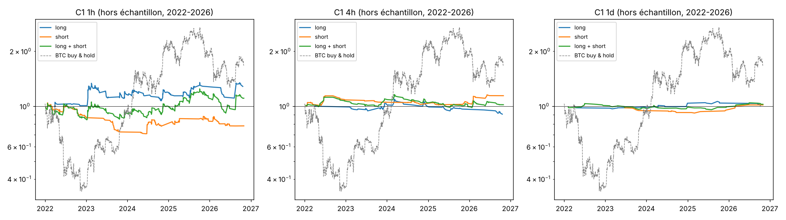
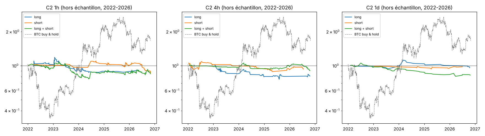

# Rapport Phase 2 : C1 (cassure de tendance) et C2 (repli dans la tendance), BTC et ETH

Protocole : `PROTOCOLE_PHASE2.md` (committé avant le calcul). Validation hors échantillon en walk-forward du 2022-01-01 au 2026-10-31. Tous les chiffres sont nets de frais (taker 0,05 %), de slippage (modèle ATR + volume) et du funding réel. Risque 1 % par trade.

## Verdict

**Aucun groupe ne passe les critères 1 à 8. Aucun candidat C1 ou C2 sur BTC et ETH.**

- Groupes à espérance hors échantillon positive : 7 sur 18.
- Essais comptés : 225 dans cette phase (153 variantes de la grille + 72 pour l'ablation du volume), **682 au total** avec les 232 hérités.
- Test SPA de Hansen (toutes les variantes de la grille contre « rester à plat », rendements journaliers 2022-2026) : p = 0,961 (p inférieur = 0,824, supérieur = 0,982). On ne peut pas exclure que la meilleure variante soit due au hasard du choix parmi toutes celles testées.
- Résultats suspects (règle 6) : aucun.

## Classement hors échantillon (walk-forward)

| Groupe | Trades | E[R] | IC 95 % | PF | Gagnants | Sharpe | DD max | Coûts × 1,5 | Hasard p95 | Voisines + | DSR | Critères ratés | Statut |
|---|---|---|---|---|---|---|---|---|---|---|---|---|---|
| C1 1h long + short | 402 | +0,050 | [-0,130 ; +0,246] | 1,09 | 28,9 % | 0,20 | 26,4 % | +0,009 | +0,099 | 100 % | 0,00 | IC 95 % > 0; SPA p < 0,05; DSR > 0,95; > 95e centile hasard; stabilité annuelle | **non concluant** |
| C1 1h long | 221 | +0,142 | [-0,130 ; +0,466] | 1,24 | 30,3 % | 0,37 | 19,8 % | +0,097 | +0,164 | 100 % | 0,00 | IC 95 % > 0; SPA p < 0,05; DSR > 0,95; > 95e centile hasard; stabilité annuelle | **non concluant** |
| C1 1h short | 241 | -0,093 | [-0,257 ; +0,091] | 0,81 | 30,3 % | -0,42 | 32,3 % | -0,131 | +0,114 | 7 % | 0,00 | IC 95 % > 0; SPA p < 0,05; DSR > 0,95; > 95e centile hasard; coûts × 1,5 > 0; voisines ≥ 75 %; stabilité annuelle | **pas d'edge** |
| C1 4h long + short | 134 | +0,021 | [-0,227 ; +0,289] | 1,04 | 29,9 % | 0,09 | 15,1 % | +0,001 | +0,348 | 100 % | 0,00 | IC 95 % > 0; SPA p < 0,05; DSR > 0,95; > 95e centile hasard; stabilité annuelle | **non concluant** |
| C1 4h long | 81 | -0,102 | [-0,402 ; +0,243] | 0,83 | 23,5 % | -0,25 | 17,3 % | -0,125 | +0,621 | 43 % | 0,00 | ≥ 100 trades; IC 95 % > 0; SPA p < 0,05; DSR > 0,95; > 95e centile hasard; coûts × 1,5 > 0; voisines ≥ 75 %; stabilité annuelle | **pas d'edge** |
| C1 4h short | 76 | +0,190 | [-0,141 ; +0,564] | 1,45 | 39,5 % | 0,37 | 10,9 % | +0,172 | +0,371 | 100 % | 0,00 | ≥ 100 trades; IC 95 % > 0; SPA p < 0,05; DSR > 0,95; > 95e centile hasard; stabilité annuelle | **non concluant** |
| C1 1d long + short | 52 | +0,056 | [-0,234 ; +0,362] | 1,13 | 42,3 % | 0,14 | 7,4 % | +0,047 | +0,306 | 100 % | 0,00 | ≥ 100 trades; IC 95 % > 0; SPA p < 0,05; DSR > 0,95; > 95e centile hasard; stabilité annuelle | **non concluant** |
| C1 1d long | 29 | +0,036 | [-0,391 ; +0,566] | 1,08 | 41,4 % | 0,07 | 5,1 % | +0,026 | +0,497 | 100 % | 0,00 | ≥ 100 trades; IC 95 % > 0; SPA p < 0,05; DSR > 0,95; > 95e centile hasard; stabilité annuelle | **non concluant** |
| C1 1d short | 22 | +0,079 | [-0,384 ; +0,571] | 1,19 | 36,4 % | 0,12 | 8,3 % | +0,071 | +0,367 | 100 % | 0,00 | ≥ 100 trades; IC 95 % > 0; SPA p < 0,05; DSR > 0,95; > 95e centile hasard; stabilité annuelle | **non concluant** |
| C2 1h long + short | 397 | -0,032 | [-0,149 ; +0,100] | 0,92 | 33,2 % | -0,22 | 29,3 % | -0,077 | +0,039 | 0 % | 0,00 | IC 95 % > 0; SPA p < 0,05; DSR > 0,95; > 95e centile hasard; coûts × 1,5 > 0; voisines ≥ 75 %; stabilité annuelle | **pas d'edge** |
| C2 1h long | 197 | -0,040 | [-0,190 ; +0,120] | 0,91 | 30,5 % | -0,19 | 26,4 % | -0,080 | +0,080 | 25 % | 0,00 | IC 95 % > 0; SPA p < 0,05; DSR > 0,95; > 95e centile hasard; coûts × 1,5 > 0; voisines ≥ 75 %; stabilité annuelle | **pas d'edge** |
| C2 1h short | 162 | -0,087 | [-0,298 ; +0,171] | 0,82 | 31,5 % | -0,31 | 22,2 % | -0,135 | +0,066 | 6 % | 0,00 | IC 95 % > 0; SPA p < 0,05; DSR > 0,95; > 95e centile hasard; coûts × 1,5 > 0; voisines ≥ 75 %; stabilité annuelle | **pas d'edge** |
| C2 4h long + short | 113 | -0,078 | [-0,289 ; +0,166] | 0,82 | 34,5 % | -0,28 | 14,3 % | -0,103 | +0,317 | 6 % | 0,00 | IC 95 % > 0; SPA p < 0,05; DSR > 0,95; > 95e centile hasard; coûts × 1,5 > 0; voisines ≥ 75 %; stabilité annuelle | **pas d'edge** |
| C2 4h long | 129 | -0,151 | [-0,398 ; +0,141] | 0,74 | 24,8 % | -0,47 | 25,6 % | -0,181 | +0,787 | 28 % | 0,00 | IC 95 % > 0; SPA p < 0,05; DSR > 0,95; > 95e centile hasard; coûts × 1,5 > 0; voisines ≥ 75 %; stabilité annuelle | **pas d'edge** |
| C2 4h short | 125 | -0,047 | [-0,311 ; +0,261] | 0,91 | 28,8 % | -0,13 | 18,7 % | -0,071 | +0,390 | 83 % | 0,00 | IC 95 % > 0; SPA p < 0,05; DSR > 0,95; > 95e centile hasard; coûts × 1,5 > 0; stabilité annuelle | **pas d'edge** |
| C2 1d long + short | 65 | -0,303 | [-0,590 ; +0,028] | 0,54 | 24,6 % | -0,79 | 23,7 % | -0,318 | +0,540 | 0 % | 0,00 | ≥ 100 trades; IC 95 % > 0; SPA p < 0,05; DSR > 0,95; > 95e centile hasard; coûts × 1,5 > 0; voisines ≥ 75 %; stabilité annuelle | **pas d'edge** |
| C2 1d long | 33 | -0,086 | [-0,775 ; +0,948] | 0,89 | 18,2 % | -0,09 | 14,6 % | -0,102 | +0,939 | 89 % | 0,00 | ≥ 100 trades; IC 95 % > 0; SPA p < 0,05; DSR > 0,95; > 95e centile hasard; coûts × 1,5 > 0; stabilité annuelle | **pas d'edge** |
| C2 1d short | 23 | -0,086 | [-0,558 ; +0,470] | 0,84 | 34,8 % | -0,13 | 6,6 % | -0,100 | +0,573 | 0 % | 0,00 | ≥ 100 trades; IC 95 % > 0; SPA p < 0,05; DSR > 0,95; > 95e centile hasard; coûts × 1,5 > 0; voisines ≥ 75 %; stabilité annuelle | **pas d'edge** |

E[R] = gain moyen par trade en multiples du risque, après tous les coûts. Hasard p95 = 95e centile de l'espérance d'entrées aléatoires avec les mêmes stops, la même sortie et les mêmes coûts. Voisines + = part des variantes à paramètres ±20 % qui restent positives. DSR = Deflated Sharpe Ratio, probabilité que le Sharpe soit réel compte tenu des 682 essais.

## Référence : détention passive sur la même période

| Référence | Rendement | Sharpe | Drawdown max |
|---|---|---|---|
| BTC buy & hold | 67,8 % | 0,46 | 66,9 % |
| Panier BTC+ETH | 10,2 % | 0,32 | 68,3 % |

## Détail par groupe

### C1 1h long + short : non concluant

Variante retenue par fenêtre : 2022-01 → direction-both_entry_n-100_tf-1h_trail-donchian; 2022-07 → direction-both_entry_n-100_tf-1h_trail-donchian; 2023-01 → direction-both_entry_n-20_tf-1h_trail-chandelier; 2023-07 → direction-both_entry_n-100_tf-1h_trail-donchian; 2024-01 → direction-both_entry_n-100_tf-1h_trail-donchian; 2024-07 → direction-both_entry_n-100_tf-1h_trail-donchian; 2025-01 → direction-both_entry_n-100_tf-1h_trail-donchian; 2025-07 → direction-both_entry_n-100_tf-1h_trail-donchian; 2026-01 → direction-both_entry_n-100_tf-1h_trail-donchian; 2026-07 → direction-both_entry_n-100_tf-1h_trail-donchian.

- 402 trades, espérance +0,050 R, profit factor 1,09, 28,9 % de gagnants, Sharpe 0,20, Sortino 0,52, drawdown max 26,4 % (durée 1171 jours), plus longue série de pertes 30, durée moyenne 1,1 jours, rendement 10,6 %, coûts = 77 % du gain brut.
- Hasard (même sortie) : médiane -0,028 R, 95e centile +0,099 R ; le groupe est au 85e centile.
- Ablation du filtre volume relatif > 1,2 : 401 trades, espérance +0,058 R (sans filtre : +0,050 R) → le filtre améliore le résultat.
- Par année : 2022 -14,0 R (86); 2023 +9,0 R (94); 2024 +10,9 R (80); 2025 +11,3 R (82); 2026 +2,8 R (60).
- Par paire : BTCUSDT +0,124 R (195); ETHUSDT -0,020 R (207).
- Par sens : long +0,151 R (224); short -0,077 R (178).
- Par sortie : end -0,320 R (2); stop -1,069 R (134); trail +0,616 R (266).
- Par régime à l'entrée : range +0,555 R (41); tendance -0,008 R (361) ; forte volatilité : non +0,118 R (351); oui -0,422 R (51).
- Par trimestre (somme de R) : 2022Q1 -4,5; 2022Q2 +6,8; 2022Q3 -4,4; 2022Q4 -11,9; 2023Q1 +16,9; 2023Q2 -7,4; 2023Q3 -5,6; 2023Q4 +5,1; 2024Q1 +2,8; 2024Q2 -5,0; 2024Q3 +6,9; 2024Q4 +6,1; 2025Q1 +3,2; 2025Q2 +3,0; 2025Q3 +12,1; 2025Q4 -6,9; 2026Q1 -4,5; 2026Q2 -7,3; 2026Q3 +19,0; 2026Q4 -4,4.

### C1 1h long : non concluant

Variante retenue par fenêtre : 2022-01 → direction-long_entry_n-55_tf-1h_trail-donchian; 2022-07 → direction-long_entry_n-100_tf-1h_trail-donchian; 2023-01 → direction-long_entry_n-20_tf-1h_trail-donchian; 2023-07 → direction-long_entry_n-55_tf-1h_trail-donchian; 2024-01 → direction-long_entry_n-100_tf-1h_trail-donchian; 2024-07 → direction-long_entry_n-100_tf-1h_trail-donchian; 2025-01 → direction-long_entry_n-100_tf-1h_trail-donchian; 2025-07 → direction-long_entry_n-100_tf-1h_trail-donchian; 2026-01 → direction-long_entry_n-100_tf-1h_trail-donchian; 2026-07 → direction-long_entry_n-100_tf-1h_trail-donchian.

- 221 trades, espérance +0,142 R, profit factor 1,24, 30,3 % de gagnants, Sharpe 0,37, Sortino 1,14, drawdown max 19,8 % (durée 960 jours), plus longue série de pertes 21, durée moyenne 1,2 jours, rendement 28,3 %, coûts = 51 % du gain brut.
- Hasard (même sortie) : médiane -0,028 R, 95e centile +0,164 R ; le groupe est au 93e centile.
- Ablation du filtre volume relatif > 1,2 : 203 trades, espérance +0,184 R (sans filtre : +0,142 R) → le filtre améliore le résultat.
- Par année : 2022 +0,9 R (14); 2023 +16,8 R (77); 2024 +4,2 R (59); 2025 +8,1 R (43); 2026 +1,5 R (28).
- Par paire : BTCUSDT +0,265 R (112); ETHUSDT +0,017 R (109).
- Par sens : long +0,142 R (221).
- Par sortie : stop -1,081 R (83); trail +0,878 R (138).
- Par régime à l'entrée : range +0,990 R (27); tendance +0,025 R (194) ; forte volatilité : non +0,158 R (209); oui -0,134 R (12).
- Par trimestre (somme de R) : 2022Q1 +5,1; 2022Q2 -2,6; 2022Q3 +0,5; 2022Q4 -2,2; 2023Q1 +24,2; 2023Q2 -11,1; 2023Q3 -0,5; 2023Q4 +4,2; 2024Q1 +2,8; 2024Q2 -3,9; 2024Q3 -0,9; 2024Q4 +6,2; 2025Q1 -4,6; 2025Q2 +0,0; 2025Q3 +12,7; 2025Q4 +0,1; 2026Q1 -0,9; 2026Q2 -12,2; 2026Q3 +19,1; 2026Q4 -4,5.

### C1 1h short : pas d'edge

Variante retenue par fenêtre : 2022-01 → direction-short_entry_n-100_tf-1h_trail-chandelier; 2022-07 → direction-short_entry_n-100_tf-1h_trail-chandelier; 2023-01 → direction-short_entry_n-ensemble_tf-1h_trail-chandelier; 2023-07 → direction-short_entry_n-20_tf-1h_trail-chandelier; 2024-01 → direction-short_entry_n-20_tf-1h_trail-chandelier; 2024-07 → direction-short_entry_n-ensemble_tf-1h_trail-chandelier; 2025-01 → direction-short_entry_n-100_tf-1h_trail-chandelier; 2025-07 → direction-short_entry_n-100_tf-1h_trail-chandelier; 2026-01 → direction-short_entry_n-100_tf-1h_trail-chandelier; 2026-07 → direction-short_entry_n-100_tf-1h_trail-donchian.

- 241 trades, espérance -0,093 R, profit factor 0,81, 30,3 % de gagnants, Sharpe -0,42, Sortino -0,83, drawdown max 32,3 % (durée 1742 jours), plus longue série de pertes 19, durée moyenne 0,6 jours, rendement -22,0 %, coûts = – du gain brut.
- Hasard (même sortie) : médiane -0,013 R, 95e centile +0,114 R ; le groupe est au 16e centile.
- Ablation du filtre volume relatif > 1,2 : 229 trades, espérance -0,082 R (sans filtre : -0,093 R) → le filtre améliore le résultat.
- Par année : 2022 -13,5 R (80); 2023 -17,6 R (34); 2024 +7,9 R (45); 2025 +6,5 R (43); 2026 -5,7 R (39).
- Par paire : BTCUSDT -0,084 R (111); ETHUSDT -0,100 R (130).
- Par sens : short -0,093 R (241).
- Par sortie : end -0,321 R (1); stop -1,063 R (36); trail +0,080 R (204).
- Par régime à l'entrée : range -0,234 R (17); tendance -0,082 R (224) ; forte volatilité : non -0,084 R (188); oui -0,122 R (53).
- Par trimestre (somme de R) : 2022Q1 -4,4; 2022Q2 +4,5; 2022Q3 -2,7; 2022Q4 -10,8; 2023Q2 -2,9; 2023Q3 -13,1; 2023Q4 -1,6; 2024Q2 +9,6; 2024Q3 -0,5; 2024Q4 -1,1; 2025Q1 +6,6; 2025Q2 +3,0; 2025Q3 -0,4; 2025Q4 -2,8; 2026Q1 -3,1; 2026Q2 -2,5; 2026Q3 -0,1; 2026Q4 +0,1.

### C1 4h long + short : non concluant

Variante retenue par fenêtre : 2022-01 → direction-both_entry_n-100_tf-4h_trail-donchian; 2022-07 → direction-both_entry_n-100_tf-4h_trail-donchian; 2023-01 → direction-both_entry_n-100_tf-4h_trail-donchian; 2023-07 → direction-both_entry_n-100_tf-4h_trail-chandelier; 2024-01 → direction-both_entry_n-100_tf-4h_trail-donchian; 2024-07 → direction-both_entry_n-55_tf-4h_trail-donchian; 2025-01 → direction-both_entry_n-55_tf-4h_trail-donchian; 2025-07 → direction-both_entry_n-55_tf-4h_trail-donchian; 2026-01 → direction-both_entry_n-20_tf-4h_trail-chandelier; 2026-07 → direction-both_entry_n-100_tf-4h_trail-chandelier.

- 134 trades, espérance +0,021 R, profit factor 1,04, 29,9 % de gagnants, Sharpe 0,09, Sortino 0,21, drawdown max 15,1 % (durée 965 jours), plus longue série de pertes 11, durée moyenne 3,9 jours, rendement 1,9 %, coûts = 80 % du gain brut.
- Hasard (même sortie) : médiane +0,092 R, 95e centile +0,348 R ; le groupe est au 29e centile.
- Ablation du filtre volume relatif > 1,2 : 133 trades, espérance -0,001 R (sans filtre : +0,021 R) → le filtre n'améliore pas : retiré.
- Par année : 2022 +6,7 R (19); 2023 +3,3 R (24); 2024 -5,1 R (31); 2025 -5,4 R (32); 2026 +3,4 R (28).
- Par paire : BTCUSDT +0,034 R (62); ETHUSDT +0,010 R (72).
- Par sens : long -0,037 R (64); short +0,075 R (70).
- Par sortie : end -0,112 R (2); stop -1,038 R (36); trail +0,421 R (96).
- Par régime à l'entrée : tendance +0,021 R (134) ; forte volatilité : non +0,106 R (112); oui -0,409 R (22).
- Par trimestre (somme de R) : 2022Q1 +1,4; 2022Q2 +10,3; 2022Q3 -0,8; 2022Q4 -4,3; 2023Q1 -4,1; 2023Q2 -0,7; 2023Q3 -1,6; 2023Q4 +9,7; 2024Q1 +4,3; 2024Q2 -4,2; 2024Q3 -2,6; 2024Q4 -2,6; 2025Q1 -1,3; 2025Q2 -4,2; 2025Q3 +2,2; 2025Q4 -2,1; 2026Q1 +3,9; 2026Q2 +3,0; 2026Q3 -3,5; 2026Q4 -0,1.

### C1 4h long : pas d'edge

Variante retenue par fenêtre : 2022-01 → direction-long_entry_n-100_tf-4h_trail-donchian; 2022-07 → direction-long_entry_n-100_tf-4h_trail-donchian; 2023-01 → direction-long_entry_n-100_tf-4h_trail-donchian; 2023-07 → direction-long_entry_n-20_tf-4h_trail-chandelier; 2024-01 → direction-long_entry_n-100_tf-4h_trail-donchian; 2024-07 → direction-long_entry_n-55_tf-4h_trail-donchian; 2025-01 → direction-long_entry_n-100_tf-4h_trail-donchian; 2025-07 → direction-long_entry_n-55_tf-4h_trail-donchian; 2026-01 → direction-long_entry_n-20_tf-4h_trail-chandelier; 2026-07 → direction-long_entry_n-20_tf-4h_trail-chandelier.

- 81 trades, espérance -0,102 R, profit factor 0,83, 23,5 % de gagnants, Sharpe -0,25, Sortino -0,56, drawdown max 17,3 % (durée 965 jours), plus longue série de pertes 11, durée moyenne 3,8 jours, rendement -9,5 %, coûts = – du gain brut.
- Hasard (même sortie) : médiane +0,228 R, 95e centile +0,621 R ; le groupe est au 3e centile.
- Ablation du filtre volume relatif > 1,2 : 77 trades, espérance -0,097 R (sans filtre : -0,102 R) → le filtre améliore le résultat.
- Par année : 2022 +0,0 R (1); 2023 +3,3 R (29); 2024 -2,1 R (23); 2025 -3,5 R (16); 2026 -6,0 R (12).
- Par paire : BTCUSDT -0,048 R (41); ETHUSDT -0,158 R (40).
- Par sens : long -0,102 R (81).
- Par sortie : stop -1,045 R (23); trail +0,271 R (58).
- Par régime à l'entrée : tendance -0,102 R (81) ; forte volatilité : non -0,066 R (77); oui -0,808 R (4).
- Par trimestre (somme de R) : 2022Q1 +0,0; 2023Q1 -4,1; 2023Q2 +1,4; 2023Q3 -3,1; 2023Q4 +9,1; 2024Q1 +4,3; 2024Q2 -4,2; 2024Q3 -1,2; 2024Q4 -1,1; 2025Q1 -1,0; 2025Q2 -3,7; 2025Q3 +2,2; 2025Q4 -1,0; 2026Q2 -1,1; 2026Q3 -2,5; 2026Q4 -2,4.

### C1 4h short : non concluant

Variante retenue par fenêtre : 2022-01 → direction-short_entry_n-20_tf-4h_trail-chandelier; 2022-07 → direction-short_entry_n-100_tf-4h_trail-donchian; 2023-01 → direction-short_entry_n-100_tf-4h_trail-chandelier; 2023-07 → direction-short_entry_n-100_tf-4h_trail-chandelier; 2024-01 → direction-short_entry_n-100_tf-4h_trail-chandelier; 2024-07 → direction-short_entry_n-20_tf-4h_trail-chandelier; 2025-01 → direction-short_entry_n-55_tf-4h_trail-chandelier; 2025-07 → direction-short_entry_n-100_tf-4h_trail-chandelier; 2026-01 → direction-short_entry_n-100_tf-4h_trail-chandelier; 2026-07 → direction-short_entry_n-100_tf-4h_trail-chandelier.

- 76 trades, espérance +0,190 R, profit factor 1,45, 39,5 % de gagnants, Sharpe 0,37, Sortino 1,15, drawdown max 10,9 % (durée 1349 jours), plus longue série de pertes 8, durée moyenne 2,9 jours, rendement 14,2 %, coûts = 16 % du gain brut.
- Hasard (même sortie) : médiane +0,088 R, 95e centile +0,371 R ; le groupe est au 73e centile.
- Ablation du filtre volume relatif > 1,2 : 74 trades, espérance +0,205 R (sans filtre : +0,190 R) → le filtre améliore le résultat.
- Par année : 2022 +8,8 R (30); 2023 -2,8 R (6); 2024 -2,8 R (14); 2025 +1,5 R (15); 2026 +9,7 R (11).
- Par paire : BTCUSDT +0,270 R (29); ETHUSDT +0,141 R (47).
- Par sens : short +0,190 R (76).
- Par sortie : end +0,341 R (3); stop -1,027 R (10); trail +0,376 R (63).
- Par régime à l'entrée : tendance +0,190 R (76) ; forte volatilité : non +0,276 R (57); oui -0,067 R (19).
- Par trimestre (somme de R) : 2022Q1 +2,4; 2022Q2 +11,5; 2022Q3 -0,8; 2022Q4 -4,3; 2023Q2 -1,4; 2023Q3 -0,6; 2023Q4 -0,8; 2024Q3 -0,9; 2024Q4 -1,9; 2025Q1 -0,6; 2025Q2 +0,3; 2025Q4 +1,9; 2026Q1 +7,5; 2026Q2 +2,2; 2026Q4 -0,1.

### C1 1d long + short : non concluant

Variante retenue par fenêtre : 2022-01 → direction-both_entry_n-ensemble_tf-1d_trail-donchian; 2022-07 → direction-both_entry_n-ensemble_tf-1d_trail-donchian; 2023-01 → direction-both_entry_n-20_tf-1d_trail-chandelier; 2023-07 → direction-both_entry_n-20_tf-1d_trail-chandelier; 2024-01 → direction-both_entry_n-ensemble_tf-1d_trail-chandelier; 2024-07 → direction-both_entry_n-100_tf-1d_trail-donchian; 2025-01 → direction-both_entry_n-ensemble_tf-1d_trail-donchian; 2025-07 → direction-both_entry_n-55_tf-1d_trail-donchian; 2026-01 → direction-both_entry_n-55_tf-1d_trail-donchian; 2026-07 → direction-both_entry_n-55_tf-1d_trail-donchian.

- 52 trades, espérance +0,056 R, profit factor 1,13, 42,3 % de gagnants, Sharpe 0,14, Sortino 0,30, drawdown max 7,4 % (durée 1387 jours), plus longue série de pertes 7, durée moyenne 21,9 jours, rendement 2,5 %, coûts = 54 % du gain brut.
- Hasard (même sortie) : médiane +0,055 R, 95e centile +0,306 R ; le groupe est au 50e centile.
- Ablation du filtre volume relatif > 1,2 : 49 trades, espérance +0,157 R (sans filtre : +0,056 R) → le filtre améliore le résultat.
- Par année : 2022 +1,0 R (9); 2023 -2,9 R (16); 2024 +1,0 R (11); 2025 +0,5 R (8); 2026 +3,4 R (8).
- Par paire : BTCUSDT +0,035 R (26); ETHUSDT +0,076 R (26).
- Par sens : long +0,063 R (27); short +0,048 R (25).
- Par sortie : end +1,365 R (6); liquidation -0,832 R (2); stop -1,021 R (12); trail +0,269 R (32).
- Par régime à l'entrée : tendance +0,056 R (52) ; forte volatilité : non +0,173 R (43); oui -0,504 R (9).
- Par trimestre (somme de R) : 2022Q1 -1,9; 2022Q2 +5,4; 2022Q3 -1,1; 2022Q4 -1,4; 2023Q1 -0,6; 2023Q2 -1,0; 2023Q3 -2,3; 2023Q4 +1,0; 2024Q1 +1,0; 2024Q2 -1,6; 2024Q3 +0,3; 2024Q4 +1,2; 2025Q1 -1,0; 2025Q2 -1,7; 2025Q3 +2,3; 2025Q4 +0,8; 2026Q1 +2,5; 2026Q2 +2,9; 2026Q3 -2,0; 2026Q4 -0,0.

### C1 1d long : non concluant

Variante retenue par fenêtre : 2022-01 → direction-long_entry_n-20_tf-1d_trail-donchian; 2022-07 → direction-long_entry_n-ensemble_tf-1d_trail-donchian; 2023-01 → direction-long_entry_n-ensemble_tf-1d_trail-chandelier; 2023-07 → direction-long_entry_n-ensemble_tf-1d_trail-chandelier; 2024-01 → direction-long_entry_n-20_tf-1d_trail-donchian; 2024-07 → direction-long_entry_n-ensemble_tf-1d_trail-donchian; 2025-01 → direction-long_entry_n-55_tf-1d_trail-donchian; 2025-07 → direction-long_entry_n-20_tf-1d_trail-donchian; 2026-01 → direction-long_entry_n-ensemble_tf-1d_trail-donchian; 2026-07 → direction-long_entry_n-55_tf-1d_trail-chandelier.

- 29 trades, espérance +0,036 R, profit factor 1,08, 41,4 % de gagnants, Sharpe 0,07, Sortino 0,13, drawdown max 5,1 % (durée 736 jours), plus longue série de pertes 6, durée moyenne 23,5 jours, rendement 0,9 %, coûts = 81 % du gain brut.
- Hasard (même sortie) : médiane +0,060 R, 95e centile +0,497 R ; le groupe est au 45e centile.
- Ablation du filtre volume relatif > 1,2 : 18 trades, espérance -0,009 R (sans filtre : +0,036 R) → le filtre n'améliore pas : retiré.
- Par année : 2022 -2,0 R (2); 2023 +1,3 R (9); 2024 +4,5 R (8); 2025 +0,2 R (6); 2026 -3,0 R (4).
- Par paire : BTCUSDT +0,158 R (16); ETHUSDT -0,115 R (13).
- Par sens : long +0,036 R (29).
- Par sortie : end +0,129 R (1); stop -1,033 R (4); trail +0,210 R (24).
- Par régime à l'entrée : tendance +0,036 R (29) ; forte volatilité : non +0,073 R (28); oui -1,006 R (1).
- Par trimestre (somme de R) : 2022Q1 -2,0; 2023Q1 -0,2; 2023Q2 +0,3; 2023Q4 +1,1; 2024Q1 +2,8; 2024Q2 -2,5; 2024Q4 +4,3; 2025Q2 -0,0; 2025Q3 +2,3; 2025Q4 -2,1; 2026Q3 -3,0.

### C1 1d short : non concluant

Variante retenue par fenêtre : 2022-01 → aucune (moins de 10 trades au réglage); 2022-07 → aucune (moins de 10 trades au réglage); 2023-01 → direction-short_entry_n-20_tf-1d_trail-chandelier; 2023-07 → direction-short_entry_n-20_tf-1d_trail-chandelier; 2024-01 → direction-short_entry_n-55_tf-1d_trail-chandelier; 2024-07 → direction-short_entry_n-20_tf-1d_trail-chandelier; 2025-01 → direction-short_entry_n-20_tf-1d_trail-chandelier; 2025-07 → direction-short_entry_n-20_tf-1d_trail-chandelier; 2026-01 → direction-short_entry_n-20_tf-1d_trail-chandelier; 2026-07 → direction-short_entry_n-20_tf-1d_trail-chandelier.

- 22 trades, espérance +0,079 R, profit factor 1,19, 36,4 % de gagnants, Sharpe 0,12, Sortino 0,27, drawdown max 8,3 % (durée 1091 jours), plus longue série de pertes 9, durée moyenne 14,8 jours, rendement 1,6 %, coûts = 12 % du gain brut.
- Hasard (même sortie) : médiane +0,023 R, 95e centile +0,367 R ; le groupe est au 62e centile.
- Ablation du filtre volume relatif > 1,2 : 15 trades, espérance +0,201 R (sans filtre : +0,079 R) → le filtre améliore le résultat.
- Par année : 2023 -5,3 R (6); 2024 -2,4 R (6); 2025 +2,8 R (5); 2026 +6,6 R (5).
- Par paire : BTCUSDT -0,057 R (9); ETHUSDT +0,174 R (13).
- Par sens : short +0,079 R (22).
- Par sortie : end -0,029 R (1); stop -1,009 R (4); trail +0,342 R (17).
- Par régime à l'entrée : tendance +0,079 R (22) ; forte volatilité : non +0,082 R (16); oui +0,072 R (6).
- Par trimestre (somme de R) : 2023Q2 -2,0; 2023Q3 -2,3; 2023Q4 -1,0; 2024Q3 -2,4; 2025Q1 +1,1; 2025Q4 +1,7; 2026Q1 +5,0; 2026Q2 +1,7; 2026Q4 -0,0.

### C2 1h long + short : pas d'edge

Variante retenue par fenêtre : 2022-01 → direction-both_pivots-zigzag_pullback-structure_tf-1h; 2022-07 → direction-both_pivots-hierarchical_pullback-ema20_tf-1h; 2023-01 → direction-both_pivots-hierarchical_pullback-ema50_tf-1h; 2023-07 → direction-both_pivots-hierarchical_pullback-ema50_tf-1h; 2024-01 → direction-both_pivots-hierarchical_pullback-ema20_tf-1h; 2024-07 → direction-both_pivots-hierarchical_pullback-structure_tf-1h; 2025-01 → direction-both_pivots-hierarchical_pullback-ema50_tf-1h; 2025-07 → direction-both_pivots-hierarchical_pullback-structure_tf-1h; 2026-01 → direction-both_pivots-zigzag_pullback-ema20_tf-1h; 2026-07 → direction-both_pivots-zigzag_pullback-ema20_tf-1h.

- 397 trades, espérance -0,032 R, profit factor 0,92, 33,2 % de gagnants, Sharpe -0,22, Sortino -0,45, drawdown max 29,3 % (durée 1317 jours), plus longue série de pertes 13, durée moyenne 0,6 jours, rendement -15,3 %, coûts = 186 % du gain brut.
- Hasard (même sortie) : médiane -0,050 R, 95e centile +0,039 R ; le groupe est au 63e centile.
- Par année : 2022 -4,9 R (70); 2023 -14,8 R (93); 2024 +8,2 R (61); 2025 -1,0 R (60); 2026 -0,4 R (113).
- Par paire : BTCUSDT -0,035 R (201); ETHUSDT -0,030 R (196).
- Par sens : long -0,018 R (206); short -0,048 R (191).
- Par sortie : end -0,059 R (2); stop -1,112 R (42); trail +0,096 R (353).
- Par régime à l'entrée : range +0,137 R (39); tendance -0,051 R (358) ; forte volatilité : non +0,004 R (316); oui -0,175 R (81).
- Par trimestre (somme de R) : 2022Q1 +1,1; 2022Q2 -1,2; 2022Q3 -2,1; 2022Q4 -2,8; 2023Q1 +11,0; 2023Q2 -3,9; 2023Q3 -14,5; 2023Q4 -7,4; 2024Q1 -2,3; 2024Q2 +11,7; 2024Q3 -2,1; 2024Q4 +1,0; 2025Q1 +1,7; 2025Q2 -2,3; 2025Q3 -0,9; 2025Q4 +0,4; 2026Q1 +1,6; 2026Q2 -0,1; 2026Q3 +2,3; 2026Q4 -4,2.

### C2 1h long : pas d'edge

Variante retenue par fenêtre : 2022-01 → direction-long_pivots-hierarchical_pullback-ema20_tf-1h; 2022-07 → direction-long_pivots-hierarchical_pullback-ema20_tf-1h; 2023-01 → direction-long_pivots-hierarchical_pullback-ema20_tf-1h; 2023-07 → direction-long_pivots-hierarchical_pullback-ema20_tf-1h; 2024-01 → direction-long_pivots-hierarchical_pullback-ema20_tf-1h; 2024-07 → direction-long_pivots-hierarchical_pullback-structure_tf-1h; 2025-01 → direction-long_pivots-hierarchical_pullback-structure_tf-1h; 2025-07 → direction-long_pivots-hierarchical_pullback-structure_tf-1h; 2026-01 → direction-long_pivots-hierarchical_pullback-structure_tf-1h; 2026-07 → direction-long_pivots-hierarchical_pullback-structure_tf-1h.

- 197 trades, espérance -0,040 R, profit factor 0,91, 30,5 % de gagnants, Sharpe -0,19, Sortino -0,40, drawdown max 26,4 % (durée 1379 jours), plus longue série de pertes 11, durée moyenne 0,6 jours, rendement -9,4 %, coûts = 212 % du gain brut.
- Hasard (même sortie) : médiane -0,049 R, 95e centile +0,080 R ; le groupe est au 54e centile.
- Par année : 2022 +3,2 R (30); 2023 -10,1 R (103); 2024 -2,5 R (51); 2025 -2,0 R (9); 2026 +3,6 R (4).
- Par paire : BTCUSDT -0,026 R (99); ETHUSDT -0,054 R (98).
- Par sens : long -0,040 R (197).
- Par sortie : stop -1,090 R (19); trail +0,072 R (178).
- Par régime à l'entrée : range +0,223 R (13); tendance -0,058 R (184) ; forte volatilité : non -0,022 R (176); oui -0,185 R (21).
- Par trimestre (somme de R) : 2022Q1 +6,9; 2022Q2 -2,6; 2022Q3 +0,6; 2022Q4 -1,8; 2023Q1 +4,6; 2023Q2 -8,5; 2023Q3 -2,8; 2023Q4 -3,4; 2024Q1 -2,3; 2024Q2 -1,1; 2024Q3 -1,1; 2024Q4 +2,1; 2025Q1 -0,4; 2025Q2 -0,4; 2025Q3 -0,9; 2025Q4 -0,5; 2026Q2 +3,6.

### C2 1h short : pas d'edge

Variante retenue par fenêtre : 2022-01 → direction-short_pivots-zigzag_pullback-structure_tf-1h; 2022-07 → direction-short_pivots-zigzag_pullback-structure_tf-1h; 2023-01 → direction-short_pivots-zigzag_pullback-structure_tf-1h; 2023-07 → direction-short_pivots-zigzag_pullback-structure_tf-1h; 2024-01 → direction-short_pivots-hierarchical_pullback-ema50_tf-1h; 2024-07 → direction-short_pivots-hierarchical_pullback-ema50_tf-1h; 2025-01 → direction-short_pivots-hierarchical_pullback-ema50_tf-1h; 2025-07 → direction-short_pivots-hierarchical_pullback-ema20_tf-1h; 2026-01 → direction-short_pivots-hierarchical_pullback-ema50_tf-1h; 2026-07 → direction-short_pivots-fractal_pullback-ema20_tf-1h.

- 162 trades, espérance -0,087 R, profit factor 0,82, 31,5 % de gagnants, Sharpe -0,31, Sortino -0,60, drawdown max 22,2 % (durée 784 jours), plus longue série de pertes 11, durée moyenne 0,6 jours, rendement -14,4 %, coûts = 2774 % du gain brut.
- Hasard (même sortie) : médiane -0,093 R, 95e centile +0,066 R ; le groupe est au 54e centile.
- Par année : 2022 +1,1 R (12); 2023 -4,6 R (11); 2024 +8,9 R (22); 2025 -4,5 R (66); 2026 -15,0 R (51).
- Par paire : BTCUSDT -0,123 R (78); ETHUSDT -0,053 R (84).
- Par sens : short -0,087 R (162).
- Par sortie : end +0,289 R (2); stop -1,127 R (27); trail +0,118 R (133).
- Par régime à l'entrée : range -0,305 R (16); tendance -0,063 R (146) ; forte volatilité : non -0,005 R (99); oui -0,217 R (63).
- Par trimestre (somme de R) : 2022Q1 +2,3; 2022Q2 -0,9; 2022Q4 -0,3; 2023Q2 +2,7; 2023Q3 -5,1; 2023Q4 -2,1; 2024Q2 +13,5; 2024Q3 -2,9; 2024Q4 -1,7; 2025Q1 -1,5; 2025Q2 -0,4; 2025Q3 -3,0; 2025Q4 +0,3; 2026Q1 +5,8; 2026Q2 -3,5; 2026Q3 -11,8; 2026Q4 -5,5.

### C2 4h long + short : pas d'edge

Variante retenue par fenêtre : 2022-01 → direction-both_pivots-zigzag_pullback-structure_tf-4h; 2022-07 → direction-both_pivots-hierarchical_pullback-structure_tf-4h; 2023-01 → direction-both_pivots-hierarchical_pullback-structure_tf-4h; 2023-07 → direction-both_pivots-zigzag_pullback-structure_tf-4h; 2024-01 → direction-both_pivots-fractal_pullback-ema50_tf-4h; 2024-07 → direction-both_pivots-zigzag_pullback-structure_tf-4h; 2025-01 → direction-both_pivots-hierarchical_pullback-ema50_tf-4h; 2025-07 → direction-both_pivots-hierarchical_pullback-ema50_tf-4h; 2026-01 → direction-both_pivots-zigzag_pullback-ema50_tf-4h; 2026-07 → direction-both_pivots-fractal_pullback-ema50_tf-4h.

- 113 trades, espérance -0,078 R, profit factor 0,82, 34,5 % de gagnants, Sharpe -0,28, Sortino -0,57, drawdown max 14,3 % (durée 960 jours), plus longue série de pertes 10, durée moyenne 2,8 jours, rendement -9,5 %, coûts = – du gain brut.
- Hasard (même sortie) : médiane +0,036 R, 95e centile +0,317 R ; le groupe est au 20e centile.
- Par année : 2022 -1,7 R (9); 2023 -2,0 R (12); 2024 -1,9 R (25); 2025 +4,4 R (34); 2026 -7,5 R (33).
- Par paire : BTCUSDT +0,007 R (56); ETHUSDT -0,161 R (57).
- Par sens : long -0,171 R (64); short +0,043 R (49).
- Par sortie : stop -1,089 R (22); trail +0,167 R (91).
- Par régime à l'entrée : tendance -0,078 R (113) ; forte volatilité : non -0,039 R (88); oui -0,213 R (25).
- Par trimestre (somme de R) : 2022Q1 -0,6; 2022Q3 +0,2; 2022Q4 -1,4; 2023Q1 -0,9; 2023Q2 -0,1; 2023Q3 -0,2; 2023Q4 -0,8; 2024Q1 +4,9; 2024Q2 -6,0; 2024Q3 -0,8; 2024Q4 -0,1; 2025Q1 +0,7; 2025Q2 +1,2; 2025Q3 -1,5; 2025Q4 +4,0; 2026Q1 +4,7; 2026Q2 +0,5; 2026Q3 -9,6; 2026Q4 -3,1.

### C2 4h long : pas d'edge

Variante retenue par fenêtre : 2022-01 → direction-long_pivots-zigzag_pullback-structure_tf-4h; 2022-07 → direction-long_pivots-zigzag_pullback-structure_tf-4h; 2023-01 → direction-long_pivots-fractal_pullback-structure_tf-4h; 2023-07 → direction-long_pivots-zigzag_pullback-structure_tf-4h; 2024-01 → direction-long_pivots-fractal_pullback-ema50_tf-4h; 2024-07 → direction-long_pivots-fractal_pullback-ema50_tf-4h; 2025-01 → direction-long_pivots-zigzag_pullback-ema50_tf-4h; 2025-07 → direction-long_pivots-fractal_pullback-ema50_tf-4h; 2026-01 → direction-long_pivots-zigzag_pullback-ema50_tf-4h; 2026-07 → direction-long_pivots-zigzag_pullback-ema50_tf-4h.

- 129 trades, espérance -0,151 R, profit factor 0,74, 24,8 % de gagnants, Sharpe -0,47, Sortino -0,91, drawdown max 25,6 % (durée 1374 jours), plus longue série de pertes 10, durée moyenne 2,4 jours, rendement -19,0 %, coûts = – du gain brut.
- Hasard (même sortie) : médiane +0,297 R, 95e centile +0,787 R ; le groupe est au 2e centile.
- Par année : 2023 -16,1 R (53); 2024 -5,6 R (39); 2025 +1,1 R (25); 2026 +1,0 R (12).
- Par paire : BTCUSDT -0,109 R (65); ETHUSDT -0,195 R (64).
- Par sens : long -0,151 R (129).
- Par sortie : stop -1,079 R (44); trail +0,329 R (85).
- Par régime à l'entrée : tendance -0,151 R (129) ; forte volatilité : non -0,138 R (112); oui -0,237 R (17).
- Par trimestre (somme de R) : 2023Q1 -7,4; 2023Q2 -7,4; 2023Q3 -0,6; 2023Q4 -0,8; 2024Q1 +4,9; 2024Q2 -6,0; 2024Q4 -4,5; 2025Q1 +0,6; 2025Q2 +1,7; 2025Q3 -0,1; 2025Q4 -1,1; 2026Q3 +3,3; 2026Q4 -2,3.

### C2 4h short : pas d'edge

Variante retenue par fenêtre : 2022-01 → direction-short_pivots-fractal_pullback-structure_tf-4h; 2022-07 → direction-short_pivots-zigzag_pullback-ema50_tf-4h; 2023-01 → direction-short_pivots-zigzag_pullback-ema50_tf-4h; 2023-07 → direction-short_pivots-zigzag_pullback-ema50_tf-4h; 2024-01 → direction-short_pivots-fractal_pullback-ema50_tf-4h; 2024-07 → direction-short_pivots-zigzag_pullback-ema20_tf-4h; 2025-01 → direction-short_pivots-fractal_pullback-ema50_tf-4h; 2025-07 → direction-short_pivots-hierarchical_pullback-ema50_tf-4h; 2026-01 → direction-short_pivots-hierarchical_pullback-ema50_tf-4h; 2026-07 → direction-short_pivots-fractal_pullback-ema50_tf-4h.

- 125 trades, espérance -0,047 R, profit factor 0,91, 28,8 % de gagnants, Sharpe -0,13, Sortino -0,30, drawdown max 18,7 % (durée 1567 jours), plus longue série de pertes 10, durée moyenne 2,6 jours, rendement -6,8 %, coûts = – du gain brut.
- Hasard (même sortie) : médiane +0,110 R, 95e centile +0,390 R ; le groupe est au 15e centile.
- Par année : 2022 +3,4 R (62); 2023 -2,6 R (4); 2024 -5,7 R (12); 2025 -2,4 R (31); 2026 +1,5 R (16).
- Par paire : BTCUSDT -0,084 R (55); ETHUSDT -0,018 R (70).
- Par sens : short -0,047 R (125).
- Par sortie : end +1,024 R (4); stop -1,054 R (33); trail +0,282 R (88).
- Par régime à l'entrée : tendance -0,047 R (125) ; forte volatilité : non +0,048 R (92); oui -0,312 R (33).
- Par trimestre (somme de R) : 2022Q1 -7,6; 2022Q2 +15,6; 2022Q3 -1,1; 2022Q4 -3,5; 2023Q3 -1,6; 2023Q4 -1,0; 2024Q3 -4,3; 2024Q4 -1,4; 2025Q1 -3,0; 2025Q2 -3,4; 2025Q4 +4,0; 2026Q1 +5,4; 2026Q2 +0,2; 2026Q3 -4,1.

### C2 1d long + short : pas d'edge

Variante retenue par fenêtre : 2022-01 → direction-both_pivots-fractal_pullback-ema20_tf-1d; 2022-07 → direction-both_pivots-fractal_pullback-ema20_tf-1d; 2023-01 → direction-both_pivots-fractal_pullback-ema50_tf-1d; 2023-07 → direction-both_pivots-fractal_pullback-ema20_tf-1d; 2024-01 → direction-both_pivots-zigzag_pullback-ema20_tf-1d; 2024-07 → direction-both_pivots-fractal_pullback-ema50_tf-1d; 2025-01 → direction-both_pivots-fractal_pullback-ema50_tf-1d; 2025-07 → direction-both_pivots-fractal_pullback-ema50_tf-1d; 2026-01 → direction-both_pivots-fractal_pullback-ema20_tf-1d; 2026-07 → direction-both_pivots-hierarchical_pullback-ema20_tf-1d.

- 65 trades, espérance -0,303 R, profit factor 0,54, 24,6 % de gagnants, Sharpe -0,79, Sortino -1,29, drawdown max 23,7 % (durée 1570 jours), plus longue série de pertes 16, durée moyenne 10,8 jours, rendement -17,5 %, coûts = – du gain brut.
- Hasard (même sortie) : médiane +0,074 R, 95e centile +0,540 R ; le groupe est au 4e centile.
- Par année : 2022 -2,7 R (20); 2023 -2,9 R (18); 2024 -8,3 R (9); 2025 -4,6 R (6); 2026 -1,1 R (12).
- Par paire : BTCUSDT -0,073 R (34); ETHUSDT -0,556 R (31).
- Par sens : long -0,412 R (26); short -0,231 R (39).
- Par sortie : end +0,862 R (10); stop -1,037 R (34); trail +0,330 R (21).
- Par régime à l'entrée : tendance -0,303 R (65) ; forte volatilité : non -0,231 R (59); oui -1,017 R (6).
- Par trimestre (somme de R) : 2022Q1 -1,0; 2022Q2 +6,5; 2022Q3 -4,9; 2022Q4 -3,3; 2023Q1 +0,3; 2023Q2 -3,6; 2023Q3 -5,4; 2023Q4 +5,8; 2024Q1 -2,9; 2024Q2 -1,0; 2024Q3 -1,9; 2024Q4 -2,5; 2025Q1 -2,1; 2025Q2 -1,9; 2025Q4 -0,6; 2026Q1 -3,7; 2026Q2 +3,7; 2026Q3 -0,1; 2026Q4 -1,0.

### C2 1d long : pas d'edge

Variante retenue par fenêtre : 2022-01 → direction-long_pivots-fractal_pullback-ema20_tf-1d; 2022-07 → direction-long_pivots-fractal_pullback-ema50_tf-1d; 2023-01 → direction-long_pivots-fractal_pullback-ema50_tf-1d; 2023-07 → direction-long_pivots-fractal_pullback-ema20_tf-1d; 2024-01 → direction-long_pivots-fractal_pullback-ema20_tf-1d; 2024-07 → direction-long_pivots-fractal_pullback-ema50_tf-1d; 2025-01 → direction-long_pivots-fractal_pullback-ema50_tf-1d; 2025-07 → direction-long_pivots-fractal_pullback-ema20_tf-1d; 2026-01 → direction-long_pivots-fractal_pullback-ema20_tf-1d; 2026-07 → direction-long_pivots-fractal_pullback-ema20_tf-1d.

- 33 trades, espérance -0,086 R, profit factor 0,89, 18,2 % de gagnants, Sharpe -0,09, Sortino -0,26, drawdown max 14,6 % (durée 943 jours), plus longue série de pertes 9, durée moyenne 11,1 jours, rendement -4,3 %, coûts = – du gain brut.
- Hasard (même sortie) : médiane +0,213 R, 95e centile +0,939 R ; le groupe est au 21e centile.
- Par année : 2022 -1,0 R (1); 2023 +0,3 R (13); 2024 +5,4 R (9); 2025 -3,1 R (5); 2026 -4,4 R (5).
- Par paire : BTCUSDT +0,497 R (16); ETHUSDT -0,634 R (17).
- Par sens : long -0,086 R (33).
- Par sortie : end -0,470 R (4); stop -1,056 R (19); trail +1,912 R (10).
- Par régime à l'entrée : tendance -0,086 R (33) ; forte volatilité : non -0,434 R (28); oui +1,868 R (5).
- Par trimestre (somme de R) : 2022Q2 -1,0; 2023Q1 +0,3; 2023Q2 -3,6; 2023Q3 -2,1; 2023Q4 +5,7; 2024Q1 +10,3; 2024Q2 -3,1; 2024Q3 -1,0; 2024Q4 -0,7; 2025Q1 -2,1; 2025Q3 +0,1; 2025Q4 -1,0; 2026Q3 -2,4; 2026Q4 -2,1.

### C2 1d short : pas d'edge

Variante retenue par fenêtre : 2022-01 → aucune (moins de 10 trades au réglage); 2022-07 → aucune (moins de 10 trades au réglage); 2023-01 → direction-short_pivots-fractal_pullback-structure_tf-1d; 2023-07 → direction-short_pivots-fractal_pullback-structure_tf-1d; 2024-01 → direction-short_pivots-zigzag_pullback-ema20_tf-1d; 2024-07 → direction-short_pivots-fractal_pullback-ema20_tf-1d; 2025-01 → direction-short_pivots-fractal_pullback-ema20_tf-1d; 2025-07 → direction-short_pivots-fractal_pullback-structure_tf-1d; 2026-01 → direction-short_pivots-zigzag_pullback-ema20_tf-1d; 2026-07 → direction-short_pivots-hierarchical_pullback-ema20_tf-1d.

- 23 trades, espérance -0,086 R, profit factor 0,84, 34,8 % de gagnants, Sharpe -0,13, Sortino -0,24, drawdown max 6,6 % (durée 1397 jours), plus longue série de pertes 5, durée moyenne 14,4 jours, rendement -2,0 %, coûts = – du gain brut.
- Hasard (même sortie) : médiane +0,018 R, 95e centile +0,573 R ; le groupe est au 36e centile.
- Par année : 2023 -2,4 R (4); 2024 -1,4 R (5); 2025 -0,7 R (9); 2026 +2,5 R (5).
- Par paire : BTCUSDT -0,193 R (9); ETHUSDT -0,017 R (14).
- Par sens : short -0,086 R (23).
- Par sortie : end +0,500 R (4); stop -1,024 R (8); trail +0,383 R (11).
- Par régime à l'entrée : tendance -0,086 R (23) ; forte volatilité : non -0,162 R (19); oui +0,272 R (4).
- Par trimestre (somme de R) : 2023Q1 -1,1; 2023Q3 -1,4; 2023Q4 +0,1; 2024Q3 +0,3; 2024Q4 -1,7; 2025Q1 +1,7; 2025Q2 -1,9; 2025Q4 -0,5; 2026Q1 +1,6; 2026Q2 +0,9.

## Toutes les variantes, période 2022-2026 à paramètres fixes (information, pas une validation)

| Variante | Trades | E[R] | PF | Sharpe |
|---|---|---|---|---|
| C1_direction-short_entry_n-100_tf-4h_trail-chandelier | 56 | +0,315 | 1,81 | 0,49 |
| C1_direction-long_entry_n-55_tf-1d_trail-donchian | 22 | +0,297 | 1,74 | 0,41 |
| C1_direction-short_entry_n-ensemble_tf-1d_trail-chandelier | 19 | +0,295 | 2,26 | 0,46 |
| C1_direction-long_entry_n-100_tf-1d_trail-donchian | 17 | +0,286 | 1,68 | 0,37 |
| C1_direction-short_entry_n-20_tf-1d_trail-chandelier | 30 | +0,251 | 1,68 | 0,40 |
| C1_direction-long_entry_n-ensemble_tf-1d_trail-donchian | 21 | +0,227 | 1,48 | 0,30 |
| C1_direction-long_entry_n-100_tf-1h_trail-donchian | 190 | +0,220 | 1,38 | 0,53 |
| C1_direction-both_entry_n-ensemble_tf-1d_trail-donchian | 39 | +0,217 | 1,55 | 0,44 |
| C1_direction-short_entry_n-20_tf-1d_trail-donchian | 28 | +0,215 | 1,53 | 0,35 |
| C1_direction-short_entry_n-ensemble_tf-1d_trail-donchian | 18 | +0,204 | 1,68 | 0,35 |
| C1_direction-both_entry_n-55_tf-1d_trail-donchian | 45 | +0,202 | 1,54 | 0,46 |
| C1_direction-short_entry_n-100_tf-1d_trail-chandelier | 16 | +0,197 | 1,72 | 0,30 |
| C1_direction-short_entry_n-55_tf-4h_trail-chandelier | 70 | +0,195 | 1,46 | 0,36 |
| C2_direction-long_pivots-fractal_pullback-ema50_tf-1d | 18 | +0,189 | 1,23 | 0,10 |
| C1_direction-both_entry_n-20_tf-1d_trail-donchian | 55 | +0,185 | 1,41 | 0,41 |
| C1_direction-both_entry_n-100_tf-1d_trail-donchian | 33 | +0,174 | 1,44 | 0,36 |
| C1_direction-short_entry_n-55_tf-1d_trail-chandelier | 23 | +0,172 | 1,63 | 0,33 |
| C2_direction-short_pivots-fractal_pullback-ema50_tf-4h | 158 | +0,161 | 1,27 | 0,28 |
| C1_direction-long_entry_n-20_tf-1d_trail-donchian | 27 | +0,153 | 1,31 | 0,24 |
| C1_direction-short_entry_n-100_tf-4h_trail-donchian | 52 | +0,135 | 1,28 | 0,24 |
| C1_direction-long_entry_n-55_tf-1h_trail-donchian | 222 | +0,133 | 1,23 | 0,38 |
| C1_direction-long_entry_n-ensemble_tf-1h_trail-donchian | 276 | +0,129 | 1,22 | 0,43 |
| C1_direction-short_entry_n-55_tf-1d_trail-donchian | 23 | +0,112 | 1,32 | 0,23 |
| C1_direction-both_entry_n-100_tf-4h_trail-chandelier | 123 | +0,108 | 1,24 | 0,31 |
| C2_direction-long_pivots-hierarchical_pullback-structure_tf-1h | 34 | +0,080 | 1,24 | 0,20 |
| C1_direction-both_entry_n-100_tf-1h_trail-donchian | 365 | +0,079 | 1,13 | 0,30 |
| C1_direction-short_entry_n-ensemble_tf-4h_trail-chandelier | 89 | +0,078 | 1,17 | 0,17 |
| C2_direction-both_pivots-fractal_pullback-ema50_tf-4h | 304 | +0,073 | 1,13 | 0,21 |
| C1_direction-long_entry_n-20_tf-1h_trail-donchian | 323 | +0,071 | 1,12 | 0,28 |
| C1_direction-both_entry_n-55_tf-4h_trail-chandelier | 149 | +0,062 | 1,14 | 0,20 |
| C2_direction-long_pivots-zigzag_pullback-ema50_tf-4h | 93 | +0,062 | 1,17 | 0,20 |
| C2_direction-long_pivots-fractal_pullback-ema20_tf-1d | 38 | +0,061 | 1,08 | 0,06 |
| C1_direction-both_entry_n-100_tf-4h_trail-donchian | 111 | +0,057 | 1,10 | 0,15 |
| C2_direction-both_pivots-zigzag_pullback-ema50_tf-4h | 178 | +0,056 | 1,14 | 0,23 |
| C1_direction-short_entry_n-100_tf-1d_trail-donchian | 16 | +0,054 | 1,15 | 0,09 |
| C1_direction-both_entry_n-ensemble_tf-1d_trail-chandelier | 49 | +0,053 | 1,14 | 0,14 |
| C1_direction-long_entry_n-ensemble_tf-1h_trail-chandelier | 327 | +0,051 | 1,11 | 0,31 |
| C1_direction-long_entry_n-100_tf-1h_trail-chandelier | 223 | +0,051 | 1,11 | 0,26 |
| C2_direction-short_pivots-zigzag_pullback-ema50_tf-4h | 85 | +0,050 | 1,12 | 0,13 |
| C1_direction-both_entry_n-20_tf-1d_trail-chandelier | 67 | +0,050 | 1,11 | 0,13 |
| C1_direction-both_entry_n-100_tf-1d_trail-chandelier | 41 | +0,048 | 1,13 | 0,11 |
| C1_direction-long_entry_n-55_tf-4h_trail-donchian | 70 | +0,041 | 1,07 | 0,08 |
| C1_direction-short_entry_n-20_tf-4h_trail-chandelier | 115 | +0,039 | 1,09 | 0,10 |
| C2_direction-short_pivots-hierarchical_pullback-ema50_tf-4h | 78 | +0,038 | 1,10 | 0,13 |
| C1_direction-long_entry_n-20_tf-1h_trail-chandelier | 376 | +0,035 | 1,08 | 0,24 |
| C1_direction-both_entry_n-55_tf-1d_trail-chandelier | 55 | +0,028 | 1,08 | 0,08 |
| C2_direction-short_pivots-hierarchical_pullback-ema20_tf-4h | 111 | +0,026 | 1,06 | 0,08 |
| C1_direction-both_entry_n-ensemble_tf-1h_trail-donchian | 520 | +0,025 | 1,04 | 0,14 |
| C1_direction-both_entry_n-20_tf-4h_trail-chandelier | 225 | +0,025 | 1,06 | 0,10 |
| C1_direction-both_entry_n-55_tf-4h_trail-donchian | 136 | +0,022 | 1,04 | 0,06 |
| C1_direction-long_entry_n-55_tf-1h_trail-chandelier | 257 | +0,020 | 1,04 | 0,12 |
| C1_direction-long_entry_n-20_tf-4h_trail-donchian | 97 | +0,016 | 1,03 | 0,03 |
| C2_direction-both_pivots-hierarchical_pullback-ema50_tf-4h | 159 | +0,014 | 1,04 | 0,07 |
| C1_direction-both_entry_n-ensemble_tf-1h_trail-chandelier | 617 | +0,013 | 1,03 | 0,10 |
| C1_direction-long_entry_n-20_tf-4h_trail-chandelier | 110 | +0,011 | 1,03 | 0,04 |
| C2_direction-short_pivots-zigzag_pullback-ema20_tf-4h | 125 | +0,011 | 1,02 | 0,03 |
| C1_direction-both_entry_n-100_tf-1h_trail-chandelier | 423 | +0,005 | 1,01 | 0,03 |
| C1_direction-both_entry_n-55_tf-1h_trail-donchian | 437 | +0,004 | 1,01 | 0,05 |
| C1_direction-short_entry_n-55_tf-4h_trail-donchian | 66 | +0,002 | 1,00 | -0,01 |
| C2_direction-long_pivots-hierarchical_pullback-ema50_tf-1h | 202 | -0,002 | 1,00 | -0,02 |
| C2_direction-long_pivots-hierarchical_pullback-ema20_tf-1h | 336 | -0,003 | 0,99 | -0,01 |
| C1_direction-both_entry_n-20_tf-1h_trail-chandelier | 734 | -0,004 | 0,99 | -0,04 |
| C2_direction-long_pivots-zigzag_pullback-structure_tf-4h | 21 | -0,007 | 0,98 | -0,02 |
| C1_direction-both_entry_n-ensemble_tf-4h_trail-chandelier | 187 | -0,009 | 0,98 | -0,03 |
| C2_direction-long_pivots-hierarchical_pullback-ema50_tf-4h | 81 | -0,010 | 0,97 | -0,04 |
| C2_direction-both_pivots-zigzag_pullback-ema20_tf-4h | 249 | -0,011 | 0,98 | -0,05 |
| C2_direction-long_pivots-fractal_pullback-structure_tf-4h | 191 | -0,012 | 0,98 | -0,02 |
| C1_direction-long_entry_n-100_tf-4h_trail-donchian | 59 | -0,013 | 0,98 | -0,02 |
| C2_direction-short_pivots-zigzag_pullback-ema20_tf-1d | 27 | -0,018 | 0,96 | -0,03 |
| C2_direction-both_pivots-hierarchical_pullback-ema50_tf-1h | 401 | -0,019 | 0,95 | -0,13 |
| C2_direction-long_pivots-zigzag_pullback-ema20_tf-1h | 376 | -0,020 | 0,96 | -0,12 |
| C2_direction-long_pivots-fractal_pullback-ema50_tf-4h | 146 | -0,022 | 0,96 | -0,07 |
| C2_direction-both_pivots-hierarchical_pullback-ema20_tf-1h | 640 | -0,022 | 0,94 | -0,19 |
| C1_direction-both_entry_n-20_tf-1h_trail-donchian | 633 | -0,029 | 0,95 | -0,11 |
| C1_direction-both_entry_n-55_tf-1h_trail-chandelier | 498 | -0,030 | 0,94 | -0,22 |
| C1_direction-short_entry_n-ensemble_tf-1h_trail-chandelier | 290 | -0,031 | 0,93 | -0,17 |
| C2_direction-long_pivots-zigzag_pullback-ema20_tf-4h | 124 | -0,033 | 0,92 | -0,14 |
| C2_direction-short_pivots-hierarchical_pullback-ema50_tf-1h | 199 | -0,037 | 0,91 | -0,16 |
| C1_direction-both_entry_n-20_tf-4h_trail-donchian | 202 | -0,041 | 0,93 | -0,15 |
| C2_direction-both_pivots-zigzag_pullback-ema20_tf-1h | 730 | -0,042 | 0,91 | -0,37 |
| C2_direction-short_pivots-fractal_pullback-ema20_tf-1h | 596 | -0,042 | 0,93 | -0,27 |
| C2_direction-short_pivots-hierarchical_pullback-ema20_tf-1h | 304 | -0,044 | 0,89 | -0,27 |
| C1_direction-short_entry_n-20_tf-1h_trail-chandelier | 358 | -0,046 | 0,90 | -0,28 |
| C1_direction-short_entry_n-100_tf-1h_trail-chandelier | 200 | -0,047 | 0,90 | -0,21 |
| C1_direction-long_entry_n-100_tf-1d_trail-chandelier | 25 | -0,047 | 0,89 | -0,09 |
| C2_direction-both_pivots-hierarchical_pullback-ema20_tf-4h | 221 | -0,048 | 0,88 | -0,24 |
| C1_direction-long_entry_n-55_tf-4h_trail-chandelier | 79 | -0,056 | 0,88 | -0,17 |
| C2_direction-short_pivots-hierarchical_pullback-ema20_tf-1d | 22 | -0,057 | 0,88 | -0,11 |
| C2_direction-long_pivots-zigzag_pullback-ema50_tf-1h | 244 | -0,064 | 0,86 | -0,36 |
| C2_direction-short_pivots-zigzag_pullback-ema20_tf-1h | 354 | -0,065 | 0,85 | -0,41 |
| C1_direction-short_entry_n-ensemble_tf-4h_trail-donchian | 81 | -0,065 | 0,89 | -0,17 |
| C1_direction-long_entry_n-100_tf-4h_trail-chandelier | 67 | -0,066 | 0,86 | -0,18 |
| C1_direction-short_entry_n-100_tf-1h_trail-donchian | 175 | -0,073 | 0,88 | -0,21 |
| C1_direction-long_entry_n-55_tf-1d_trail-chandelier | 32 | -0,075 | 0,83 | -0,18 |
| C2_direction-both_pivots-zigzag_pullback-ema50_tf-1h | 492 | -0,077 | 0,83 | -0,58 |
| C1_direction-short_entry_n-55_tf-1h_trail-chandelier | 241 | -0,083 | 0,83 | -0,41 |
| C1_direction-long_entry_n-ensemble_tf-4h_trail-chandelier | 98 | -0,088 | 0,82 | -0,28 |
| C2_direction-long_pivots-fractal_pullback-ema20_tf-4h | 191 | -0,088 | 0,86 | -0,27 |
| C1_direction-both_entry_n-ensemble_tf-4h_trail-donchian | 168 | -0,089 | 0,85 | -0,29 |
| C2_direction-both_pivots-fractal_pullback-ema20_tf-4h | 398 | -0,090 | 0,86 | -0,37 |
| C2_direction-short_pivots-zigzag_pullback-ema50_tf-1h | 248 | -0,090 | 0,80 | -0,43 |
| C1_direction-short_entry_n-ensemble_tf-1h_trail-donchian | 244 | -0,092 | 0,85 | -0,34 |
| C2_direction-short_pivots-fractal_pullback-ema20_tf-4h | 207 | -0,092 | 0,85 | -0,26 |
| C2_direction-both_pivots-fractal_pullback-structure_tf-4h | 402 | -0,092 | 0,85 | -0,32 |
| C1_direction-short_entry_n-20_tf-4h_trail-donchian | 105 | -0,093 | 0,83 | -0,29 |
| C2_direction-short_pivots-fractal_pullback-structure_tf-1h | 593 | -0,096 | 0,85 | -0,48 |
| C1_direction-long_entry_n-ensemble_tf-1d_trail-chandelier | 30 | -0,100 | 0,79 | -0,21 |
| C2_direction-both_pivots-hierarchical_pullback-structure_tf-1h | 79 | -0,101 | 0,75 | -0,37 |
| C2_direction-both_pivots-fractal_pullback-structure_tf-1h | 1166 | -0,106 | 0,84 | -0,82 |
| C1_direction-long_entry_n-ensemble_tf-4h_trail-donchian | 87 | -0,110 | 0,83 | -0,24 |
| C2_direction-both_pivots-fractal_pullback-ema20_tf-1h | 1193 | -0,113 | 0,83 | -1,01 |
| C2_direction-short_pivots-hierarchical_pullback-structure_tf-4h | 27 | -0,113 | 0,62 | -0,40 |
| C1_direction-long_entry_n-20_tf-1d_trail-chandelier | 37 | -0,113 | 0,77 | -0,27 |
| C2_direction-both_pivots-zigzag_pullback-structure_tf-4h | 37 | -0,117 | 0,66 | -0,40 |
| C2_direction-long_pivots-fractal_pullback-structure_tf-1h | 573 | -0,117 | 0,83 | -0,60 |
| C2_direction-short_pivots-fractal_pullback-ema50_tf-1h | 455 | -0,121 | 0,81 | -0,58 |
| C2_direction-long_pivots-hierarchical_pullback-ema20_tf-4h | 110 | -0,122 | 0,71 | -0,53 |
| C1_direction-short_entry_n-55_tf-1h_trail-donchian | 215 | -0,130 | 0,80 | -0,43 |
| C1_direction-short_entry_n-20_tf-1h_trail-donchian | 310 | -0,134 | 0,78 | -0,58 |
| C2_direction-both_pivots-fractal_pullback-ema50_tf-1h | 892 | -0,151 | 0,77 | -1,16 |
| C2_direction-short_pivots-zigzag_pullback-structure_tf-1h | 61 | -0,157 | 0,68 | -0,44 |
| C2_direction-both_pivots-zigzag_pullback-ema20_tf-1d | 47 | -0,158 | 0,69 | -0,43 |
| C2_direction-both_pivots-fractal_pullback-ema20_tf-1d | 86 | -0,159 | 0,78 | -0,30 |
| C2_direction-short_pivots-fractal_pullback-structure_tf-4h | 211 | -0,165 | 0,75 | -0,52 |
| C2_direction-both_pivots-zigzag_pullback-structure_tf-1h | 113 | -0,170 | 0,64 | -0,73 |
| C2_direction-long_pivots-fractal_pullback-ema50_tf-1h | 437 | -0,183 | 0,73 | -0,99 |
| C2_direction-long_pivots-zigzag_pullback-structure_tf-1h | 52 | -0,185 | 0,60 | -0,63 |
| C2_direction-long_pivots-fractal_pullback-ema20_tf-1h | 597 | -0,186 | 0,72 | -1,15 |
| C2_direction-both_pivots-hierarchical_pullback-ema20_tf-1d | 40 | -0,219 | 0,58 | -0,61 |
| C2_direction-both_pivots-hierarchical_pullback-structure_tf-4h | 46 | -0,223 | 0,37 | -1,11 |
| C2_direction-short_pivots-hierarchical_pullback-structure_tf-1h | 45 | -0,238 | 0,49 | -0,64 |
| C2_direction-short_pivots-zigzag_pullback-structure_tf-4h | 16 | -0,260 | 0,34 | -0,64 |
| C2_direction-both_pivots-fractal_pullback-ema50_tf-1d | 37 | -0,280 | 0,65 | -0,31 |
| C2_direction-short_pivots-fractal_pullback-structure_tf-1d | 43 | -0,327 | 0,56 | -0,64 |
| C2_direction-short_pivots-fractal_pullback-ema20_tf-1d | 48 | -0,333 | 0,52 | -0,76 |
| C2_direction-long_pivots-zigzag_pullback-ema20_tf-1d | 20 | -0,347 | 0,39 | -0,75 |
| C2_direction-long_pivots-hierarchical_pullback-structure_tf-4h | 19 | -0,380 | 0,12 | -1,38 |
| C2_direction-long_pivots-hierarchical_pullback-ema20_tf-1d | 18 | -0,418 | 0,29 | -0,91 |
| C2_direction-short_pivots-zigzag_pullback-ema50_tf-1d | 10 | -0,486 | 0,05 | -1,06 |
| C2_direction-both_pivots-fractal_pullback-structure_tf-1d | 79 | -0,494 | 0,37 | -1,51 |
| C2_direction-short_pivots-hierarchical_pullback-ema50_tf-1d | 8 | -0,579 | 0,03 | -1,09 |
| C2_direction-both_pivots-zigzag_pullback-ema50_tf-1d | 16 | -0,586 | 0,06 | -1,40 |
| C2_direction-long_pivots-fractal_pullback-structure_tf-1d | 36 | -0,693 | 0,15 | -1,85 |
| C2_direction-both_pivots-hierarchical_pullback-ema50_tf-1d | 14 | -0,716 | 0,01 | -1,54 |
| C2_direction-short_pivots-fractal_pullback-ema50_tf-1d | 19 | -0,725 | 0,04 | -1,68 |
| C2_direction-long_pivots-zigzag_pullback-ema50_tf-1d | 6 | -0,754 | 0,07 | -0,93 |
| C2_direction-long_pivots-hierarchical_pullback-ema50_tf-1d | 6 | -0,898 | 0,00 | -1,09 |
| C2_direction-long_pivots-zigzag_pullback-structure_tf-1d | 0 | – | – | – |
| C2_direction-long_pivots-hierarchical_pullback-structure_tf-1d | 0 | – | – | – |
| C2_direction-short_pivots-zigzag_pullback-structure_tf-1d | 0 | – | – | – |
| C2_direction-short_pivots-hierarchical_pullback-structure_tf-1d | 0 | – | – | – |
| C2_direction-both_pivots-zigzag_pullback-structure_tf-1d | 0 | – | – | – |
| C2_direction-both_pivots-hierarchical_pullback-structure_tf-1d | 0 | – | – | – |

Choisir la meilleure ligne de ce tableau serait de la sélection après coup : seul le walk-forward compte.

