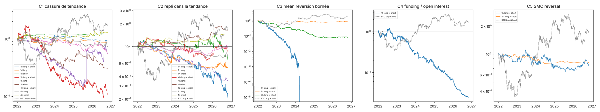

# Rapport Phase 3 : tournoi complet sur l'univers (C1 à C5)

Protocole : `PROTOCOLE_PHASE3.md` (committé avant le calcul). Univers de développement point-in-time : 197 paires (top 30 mensuel, paires délistées comprises, paires mises de côté exclues). Walk-forward hors échantillon du 2022-01-01 au 2026-10-31. Chiffres nets de frais, slippage et funding ; 1 % de risque par trade, 5 positions, plafond de corrélation BTC.

## Verdict

**Aucun groupe ne passe les critères de validation. Aucun concept n'a d'edge démontré : tous restent désactivés.**

- Groupes à espérance hors échantillon positive : 7 sur 24.
- Essais de cette phase : 279 (213 variantes + 66 ablations) ; **1411 au total** avec les 1132 déjà comptés.
- Test SPA de Hansen sur les 213 variantes (rendements journaliers 2022-2026, référence : rester à plat) : p = 0,669. Le meilleur résultat est compatible avec le hasard du choix parmi toutes les variantes.
- Résultats suspects (règle 6) : aucun.

## Classement hors échantillon (walk-forward)

| Groupe | Trades | E[R] | IC 95 % | PF | Gagnants | Sharpe | DD max | Coûts × 1,5 | Hasard p95 | Voisines + | DSR | Critères ratés | Statut |
|---|---|---|---|---|---|---|---|---|---|---|---|---|---|
| C1 1h long + short | 3615 | -0,045 | [-0,092 ; +0,006] | 0,91 | 31,2 % | -0,71 | 94,5 % | -0,075 | -0,013 | 79 % | 0,00 | IC 95 % > 0; SPA p < 0,05; DSR > 0,95; > 95e centile hasard; coûts × 1,5 > 0; stabilité annuelle | **pas d'edge** |
| C1 1h long | 1721 | +0,050 | [-0,137 ; +0,361] | 1,09 | 29,2 % | 0,17 | 85,4 % | +0,019 | +0,142 | 0 % | 0,00 | IC 95 % > 0; SPA p < 0,05; DSR > 0,95; > 95e centile hasard; voisines ≥ 75 %; stabilité annuelle | **non concluant** |
| C1 1h short | 1734 | -0,052 | [-0,112 ; +0,010] | 0,89 | 32,9 % | -0,48 | 78,4 % | -0,083 | +0,046 | 8 % | 0,00 | IC 95 % > 0; SPA p < 0,05; DSR > 0,95; > 95e centile hasard; coûts × 1,5 > 0; voisines ≥ 75 %; stabilité annuelle | **pas d'edge** |
| C1 4h long + short | 1010 | -0,051 | [-0,129 ; +0,029] | 0,90 | 31,0 % | -0,52 | 54,6 % | -0,067 | +0,118 | 42 % | 0,00 | IC 95 % > 0; SPA p < 0,05; DSR > 0,95; > 95e centile hasard; coûts × 1,5 > 0; voisines ≥ 75 %; stabilité annuelle | **pas d'edge** |
| C1 4h long | 401 | -0,042 | [-0,219 ; +0,155] | 0,93 | 27,4 % | -0,23 | 34,1 % | -0,061 | +0,564 | 36 % | 0,00 | IC 95 % > 0; SPA p < 0,05; DSR > 0,95; > 95e centile hasard; coûts × 1,5 > 0; voisines ≥ 75 %; stabilité annuelle | **pas d'edge** |
| C1 4h short | 490 | +0,066 | [-0,034 ; +0,172] | 1,18 | 37,6 % | 0,42 | 19,9 % | +0,050 | +0,240 | 100 % | 0,00 | IC 95 % > 0; SPA p < 0,05; DSR > 0,95; > 95e centile hasard | **non concluant** |
| C1 1d long + short | 217 | -0,027 | [-0,175 ; +0,132] | 0,94 | 36,4 % | -0,13 | 19,5 % | -0,034 | +0,247 | 86 % | 0,00 | IC 95 % > 0; SPA p < 0,05; DSR > 0,95; > 95e centile hasard; coûts × 1,5 > 0; stabilité annuelle | **pas d'edge** |
| C1 1d long | 150 | -0,097 | [-0,312 ; +0,143] | 0,82 | 29,3 % | -0,31 | 21,3 % | -0,105 | +1,087 | 21 % | 0,00 | IC 95 % > 0; SPA p < 0,05; DSR > 0,95; > 95e centile hasard; coûts × 1,5 > 0; voisines ≥ 75 %; stabilité annuelle | **pas d'edge** |
| C1 1d short | 74 | +0,295 | [+0,066 ; +0,535] | 2,19 | 51,4 % | 0,90 | 5,0 % | +0,289 | +0,574 | 100 % | 0,00 | ≥ 100 trades; SPA p < 0,05; DSR > 0,95; > 95e centile hasard; stabilité annuelle | **non concluant** |
| C2 1h long + short | 2059 | -0,066 | [-0,118 ; -0,010] | 0,85 | 31,6 % | -0,86 | 82,3 % | -0,098 | +0,009 | 6 % | 0,00 | IC 95 % > 0; SPA p < 0,05; DSR > 0,95; > 95e centile hasard; coûts × 1,5 > 0; voisines ≥ 75 %; stabilité annuelle | **pas d'edge** |
| C2 1h long | 976 | -0,056 | [-0,132 ; +0,027] | 0,86 | 32,2 % | -0,59 | 50,1 % | -0,088 | +0,060 | 0 % | 0,00 | IC 95 % > 0; SPA p < 0,05; DSR > 0,95; > 95e centile hasard; coûts × 1,5 > 0; voisines ≥ 75 %; stabilité annuelle | **pas d'edge** |
| C2 1h short | 1297 | -0,018 | [-0,085 ; +0,053] | 0,96 | 34,9 % | -0,16 | 54,6 % | -0,051 | +0,045 | 6 % | 0,00 | IC 95 % > 0; SPA p < 0,05; DSR > 0,95; > 95e centile hasard; coûts × 1,5 > 0; voisines ≥ 75 %; stabilité annuelle | **pas d'edge** |
| C2 4h long + short | 1084 | +0,002 | [-0,081 ; +0,088] | 1,00 | 33,4 % | -0,02 | 49,6 % | -0,016 | +0,099 | 100 % | 0,00 | IC 95 % > 0; SPA p < 0,05; DSR > 0,95; > 95e centile hasard; coûts × 1,5 > 0; stabilité annuelle | **non concluant** |
| C2 4h long | 582 | -0,165 | [-0,246 ; -0,079] | 0,63 | 28,4 % | -1,69 | 65,4 % | -0,180 | +0,165 | 0 % | 0,00 | IC 95 % > 0; SPA p < 0,05; DSR > 0,95; > 95e centile hasard; coûts × 1,5 > 0; voisines ≥ 75 %; stabilité annuelle | **pas d'edge** |
| C2 4h short | 389 | +0,148 | [+0,024 ; +0,283] | 1,45 | 42,9 % | 0,86 | 13,8 % | +0,131 | +0,148 | 100 % | 0,00 | SPA p < 0,05; DSR > 0,95 | **non concluant** |
| C2 1d long + short | 374 | +0,001 | [-0,171 ; +0,191] | 1,00 | 29,7 % | -0,02 | 31,3 % | -0,011 | +0,268 | 56 % | 0,00 | IC 95 % > 0; SPA p < 0,05; DSR > 0,95; > 95e centile hasard; coûts × 1,5 > 0; voisines ≥ 75 %; stabilité annuelle | **non concluant** |
| C2 1d long | 176 | -0,168 | [-0,385 ; +0,076] | 0,74 | 22,7 % | -0,57 | 30,8 % | -0,178 | +0,563 | 0 % | 0,00 | IC 95 % > 0; SPA p < 0,05; DSR > 0,95; > 95e centile hasard; coûts × 1,5 > 0; voisines ≥ 75 %; stabilité annuelle | **pas d'edge** |
| C2 1d short | 188 | +0,241 | [-0,016 ; +0,508] | 1,44 | 37,2 % | 0,65 | 16,4 % | +0,227 | +0,368 | 100 % | 0,00 | IC 95 % > 0; SPA p < 0,05; DSR > 0,95; > 95e centile hasard; stabilité annuelle | **non concluant** |
| C3 1h long + short | 11901 | -0,081 | [-0,099 ; -0,064] | 0,83 | 45,7 % | -0,73 | 100,6 % | -0,123 | -0,091 | 0 % | 0,00 | IC 95 % > 0; SPA p < 0,05; DSR > 0,95; coûts × 1,5 > 0; voisines ≥ 75 %; stabilité annuelle | **pas d'edge** |
| C3 4h long + short | 3568 | -0,071 | [-0,104 ; -0,038] | 0,86 | 45,2 % | -1,51 | 92,9 % | -0,093 | -0,017 | 0 % | 0,00 | IC 95 % > 0; SPA p < 0,05; DSR > 0,95; > 95e centile hasard; coûts × 1,5 > 0; voisines ≥ 75 %; stabilité annuelle | **pas d'edge** |
| C3 1d long + short | 396 | -0,018 | [-0,115 ; +0,081] | 0,96 | 47,7 % | -0,16 | 28,0 % | -0,028 | +0,067 | 0 % | 0,00 | IC 95 % > 0; SPA p < 0,05; DSR > 0,95; > 95e centile hasard; coûts × 1,5 > 0; voisines ≥ 75 %; stabilité annuelle | **pas d'edge** |
| C4 1h long + short | 4071 | -0,104 | [-0,144 ; -0,066] | 0,84 | 34,8 % | -1,65 | 98,0 % | -0,136 | -0,044 | 0 % | 0,00 | IC 95 % > 0; SPA p < 0,05; DSR > 0,95; > 95e centile hasard; coûts × 1,5 > 0; voisines ≥ 75 %; stabilité annuelle | **pas d'edge** |
| C5 1h long + short | 683 | -0,029 | [-0,159 ; +0,102] | 0,96 | 26,5 % | -0,19 | 41,9 % | -0,056 | +0,017 | 79 % | 0,00 | IC 95 % > 0; SPA p < 0,05; DSR > 0,95; > 95e centile hasard; coûts × 1,5 > 0; stabilité annuelle | **pas d'edge** |
| C5 4h long + short | 75 | -0,269 | [-0,593 ; +0,075] | 0,66 | 22,7 % | -0,70 | 20,9 % | -0,283 | +0,266 | 100 % | 0,00 | ≥ 100 trades; IC 95 % > 0; SPA p < 0,05; DSR > 0,95; > 95e centile hasard; coûts × 1,5 > 0; stabilité annuelle | **pas d'edge** |

## Ablations (même sélection, avec ou sans le filtre)

| Groupe | Ablation | Trades | E[R] de base | E[R] modifié | Apport |
|---|---|---|---|---|---|
| C1 1h long + short | + filtre volume | 3458 | -0,045 | -0,044 | améliore |
| C1 1h long + short | − ADX du régime | 4440 | -0,045 | -0,043 | améliore |
| C1 1h long + short | − momentum du régime | 4575 | -0,045 | -0,046 | n'améliore pas |
| C1 1h long + short | + filtre funding | 3503 | -0,045 | -0,040 | améliore |
| C1 1h long | + filtre volume | 1649 | +0,050 | +0,065 | améliore |
| C1 1h long | − ADX du régime | 2161 | +0,050 | +0,028 | n'améliore pas |
| C1 1h long | − momentum du régime | 2134 | +0,050 | +0,056 | améliore |
| C1 1h long | + filtre funding | 1650 | +0,050 | +0,073 | améliore |
| C1 1h short | + filtre volume | 1656 | -0,052 | -0,044 | améliore |
| C1 1h short | − ADX du régime | 2185 | -0,052 | -0,033 | améliore |
| C1 1h short | − momentum du régime | 2419 | -0,052 | -0,064 | n'améliore pas |
| C1 1h short | + filtre funding | 1688 | -0,052 | -0,055 | n'améliore pas |
| C1 4h long + short | + filtre volume | 936 | -0,051 | -0,033 | améliore |
| C1 4h long + short | − ADX du régime | 1201 | -0,051 | +0,014 | améliore |
| C1 4h long + short | − momentum du régime | 1133 | -0,051 | -0,038 | améliore |
| C1 4h long + short | + filtre funding | 971 | -0,051 | -0,037 | améliore |
| C1 4h long | + filtre volume | 374 | -0,042 | +0,006 | améliore |
| C1 4h long | − ADX du régime | 476 | -0,042 | +0,025 | améliore |
| C1 4h long | − momentum du régime | 433 | -0,042 | -0,063 | n'améliore pas |
| C1 4h long | + filtre funding | 394 | -0,042 | -0,037 | améliore |
| C1 4h short | + filtre volume | 459 | +0,066 | +0,059 | n'améliore pas |
| C1 4h short | − ADX du régime | 617 | +0,066 | +0,104 | améliore |
| C1 4h short | − momentum du régime | 586 | +0,066 | +0,057 | n'améliore pas |
| C1 4h short | + filtre funding | 468 | +0,066 | +0,073 | améliore |
| C1 1d long + short | + filtre volume | 207 | -0,027 | -0,069 | n'améliore pas |
| C1 1d long + short | − ADX du régime | 248 | -0,027 | -0,053 | n'améliore pas |
| C1 1d long + short | − momentum du régime | 224 | -0,027 | -0,034 | n'améliore pas |
| C1 1d long + short | + filtre funding | 205 | -0,027 | -0,031 | n'améliore pas |
| C1 1d long | + filtre volume | 137 | -0,097 | -0,094 | améliore |
| C1 1d long | − ADX du régime | 165 | -0,097 | -0,113 | n'améliore pas |
| C1 1d long | − momentum du régime | 151 | -0,097 | -0,083 | améliore |
| C1 1d long | + filtre funding | 149 | -0,097 | -0,095 | améliore |
| C1 1d short | + filtre volume | 73 | +0,295 | +0,177 | n'améliore pas |
| C1 1d short | − ADX du régime | 83 | +0,295 | +0,355 | améliore |
| C1 1d short | − momentum du régime | 74 | +0,295 | +0,299 | améliore |
| C1 1d short | + filtre funding | 62 | +0,295 | +0,262 | n'améliore pas |
| C2 1h long + short | − ADX du régime | 2862 | -0,066 | -0,040 | améliore |
| C2 1h long + short | − momentum du régime | 2694 | -0,066 | -0,059 | améliore |
| C2 1h long + short | + filtre funding | 2004 | -0,066 | -0,066 | n'améliore pas |
| C2 1h long | − ADX du régime | 1293 | -0,056 | -0,048 | améliore |
| C2 1h long | − momentum du régime | 1226 | -0,056 | -0,045 | améliore |
| C2 1h long | + filtre funding | 946 | -0,056 | -0,051 | améliore |
| C2 1h short | − ADX du régime | 1847 | -0,018 | -0,004 | améliore |
| C2 1h short | − momentum du régime | 1769 | -0,018 | -0,031 | n'améliore pas |
| C2 1h short | + filtre funding | 1264 | -0,018 | -0,024 | n'améliore pas |
| C2 4h long + short | − ADX du régime | 1344 | +0,002 | +0,005 | améliore |
| C2 4h long + short | − momentum du régime | 1171 | +0,002 | -0,006 | n'améliore pas |
| C2 4h long + short | + filtre funding | 1061 | +0,002 | -0,000 | n'améliore pas |
| C2 4h long | − ADX du régime | 700 | -0,165 | -0,127 | améliore |
| C2 4h long | − momentum du régime | 624 | -0,165 | -0,177 | n'améliore pas |
| C2 4h long | + filtre funding | 573 | -0,165 | -0,178 | n'améliore pas |
| C2 4h short | − ADX du régime | 545 | +0,148 | +0,134 | n'améliore pas |
| C2 4h short | − momentum du régime | 437 | +0,148 | +0,153 | améliore |
| C2 4h short | + filtre funding | 382 | +0,148 | +0,157 | améliore |
| C2 1d long + short | − ADX du régime | 443 | +0,001 | +0,040 | améliore |
| C2 1d long + short | − momentum du régime | 411 | +0,001 | -0,014 | n'améliore pas |
| C2 1d long + short | + filtre funding | 359 | +0,001 | +0,021 | améliore |
| C2 1d long | − ADX du régime | 248 | -0,168 | -0,046 | améliore |
| C2 1d long | − momentum du régime | 194 | -0,168 | -0,118 | améliore |
| C2 1d long | + filtre funding | 170 | -0,168 | -0,171 | n'améliore pas |
| C2 1d short | − ADX du régime | 263 | +0,241 | +0,129 | n'améliore pas |
| C2 1d short | − momentum du régime | 226 | +0,241 | +0,201 | n'améliore pas |
| C2 1d short | + filtre funding | 184 | +0,241 | +0,258 | améliore |
| C3 1h long + short | + filtre funding | 11670 | -0,081 | -0,082 | n'améliore pas |
| C3 4h long + short | + filtre funding | 3492 | -0,071 | -0,075 | n'améliore pas |
| C3 1d long + short | + filtre funding | 395 | -0,018 | -0,018 | améliore |

## Référence passive (BTC, panier BTC + ETH)

| Référence | Rendement | Sharpe | Drawdown max |
|---|---|---|---|
| BTC buy & hold | 67,8 % | 0,46 | 66,9 % |
| Panier BTC+ETH | 10,2 % | 0,32 | 68,3 % |

## Détail par groupe

### C1 1h long + short : pas d'edge

Variante retenue par fenêtre : 2022-01 → direction-both_entry_n-20_tf-1h_trail-donchian; 2022-07 → direction-both_entry_n-20_tf-1h_trail-donchian; 2023-01 → direction-both_entry_n-20_tf-1h_trail-donchian; 2023-07 → direction-both_entry_n-20_tf-1h_trail-chandelier; 2024-01 → direction-both_entry_n-100_tf-1h_trail-chandelier; 2024-07 → direction-both_entry_n-100_tf-1h_trail-chandelier; 2025-01 → direction-both_entry_n-100_tf-1h_trail-chandelier; 2025-07 → direction-both_entry_n-ensemble_tf-1h_trail-chandelier; 2026-01 → direction-both_entry_n-100_tf-1h_trail-donchian; 2026-07 → direction-both_entry_n-100_tf-1h_trail-donchian.

- 3615 trades, espérance -0,045 R, PF 0,91, 31,2 % de gagnants, Sharpe -0,71, Sortino -1,52, drawdown 94,5 % (1592 jours), série de pertes max 31, durée moyenne 0,9 jours, coûts = 540 % du gain brut.
- Hasard (même sortie) : médiane -0,051 R, 95e centile -0,013 R ; le groupe est au 62e centile.
- Excursion moyenne pendant le trade : favorable 1,39 R, défavorable 0,71 R.
- Par année : 2022 +24,9 R (671); 2023 -119,9 R (973); 2024 -57,2 R (721); 2025 +10,1 R (748); 2026 -19,0 R (502).
- Par sens : long -0,071 R (1910); short -0,015 R (1705).
- Par sortie : end +1,214 R (15); stop -1,050 R (732); trail +0,206 R (2868).
- Par régime : range +0,117 R (431); tendance -0,066 R (3184) ; forte volatilité : non -0,014 R (3119); oui -0,239 R (496).
- 161 paires tradées ; part des paires (≥ 10 trades) positives : 37 % ; plus mauvaises : OPUSDT -23,2 R, MATICUSDT -20,2 R, LTCUSDT -17,1 R ; meilleures : ZECUSDT +21,2 R, LUNAUSDT +23,3 R, SOLUSDT +30,0 R.
- Trimestres positifs : 7 sur 20.

### C1 1h long : non concluant

Variante retenue par fenêtre : 2022-01 → direction-long_entry_n-20_tf-1h_trail-donchian; 2022-07 → direction-long_entry_n-ensemble_tf-1h_trail-donchian; 2023-01 → direction-long_entry_n-20_tf-1h_trail-donchian; 2023-07 → direction-long_entry_n-100_tf-1h_trail-chandelier; 2024-01 → direction-long_entry_n-100_tf-1h_trail-chandelier; 2024-07 → direction-long_entry_n-100_tf-1h_trail-chandelier; 2025-01 → direction-long_entry_n-100_tf-1h_trail-donchian; 2025-07 → direction-long_entry_n-55_tf-1h_trail-donchian; 2026-01 → direction-long_entry_n-100_tf-1h_trail-donchian; 2026-07 → direction-long_entry_n-ensemble_tf-1h_trail-donchian.

- 1721 trades, espérance +0,050 R, PF 1,09, 29,2 % de gagnants, Sharpe 0,17, Sortino 1,24, drawdown 85,4 % (1764 jours), série de pertes max 19, durée moyenne 0,9 jours, coûts = – du gain brut.
- Hasard (même sortie) : médiane -0,005 R, 95e centile +0,142 R ; le groupe est au 81e centile.
- Excursion moyenne pendant le trade : favorable 1,55 R, défavorable 0,76 R.
- Par année : 2022 -45,3 R (192); 2023 -31,1 R (471); 2024 -61,5 R (471); 2025 +208,6 R (268); 2026 +15,6 R (319).
- Par sens : long +0,050 R (1721).
- Par sortie : end -0,651 R (1); stop -1,045 R (462); trail +0,453 R (1258).
- Par régime : range +0,327 R (179); tendance +0,018 R (1542) ; forte volatilité : non +0,096 R (1504); oui -0,264 R (217).
- 125 paires tradées ; part des paires (≥ 10 trades) positives : 37 % ; plus mauvaises : LTCUSDT -18,6 R, AVAXUSDT -14,0 R, AAVEUSDT -13,6 R ; meilleures : ZECUSDT +23,4 R, SOLUSDT +40,2 R, MYXUSDT +227,8 R.
- Trimestres positifs : 4 sur 20.

### C1 1h short : pas d'edge

Variante retenue par fenêtre : 2022-01 → direction-short_entry_n-55_tf-1h_trail-chandelier; 2022-07 → direction-short_entry_n-100_tf-1h_trail-donchian; 2023-01 → direction-short_entry_n-20_tf-1h_trail-donchian; 2023-07 → direction-short_entry_n-ensemble_tf-1h_trail-donchian; 2024-01 → direction-short_entry_n-ensemble_tf-1h_trail-donchian; 2024-07 → direction-short_entry_n-ensemble_tf-1h_trail-chandelier; 2025-01 → direction-short_entry_n-ensemble_tf-1h_trail-chandelier; 2025-07 → direction-short_entry_n-ensemble_tf-1h_trail-chandelier; 2026-01 → direction-short_entry_n-100_tf-1h_trail-chandelier; 2026-07 → direction-short_entry_n-100_tf-1h_trail-chandelier.

- 1734 trades, espérance -0,052 R, PF 0,89, 32,9 % de gagnants, Sharpe -0,48, Sortino -1,10, drawdown 78,4 % (1601 jours), série de pertes max 30, durée moyenne 0,9 jours, coûts = 6046 % du gain brut.
- Hasard (même sortie) : médiane -0,004 R, 95e centile +0,046 R ; le groupe est au 6e centile.
- Excursion moyenne pendant le trade : favorable 1,37 R, défavorable 0,66 R.
- Par année : 2022 +14,3 R (357); 2023 -88,0 R (316); 2024 +6,8 R (332); 2025 +13,4 R (446); 2026 -36,3 R (283).
- Par sens : short -0,052 R (1734).
- Par sortie : end -0,032 R (9); stop -1,056 R (289); trail +0,150 R (1436).
- Par régime : range -0,010 R (225); tendance -0,058 R (1509) ; forte volatilité : non -0,008 R (1451); oui -0,277 R (283).
- 119 paires tradées ; part des paires (≥ 10 trades) positives : 44 % ; plus mauvaises : ADAUSDT -15,8 R, DYDXUSDT -14,9 R, OPUSDT -10,2 R ; meilleures : WLDUSDT +7,9 R, WIFUSDT +8,5 R, HIGHUSDT +8,7 R.
- Trimestres positifs : 6 sur 20.

### C1 4h long + short : pas d'edge

Variante retenue par fenêtre : 2022-01 → direction-both_entry_n-ensemble_tf-4h_trail-donchian; 2022-07 → direction-both_entry_n-ensemble_tf-4h_trail-donchian; 2023-01 → direction-both_entry_n-ensemble_tf-4h_trail-donchian; 2023-07 → direction-both_entry_n-20_tf-4h_trail-chandelier; 2024-01 → direction-both_entry_n-100_tf-4h_trail-donchian; 2024-07 → direction-both_entry_n-100_tf-4h_trail-chandelier; 2025-01 → direction-both_entry_n-20_tf-4h_trail-donchian; 2025-07 → direction-both_entry_n-20_tf-4h_trail-donchian; 2026-01 → direction-both_entry_n-20_tf-4h_trail-donchian; 2026-07 → direction-both_entry_n-20_tf-4h_trail-chandelier.

- 1010 trades, espérance -0,051 R, PF 0,90, 31,0 % de gagnants, Sharpe -0,52, Sortino -0,93, drawdown 54,6 % (1575 jours), série de pertes max 19, durée moyenne 3,8 jours, coûts = – du gain brut.
- Hasard (même sortie) : médiane +0,035 R, 95e centile +0,118 R ; le groupe est au 3e centile.
- Excursion moyenne pendant le trade : favorable 1,40 R, défavorable 0,68 R.
- Par année : 2022 +6,0 R (145); 2023 -3,4 R (253); 2024 -19,9 R (166); 2025 -3,4 R (198); 2026 -30,7 R (248).
- Par sens : long -0,112 R (562); short +0,026 R (448).
- Par sortie : end +0,661 R (22); stop -1,014 R (203); trail +0,178 R (785).
- Par régime : tendance -0,051 R (1010) ; forte volatilité : non -0,028 R (854); oui -0,176 R (156).
- 106 paires tradées ; part des paires (≥ 10 trades) positives : 42 % ; plus mauvaises : AVAXUSDT -9,6 R, BCHUSDT -8,7 R, UNFIUSDT -7,1 R ; meilleures : ZECUSDT +8,3 R, SOLUSDT +16,9 R, ADAUSDT +22,3 R.
- Trimestres positifs : 9 sur 20.

### C1 4h long : pas d'edge

Variante retenue par fenêtre : 2022-01 → direction-long_entry_n-ensemble_tf-4h_trail-donchian; 2022-07 → direction-long_entry_n-ensemble_tf-4h_trail-donchian; 2023-01 → direction-long_entry_n-ensemble_tf-4h_trail-donchian; 2023-07 → direction-long_entry_n-100_tf-4h_trail-donchian; 2024-01 → direction-long_entry_n-100_tf-4h_trail-donchian; 2024-07 → direction-long_entry_n-100_tf-4h_trail-donchian; 2025-01 → direction-long_entry_n-100_tf-4h_trail-donchian; 2025-07 → direction-long_entry_n-100_tf-4h_trail-donchian; 2026-01 → direction-long_entry_n-20_tf-4h_trail-donchian; 2026-07 → direction-long_entry_n-20_tf-4h_trail-donchian.

- 401 trades, espérance -0,042 R, PF 0,93, 27,4 % de gagnants, Sharpe -0,23, Sortino -0,52, drawdown 34,1 % (962 jours), série de pertes max 19, durée moyenne 4,2 jours, coûts = – du gain brut.
- Hasard (même sortie) : médiane +0,251 R, 95e centile +0,564 R ; le groupe est au 0e centile.
- Excursion moyenne pendant le trade : favorable 1,82 R, défavorable 0,79 R.
- Par année : 2022 -10,9 R (25); 2023 +22,5 R (105); 2024 -7,1 R (101); 2025 -19,1 R (65); 2026 -2,4 R (105).
- Par sens : long -0,042 R (401).
- Par sortie : end +0,703 R (2); stop -1,006 R (156); trail +0,570 R (243).
- Par régime : tendance -0,042 R (401) ; forte volatilité : non -0,008 R (359); oui -0,340 R (42).
- 75 paires tradées ; part des paires (≥ 10 trades) positives : 58 % ; plus mauvaises : AVAXUSDT -9,5 R, LTCUSDT -6,0 R, UNFIUSDT -5,9 R ; meilleures : NEARUSDT +8,6 R, ZECUSDT +9,2 R, SOLUSDT +15,1 R.
- Trimestres positifs : 8 sur 20.

### C1 4h short : non concluant

Variante retenue par fenêtre : 2022-01 → direction-short_entry_n-ensemble_tf-4h_trail-chandelier; 2022-07 → direction-short_entry_n-20_tf-4h_trail-donchian; 2023-01 → direction-short_entry_n-20_tf-4h_trail-chandelier; 2023-07 → direction-short_entry_n-100_tf-4h_trail-chandelier; 2024-01 → direction-short_entry_n-100_tf-4h_trail-chandelier; 2024-07 → direction-short_entry_n-20_tf-4h_trail-chandelier; 2025-01 → direction-short_entry_n-100_tf-4h_trail-chandelier; 2025-07 → direction-short_entry_n-20_tf-4h_trail-chandelier; 2026-01 → direction-short_entry_n-20_tf-4h_trail-donchian; 2026-07 → direction-short_entry_n-100_tf-4h_trail-chandelier.

- 490 trades, espérance +0,066 R, PF 1,18, 37,6 % de gagnants, Sharpe 0,42, Sortino 0,97, drawdown 19,9 % (1257 jours), série de pertes max 17, durée moyenne 3,5 jours, coûts = 42 % du gain brut.
- Hasard (même sortie) : médiane +0,140 R, 95e centile +0,240 R ; le groupe est au 10e centile.
- Excursion moyenne pendant le trade : favorable 1,27 R, défavorable 0,55 R.
- Par année : 2022 +10,4 R (155); 2023 -3,8 R (60); 2024 +6,6 R (79); 2025 +8,0 R (104); 2026 +11,0 R (92).
- Par sens : short +0,066 R (490).
- Par sortie : end +0,510 R (21); stop -1,027 R (38); trail +0,140 R (431).
- Par régime : tendance +0,066 R (490) ; forte volatilité : non +0,144 R (394); oui -0,253 R (96).
- 76 paires tradées ; part des paires (≥ 10 trades) positives : 47 % ; plus mauvaises : XRPUSDT -5,5 R, BTCUSDT -5,0 R, TRUMPUSDT -4,0 R ; meilleures : LTCUSDT +6,2 R, DOGEUSDT +10,1 R, ADAUSDT +18,4 R.
- Trimestres positifs : 9 sur 20.

### C1 1d long + short : pas d'edge

Variante retenue par fenêtre : 2022-01 → direction-both_entry_n-ensemble_tf-1d_trail-donchian; 2022-07 → direction-both_entry_n-ensemble_tf-1d_trail-donchian; 2023-01 → direction-both_entry_n-ensemble_tf-1d_trail-chandelier; 2023-07 → direction-both_entry_n-ensemble_tf-1d_trail-chandelier; 2024-01 → direction-both_entry_n-100_tf-1d_trail-chandelier; 2024-07 → direction-both_entry_n-100_tf-1d_trail-chandelier; 2025-01 → direction-both_entry_n-100_tf-1d_trail-donchian; 2025-07 → direction-both_entry_n-100_tf-1d_trail-donchian; 2026-01 → direction-both_entry_n-55_tf-1d_trail-chandelier; 2026-07 → direction-both_entry_n-100_tf-1d_trail-donchian.

- 217 trades, espérance -0,027 R, PF 0,94, 36,4 % de gagnants, Sharpe -0,13, Sortino -0,24, drawdown 19,5 % (1033 jours), série de pertes max 12, durée moyenne 17,2 jours, coûts = – du gain brut.
- Hasard (même sortie) : médiane +0,066 R, 95e centile +0,247 R ; le groupe est au 14e centile.
- Excursion moyenne pendant le trade : favorable 1,35 R, défavorable 0,63 R.
- Par année : 2022 +3,8 R (29); 2023 +13,0 R (66); 2024 -5,7 R (57); 2025 -11,8 R (29); 2026 -5,1 R (36).
- Par sens : long -0,077 R (145); short +0,075 R (72).
- Par sortie : end +0,680 R (19); stop -1,002 R (35); trail +0,100 R (163).
- Par régime : tendance -0,027 R (217) ; forte volatilité : non -0,010 R (189); oui -0,140 R (28).
- 55 paires tradées ; part des paires (≥ 10 trades) positives : 80 % ; plus mauvaises : BCHUSDT -4,0 R, ARBUSDT -3,2 R, CRVUSDT -3,1 R ; meilleures : LINKUSDT +4,3 R, NEARUSDT +4,5 R, RUNEUSDT +6,0 R.
- Trimestres positifs : 6 sur 19.

### C1 1d long : pas d'edge

Variante retenue par fenêtre : 2022-01 → direction-long_entry_n-20_tf-1d_trail-donchian; 2022-07 → direction-long_entry_n-ensemble_tf-1d_trail-donchian; 2023-01 → direction-long_entry_n-ensemble_tf-1d_trail-chandelier; 2023-07 → direction-long_entry_n-ensemble_tf-1d_trail-chandelier; 2024-01 → direction-long_entry_n-100_tf-1d_trail-chandelier; 2024-07 → direction-long_entry_n-20_tf-1d_trail-donchian; 2025-01 → direction-long_entry_n-100_tf-1d_trail-donchian; 2025-07 → direction-long_entry_n-100_tf-1d_trail-donchian; 2026-01 → direction-long_entry_n-100_tf-1d_trail-donchian; 2026-07 → direction-long_entry_n-100_tf-1d_trail-donchian.

- 150 trades, espérance -0,097 R, PF 0,82, 29,3 % de gagnants, Sharpe -0,31, Sortino -0,64, drawdown 21,3 % (1759 jours), série de pertes max 15, durée moyenne 15,9 jours, coûts = – du gain brut.
- Hasard (même sortie) : médiane +0,378 R, 95e centile +1,087 R ; le groupe est au 0e centile.
- Excursion moyenne pendant le trade : favorable 1,56 R, défavorable 0,71 R.
- Par année : 2022 -14,2 R (15); 2023 +13,8 R (51); 2024 +1,8 R (47); 2025 -8,4 R (18); 2026 -7,6 R (19).
- Par sens : long -0,097 R (150).
- Par sortie : end +1,566 R (6); stop -1,005 R (44); trail +0,203 R (100).
- Par régime : tendance -0,097 R (150) ; forte volatilité : non -0,132 R (135); oui +0,219 R (15).
- 50 paires tradées ; part des paires (≥ 10 trades) positives : 0 % ; plus mauvaises : BCHUSDT -3,7 R, XRPUSDT -2,9 R, HYPEUSDT -2,8 R ; meilleures : DOGEUSDT +3,9 R, SUIUSDT +4,9 R, RUNEUSDT +6,0 R.
- Trimestres positifs : 3 sur 18.

### C1 1d short : non concluant

Variante retenue par fenêtre : 2022-01 → direction-short_entry_n-20_tf-1d_trail-chandelier; 2022-07 → direction-short_entry_n-100_tf-1d_trail-chandelier; 2023-01 → direction-short_entry_n-100_tf-1d_trail-chandelier; 2023-07 → direction-short_entry_n-100_tf-1d_trail-chandelier; 2024-01 → direction-short_entry_n-100_tf-1d_trail-chandelier; 2024-07 → direction-short_entry_n-100_tf-1d_trail-chandelier; 2025-01 → direction-short_entry_n-55_tf-1d_trail-donchian; 2025-07 → direction-short_entry_n-55_tf-1d_trail-donchian; 2026-01 → direction-short_entry_n-55_tf-1d_trail-donchian; 2026-07 → direction-short_entry_n-100_tf-1d_trail-chandelier.

- 74 trades, espérance +0,295 R, PF 2,19, 51,4 % de gagnants, Sharpe 0,90, Sortino 2,89, drawdown 5,0 % (1019 jours), série de pertes max 9, durée moyenne 24,6 jours, coûts = 5 % du gain brut.
- Hasard (même sortie) : médiane +0,329 R, 95e centile +0,574 R ; le groupe est au 40e centile.
- Excursion moyenne pendant le trade : favorable 1,18 R, défavorable 0,46 R.
- Par année : 2022 +17,5 R (23); 2023 +2,2 R (9); 2024 -3,9 R (10); 2025 +2,4 R (19); 2026 +3,6 R (13).
- Par sens : short +0,295 R (74).
- Par sortie : end +0,749 R (20); stop -1,005 R (5); trail +0,243 R (49).
- Par régime : tendance +0,295 R (74) ; forte volatilité : non +0,351 R (60); oui +0,058 R (14).
- 28 paires tradées ; part des paires (≥ 10 trades) positives : – ; plus mauvaises : DOGEUSDT -3,0 R, TRUMPUSDT -1,5 R, CRVUSDT -1,3 R ; meilleures : MATICUSDT +3,4 R, ETHUSDT +3,9 R, AVAXUSDT +4,8 R.
- Trimestres positifs : 7 sur 14.

### C2 1h long + short : pas d'edge

Variante retenue par fenêtre : 2022-01 → direction-both_pivots-zigzag_pullback-structure_tf-1h; 2022-07 → direction-both_pivots-zigzag_pullback-structure_tf-1h; 2023-01 → direction-both_pivots-hierarchical_pullback-structure_tf-1h; 2023-07 → direction-both_pivots-zigzag_pullback-structure_tf-1h; 2024-01 → direction-both_pivots-hierarchical_pullback-structure_tf-1h; 2024-07 → direction-both_pivots-hierarchical_pullback-structure_tf-1h; 2025-01 → direction-both_pivots-zigzag_pullback-ema50_tf-1h; 2025-07 → direction-both_pivots-zigzag_pullback-ema50_tf-1h; 2026-01 → direction-both_pivots-zigzag_pullback-ema50_tf-1h; 2026-07 → direction-both_pivots-zigzag_pullback-ema20_tf-1h.

- 2059 trades, espérance -0,066 R, PF 0,85, 31,6 % de gagnants, Sharpe -0,86, Sortino -1,60, drawdown 82,3 % (1644 jours), série de pertes max 22, durée moyenne 0,7 jours, coûts = – du gain brut.
- Hasard (même sortie) : médiane -0,040 R, 95e centile +0,009 R ; le groupe est au 18e centile.
- Excursion moyenne pendant le trade : favorable 1,15 R, défavorable 0,63 R.
- Par année : 2022 +1,3 R (206); 2023 -33,2 R (166); 2024 -22,7 R (180); 2025 -33,2 R (711); 2026 -47,8 R (796).
- Par sens : long -0,091 R (926); short -0,045 R (1133).
- Par sortie : end -0,068 R (9); stop -1,061 R (286); trail +0,096 R (1764).
- Par régime : range +0,168 R (172); tendance -0,087 R (1887) ; forte volatilité : non -0,046 R (1723); oui -0,166 R (336).
- 142 paires tradées ; part des paires (≥ 10 trades) positives : 36 % ; plus mauvaises : DOGEUSDT -20,9 R, ADAUSDT -19,1 R, AVAXUSDT -14,9 R ; meilleures : LINKUSDT +7,7 R, PNUTUSDT +9,3 R, API3USDT +10,7 R.
- Trimestres positifs : 5 sur 20.

### C2 1h long : pas d'edge

Variante retenue par fenêtre : 2022-01 → direction-long_pivots-zigzag_pullback-structure_tf-1h; 2022-07 → direction-long_pivots-zigzag_pullback-structure_tf-1h; 2023-01 → direction-long_pivots-zigzag_pullback-structure_tf-1h; 2023-07 → direction-long_pivots-hierarchical_pullback-ema20_tf-1h; 2024-01 → direction-long_pivots-hierarchical_pullback-structure_tf-1h; 2024-07 → direction-long_pivots-hierarchical_pullback-structure_tf-1h; 2025-01 → direction-long_pivots-hierarchical_pullback-structure_tf-1h; 2025-07 → direction-long_pivots-hierarchical_pullback-structure_tf-1h; 2026-01 → direction-long_pivots-zigzag_pullback-ema50_tf-1h; 2026-07 → direction-long_pivots-zigzag_pullback-ema50_tf-1h.

- 976 trades, espérance -0,056 R, PF 0,86, 32,2 % de gagnants, Sharpe -0,59, Sortino -1,16, drawdown 50,1 % (1541 jours), série de pertes max 14, durée moyenne 0,6 jours, coûts = – du gain brut.
- Hasard (même sortie) : médiane -0,020 R, 95e centile +0,060 R ; le groupe est au 20e centile.
- Excursion moyenne pendant le trade : favorable 1,12 R, défavorable 0,62 R.
- Par année : 2022 -15,8 R (54); 2023 -20,9 R (433); 2024 -11,2 R (102); 2025 -7,7 R (57); 2026 +0,8 R (330).
- Par sens : long -0,056 R (976).
- Par sortie : stop -1,060 R (119); trail +0,083 R (857).
- Par régime : range +0,083 R (56); tendance -0,065 R (920) ; forte volatilité : non -0,035 R (846); oui -0,194 R (130).
- 100 paires tradées ; part des paires (≥ 10 trades) positives : 38 % ; plus mauvaises : BNBUSDT -10,8 R, 1000PEPEUSDT -9,0 R, OPUSDT -8,7 R ; meilleures : HYPEUSDT +8,4 R, API3USDT +10,1 R, SOLUSDT +21,5 R.
- Trimestres positifs : 6 sur 20.

### C2 1h short : pas d'edge

Variante retenue par fenêtre : 2022-01 → direction-short_pivots-zigzag_pullback-structure_tf-1h; 2022-07 → direction-short_pivots-hierarchical_pullback-structure_tf-1h; 2023-01 → direction-short_pivots-hierarchical_pullback-structure_tf-1h; 2023-07 → direction-short_pivots-hierarchical_pullback-structure_tf-1h; 2024-01 → direction-short_pivots-hierarchical_pullback-structure_tf-1h; 2024-07 → direction-short_pivots-hierarchical_pullback-structure_tf-1h; 2025-01 → direction-short_pivots-zigzag_pullback-ema50_tf-1h; 2025-07 → direction-short_pivots-zigzag_pullback-ema20_tf-1h; 2026-01 → direction-short_pivots-zigzag_pullback-ema20_tf-1h; 2026-07 → direction-short_pivots-zigzag_pullback-ema20_tf-1h.

- 1297 trades, espérance -0,018 R, PF 0,96, 34,9 % de gagnants, Sharpe -0,16, Sortino -0,35, drawdown 54,6 % (1012 jours), série de pertes max 22, durée moyenne 0,7 jours, coûts = 152 % du gain brut.
- Hasard (même sortie) : médiane -0,010 R, 95e centile +0,045 R ; le groupe est au 40e centile.
- Excursion moyenne pendant le trade : favorable 1,23 R, défavorable 0,61 R.
- Par année : 2022 +22,5 R (134); 2023 -10,0 R (59); 2024 -11,6 R (78); 2025 +21,6 R (495); 2026 -46,1 R (531).
- Par sens : short -0,018 R (1297).
- Par sortie : end -0,046 R (8); stop -1,068 R (173); trail +0,145 R (1116).
- Par régime : range +0,227 R (119); tendance -0,043 R (1178) ; forte volatilité : non +0,020 R (1011); oui -0,153 R (286).
- 102 paires tradées ; part des paires (≥ 10 trades) positives : 44 % ; plus mauvaises : DOGEUSDT -14,0 R, ADAUSDT -10,9 R, SUIUSDT -9,6 R ; meilleures : WIFUSDT +9,1 R, PNUTUSDT +9,3 R, PUMPUSDT +12,1 R.
- Trimestres positifs : 10 sur 20.

### C2 4h long + short : non concluant

Variante retenue par fenêtre : 2022-01 → direction-both_pivots-zigzag_pullback-ema20_tf-4h; 2022-07 → direction-both_pivots-zigzag_pullback-structure_tf-4h; 2023-01 → direction-both_pivots-zigzag_pullback-ema20_tf-4h; 2023-07 → direction-both_pivots-zigzag_pullback-structure_tf-4h; 2024-01 → direction-both_pivots-zigzag_pullback-ema50_tf-4h; 2024-07 → direction-both_pivots-fractal_pullback-structure_tf-4h; 2025-01 → direction-both_pivots-hierarchical_pullback-ema50_tf-4h; 2025-07 → direction-both_pivots-hierarchical_pullback-ema50_tf-4h; 2026-01 → direction-both_pivots-hierarchical_pullback-ema50_tf-4h; 2026-07 → direction-both_pivots-hierarchical_pullback-ema50_tf-4h.

- 1084 trades, espérance +0,002 R, PF 1,00, 33,4 % de gagnants, Sharpe -0,02, Sortino -0,04, drawdown 49,6 % (1577 jours), série de pertes max 29, durée moyenne 2,8 jours, coûts = 158 % du gain brut.
- Hasard (même sortie) : médiane +0,021 R, 95e centile +0,099 R ; le groupe est au 32e centile.
- Excursion moyenne pendant le trade : favorable 1,24 R, défavorable 0,61 R.
- Par année : 2022 +25,5 R (147); 2023 -20,2 R (175); 2024 -29,4 R (369); 2025 +13,2 R (209); 2026 +12,6 R (184).
- Par sens : long -0,139 R (571); short +0,158 R (513).
- Par sortie : end +0,552 R (24); stop -1,041 R (204); trail +0,235 R (856).
- Par régime : tendance +0,002 R (1084) ; forte volatilité : non +0,030 R (854); oui -0,104 R (230).
- 100 paires tradées ; part des paires (≥ 10 trades) positives : 48 % ; plus mauvaises : BNBUSDT -12,8 R, ETHUSDT -9,2 R, 1000PEPEUSDT -8,4 R ; meilleures : REEFUSDT +10,0 R, FILUSDT +14,0 R, MATICUSDT +16,3 R.
- Trimestres positifs : 9 sur 20.

### C2 4h long : pas d'edge

Variante retenue par fenêtre : 2022-01 → direction-long_pivots-zigzag_pullback-ema20_tf-4h; 2022-07 → direction-long_pivots-zigzag_pullback-ema20_tf-4h; 2023-01 → direction-long_pivots-zigzag_pullback-ema20_tf-4h; 2023-07 → direction-long_pivots-zigzag_pullback-structure_tf-4h; 2024-01 → direction-long_pivots-hierarchical_pullback-ema20_tf-4h; 2024-07 → direction-long_pivots-hierarchical_pullback-ema20_tf-4h; 2025-01 → direction-long_pivots-hierarchical_pullback-ema20_tf-4h; 2025-07 → direction-long_pivots-hierarchical_pullback-ema20_tf-4h; 2026-01 → direction-long_pivots-fractal_pullback-structure_tf-4h; 2026-07 → direction-long_pivots-zigzag_pullback-structure_tf-4h.

- 582 trades, espérance -0,165 R, PF 0,63, 28,4 % de gagnants, Sharpe -1,69, Sortino -2,52, drawdown 65,4 % (1725 jours), série de pertes max 17, durée moyenne 2,4 jours, coûts = – du gain brut.
- Hasard (même sortie) : médiane +0,052 R, 95e centile +0,165 R ; le groupe est au 0e centile.
- Excursion moyenne pendant le trade : favorable 1,02 R, défavorable 0,61 R.
- Par année : 2022 -13,3 R (35); 2023 -23,5 R (112); 2024 -16,9 R (209); 2025 -11,5 R (125); 2026 -30,8 R (101).
- Par sens : long -0,165 R (582).
- Par sortie : end -0,309 R (2); stop -1,027 R (87); trail -0,012 R (493).
- Par régime : tendance -0,165 R (582) ; forte volatilité : non -0,194 R (444); oui -0,071 R (138).
- 78 paires tradées ; part des paires (≥ 10 trades) positives : 24 % ; plus mauvaises : HYPEUSDT -8,4 R, ZECUSDT -7,6 R, ETHUSDT -6,7 R ; meilleures : SUIUSDT +3,7 R, BLZUSDT +3,9 R, BNBUSDT +5,2 R.
- Trimestres positifs : 3 sur 20.

### C2 4h short : non concluant

Variante retenue par fenêtre : 2022-01 → direction-short_pivots-zigzag_pullback-structure_tf-4h; 2022-07 → direction-short_pivots-zigzag_pullback-structure_tf-4h; 2023-01 → direction-short_pivots-zigzag_pullback-structure_tf-4h; 2023-07 → direction-short_pivots-zigzag_pullback-ema50_tf-4h; 2024-01 → direction-short_pivots-zigzag_pullback-ema50_tf-4h; 2024-07 → direction-short_pivots-zigzag_pullback-ema50_tf-4h; 2025-01 → direction-short_pivots-zigzag_pullback-ema50_tf-4h; 2025-07 → direction-short_pivots-zigzag_pullback-ema50_tf-4h; 2026-01 → direction-short_pivots-hierarchical_pullback-ema50_tf-4h; 2026-07 → direction-short_pivots-hierarchical_pullback-ema50_tf-4h.

- 389 trades, espérance +0,148 R, PF 1,45, 42,9 % de gagnants, Sharpe 0,86, Sortino 1,98, drawdown 13,8 % (443 jours), série de pertes max 9, durée moyenne 3,3 jours, coûts = 23 % du gain brut.
- Hasard (même sortie) : médiane +0,062 R, 95e centile +0,148 R ; le groupe est au 95e centile.
- Excursion moyenne pendant le trade : favorable 1,22 R, défavorable 0,50 R.
- Par année : 2022 +16,9 R (54); 2023 -3,4 R (48); 2024 +16,3 R (77); 2025 +13,6 R (115); 2026 +14,3 R (95).
- Par sens : short +0,148 R (389).
- Par sortie : end +0,377 R (16); stop -1,038 R (50); trail +0,321 R (323).
- Par régime : tendance +0,148 R (389) ; forte volatilité : non +0,172 R (344); oui -0,033 R (45).
- 64 paires tradées ; part des paires (≥ 10 trades) positives : 73 % ; plus mauvaises : SUIUSDT -3,8 R, CRVUSDT -3,6 R, NEARUSDT -2,4 R ; meilleures : WIFUSDT +10,3 R, DOGEUSDT +11,1 R, SOLUSDT +12,3 R.
- Trimestres positifs : 12 sur 20.

### C2 1d long + short : non concluant

Variante retenue par fenêtre : 2022-01 → direction-both_pivots-fractal_pullback-ema50_tf-1d; 2022-07 → direction-both_pivots-fractal_pullback-ema50_tf-1d; 2023-01 → direction-both_pivots-fractal_pullback-ema50_tf-1d; 2023-07 → direction-both_pivots-fractal_pullback-ema20_tf-1d; 2024-01 → direction-both_pivots-fractal_pullback-ema20_tf-1d; 2024-07 → direction-both_pivots-fractal_pullback-ema20_tf-1d; 2025-01 → direction-both_pivots-hierarchical_pullback-ema50_tf-1d; 2025-07 → direction-both_pivots-fractal_pullback-ema20_tf-1d; 2026-01 → direction-both_pivots-fractal_pullback-ema20_tf-1d; 2026-07 → direction-both_pivots-fractal_pullback-ema20_tf-1d.

- 374 trades, espérance +0,001 R, PF 1,00, 29,7 % de gagnants, Sharpe -0,02, Sortino -0,04, drawdown 31,3 % (1577 jours), série de pertes max 21, durée moyenne 12,9 jours, coûts = 219 % du gain brut.
- Hasard (même sortie) : médiane +0,067 R, 95e centile +0,268 R ; le groupe est au 27e centile.
- Excursion moyenne pendant le trade : favorable 1,75 R, défavorable 0,82 R.
- Par année : 2022 +2,2 R (43); 2023 -2,2 R (87); 2024 -11,7 R (111); 2025 +1,6 R (56); 2026 +10,5 R (77).
- Par sens : long -0,050 R (215); short +0,071 R (159).
- Par sortie : end +1,257 R (34); stop -1,018 R (177); trail +0,846 R (163).
- Par régime : tendance +0,001 R (374) ; forte volatilité : non +0,015 R (308); oui -0,065 R (66).
- 79 paires tradées ; part des paires (≥ 10 trades) positives : 54 % ; plus mauvaises : BCHUSDT -9,3 R, XRPUSDT -7,9 R, ETHUSDT -7,9 R ; meilleures : ADAUSDT +12,9 R, BNBUSDT +13,6 R, BTCUSDT +17,0 R.
- Trimestres positifs : 8 sur 20.

### C2 1d long : pas d'edge

Variante retenue par fenêtre : 2022-01 → direction-long_pivots-fractal_pullback-ema50_tf-1d; 2022-07 → direction-long_pivots-fractal_pullback-ema50_tf-1d; 2023-01 → direction-long_pivots-fractal_pullback-ema50_tf-1d; 2023-07 → direction-long_pivots-hierarchical_pullback-ema20_tf-1d; 2024-01 → direction-long_pivots-hierarchical_pullback-ema20_tf-1d; 2024-07 → direction-long_pivots-hierarchical_pullback-ema20_tf-1d; 2025-01 → direction-long_pivots-fractal_pullback-ema20_tf-1d; 2025-07 → direction-long_pivots-fractal_pullback-ema20_tf-1d; 2026-01 → direction-long_pivots-fractal_pullback-ema20_tf-1d; 2026-07 → direction-long_pivots-fractal_pullback-ema20_tf-1d.

- 176 trades, espérance -0,168 R, PF 0,74, 22,7 % de gagnants, Sharpe -0,57, Sortino -1,07, drawdown 30,8 % (1454 jours), série de pertes max 18, durée moyenne 11,0 jours, coûts = – du gain brut.
- Hasard (même sortie) : médiane +0,223 R, 95e centile +0,563 R ; le groupe est au 0e centile.
- Excursion moyenne pendant le trade : favorable 1,69 R, défavorable 0,85 R.
- Par année : 2022 +0,4 R (6); 2023 +0,3 R (41); 2024 -5,6 R (29); 2025 -25,3 R (58); 2026 +0,7 R (42).
- Par sens : long -0,168 R (176).
- Par sortie : end +0,797 R (7); stop -0,999 R (84); trail +0,574 R (85).
- Par régime : tendance -0,168 R (176) ; forte volatilité : non -0,187 R (144); oui -0,082 R (32).
- 58 paires tradées ; part des paires (≥ 10 trades) positives : 50 % ; plus mauvaises : ETHUSDT -8,6 R, SUIUSDT -5,0 R, DOGEUSDT -4,3 R ; meilleures : ENAUSDT +8,0 R, BNBUSDT +11,6 R, AKEUSDT +12,4 R.
- Trimestres positifs : 5 sur 20.

### C2 1d short : non concluant

Variante retenue par fenêtre : 2022-01 → direction-short_pivots-fractal_pullback-structure_tf-1d; 2022-07 → direction-short_pivots-fractal_pullback-structure_tf-1d; 2023-01 → direction-short_pivots-fractal_pullback-ema20_tf-1d; 2023-07 → direction-short_pivots-fractal_pullback-ema20_tf-1d; 2024-01 → direction-short_pivots-fractal_pullback-ema20_tf-1d; 2024-07 → direction-short_pivots-fractal_pullback-ema20_tf-1d; 2025-01 → direction-short_pivots-fractal_pullback-ema20_tf-1d; 2025-07 → direction-short_pivots-fractal_pullback-ema20_tf-1d; 2026-01 → direction-short_pivots-zigzag_pullback-ema20_tf-1d; 2026-07 → direction-short_pivots-hierarchical_pullback-ema50_tf-1d.

- 188 trades, espérance +0,241 R, PF 1,44, 37,2 % de gagnants, Sharpe 0,65, Sortino 1,97, drawdown 16,4 % (1272 jours), série de pertes max 14, durée moyenne 14,8 jours, coûts = 9 % du gain brut.
- Hasard (même sortie) : médiane +0,153 R, 95e centile +0,368 R ; le groupe est au 75e centile.
- Excursion moyenne pendant le trade : favorable 1,90 R, défavorable 0,77 R.
- Par année : 2022 +21,2 R (51); 2023 +2,9 R (45); 2024 -5,8 R (38); 2025 +23,3 R (35); 2026 +3,6 R (19).
- Par sens : short +0,241 R (188).
- Par sortie : end +1,629 R (26); stop -1,017 R (86); trail +1,188 R (76).
- Par régime : tendance +0,241 R (188) ; forte volatilité : non +0,278 R (174); oui -0,228 R (14).
- 48 paires tradées ; part des paires (≥ 10 trades) positives : 60 % ; plus mauvaises : CRVUSDT -4,5 R, BNBUSDT -3,3 R, XRPUSDT -3,1 R ; meilleures : AVAXUSDT +9,3 R, LINKUSDT +9,5 R, MATICUSDT +13,3 R.
- Trimestres positifs : 10 sur 19.

### C3 1h long + short : pas d'edge

Variante retenue par fenêtre : 2022-01 → deviation-vwap_rsi_period-2_tf-1h; 2022-07 → deviation-vwap_rsi_period-2_tf-1h; 2023-01 → deviation-vwap_rsi_period-3_tf-1h; 2023-07 → deviation-vwap_rsi_period-2_tf-1h; 2024-01 → deviation-vwap_rsi_period-2_tf-1h; 2024-07 → deviation-vwap_rsi_period-2_tf-1h; 2025-01 → deviation-vwap_rsi_period-2_tf-1h; 2025-07 → deviation-vwap_rsi_period-5_tf-1h; 2026-01 → deviation-vwap_rsi_period-2_tf-1h; 2026-07 → deviation-vwap_rsi_period-2_tf-1h.

- 11901 trades, espérance -0,081 R, PF 0,83, 45,7 % de gagnants, Sharpe -0,73, Sortino -0,96, drawdown 100,6 % (1765 jours), série de pertes max 28, durée moyenne 0,2 jours, coûts = 2112 % du gain brut.
- Hasard (même sortie) : médiane -0,105 R, 95e centile -0,091 R ; le groupe est au 100e centile.
- Excursion moyenne pendant le trade : favorable 0,81 R, défavorable 0,80 R.
- Par année : 2022 -177,7 R (2236); 2023 -219,0 R (2470); 2024 -248,0 R (2875); 2025 -137,5 R (1712); 2026 -187,1 R (2608).
- Par sens : long -0,108 R (5223); short -0,061 R (6678).
- Par sortie : end +0,502 R (9); stop -1,079 R (5004); time +0,188 R (3692); tp +1,168 R (3196).
- Par régime : range -0,113 R (1255); tendance -0,078 R (10646) ; forte volatilité : non -0,090 R (9827); oui -0,039 R (2074).
- 185 paires tradées ; part des paires (≥ 10 trades) positives : 42 % ; plus mauvaises : BNBUSDT -121,6 R, AVAXUSDT -76,0 R, BTCUSDT -68,7 R ; meilleures : BTWUSDT +8,7 R, MEWUSDT +9,4 R, OMUSDT +10,8 R.
- Trimestres positifs : 2 sur 20.

### C3 4h long + short : pas d'edge

Variante retenue par fenêtre : 2022-01 → deviation-vwap_rsi_period-2_tf-4h; 2022-07 → deviation-vwap_rsi_period-2_tf-4h; 2023-01 → deviation-vwap_rsi_period-2_tf-4h; 2023-07 → deviation-vwap_rsi_period-2_tf-4h; 2024-01 → deviation-vwap_rsi_period-2_tf-4h; 2024-07 → deviation-vwap_rsi_period-3_tf-4h; 2025-01 → deviation-vwap_rsi_period-3_tf-4h; 2025-07 → deviation-bb_rsi_period-2_tf-4h; 2026-01 → deviation-bb_rsi_period-2_tf-4h; 2026-07 → deviation-bb_rsi_period-2_tf-4h.

- 3568 trades, espérance -0,071 R, PF 0,86, 45,2 % de gagnants, Sharpe -1,51, Sortino -1,92, drawdown 92,9 % (1764 jours), série de pertes max 18, durée moyenne 0,9 jours, coûts = – du gain brut.
- Hasard (même sortie) : médiane -0,045 R, 95e centile -0,017 R ; le groupe est au 6e centile.
- Excursion moyenne pendant le trade : favorable 0,80 R, défavorable 0,80 R.
- Par année : 2022 -50,2 R (687); 2023 -70,4 R (842); 2024 -108,7 R (703); 2025 -34,7 R (608); 2026 +10,0 R (728).
- Par sens : long -0,149 R (1549); short -0,012 R (2019).
- Par sortie : end +0,176 R (12); stop -1,041 R (1605); time +0,263 R (1020); tp +1,231 R (931).
- Par régime : range -0,135 R (439); tendance -0,062 R (3129) ; forte volatilité : non -0,070 R (2948); oui -0,076 R (620).
- 142 paires tradées ; part des paires (≥ 10 trades) positives : 36 % ; plus mauvaises : ADAUSDT -46,7 R, BNBUSDT -40,6 R, AVAXUSDT -34,3 R ; meilleures : 1000SATSUSDT +6,5 R, BCHUSDT +7,2 R, FILUSDT +22,6 R.
- Trimestres positifs : 7 sur 20.

### C3 1d long + short : pas d'edge

Variante retenue par fenêtre : 2022-01 → deviation-vwap_rsi_period-2_tf-1d; 2022-07 → deviation-vwap_rsi_period-2_tf-1d; 2023-01 → deviation-vwap_rsi_period-2_tf-1d; 2023-07 → deviation-vwap_rsi_period-2_tf-1d; 2024-01 → deviation-vwap_rsi_period-2_tf-1d; 2024-07 → deviation-vwap_rsi_period-2_tf-1d; 2025-01 → deviation-vwap_rsi_period-2_tf-1d; 2025-07 → deviation-vwap_rsi_period-2_tf-1d; 2026-01 → deviation-bb_rsi_period-5_tf-1d; 2026-07 → deviation-bb_rsi_period-5_tf-1d.

- 396 trades, espérance -0,018 R, PF 0,96, 47,7 % de gagnants, Sharpe -0,16, Sortino -0,21, drawdown 28,0 % (1745 jours), série de pertes max 21, durée moyenne 5,4 jours, coûts = – du gain brut.
- Hasard (même sortie) : médiane -0,013 R, 95e centile +0,067 R ; le groupe est au 45e centile.
- Excursion moyenne pendant le trade : favorable 0,75 R, défavorable 0,76 R.
- Par année : 2022 -3,4 R (83); 2023 -18,1 R (96); 2024 +4,9 R (104); 2025 +1,7 R (88); 2026 +7,6 R (25).
- Par sens : long -0,004 R (188); short -0,031 R (208).
- Par sortie : end +0,150 R (7); stop -1,018 R (170); time +0,279 R (104); tp +1,180 R (115).
- Par régime : range -0,261 R (44); tendance +0,012 R (352) ; forte volatilité : non -0,029 R (312); oui +0,021 R (84).
- 79 paires tradées ; part des paires (≥ 10 trades) positives : 50 % ; plus mauvaises : DOGEUSDT -11,7 R, BNBUSDT -8,1 R, ADAUSDT -3,3 R ; meilleures : SUIUSDT +4,8 R, AAVEUSDT +5,3 R, BCHUSDT +5,3 R.
- Trimestres positifs : 13 sur 20.

### C4 1h long + short : pas d'edge

Variante retenue par fenêtre : 2022-01 → signal-funding_rel_window_days-7_z-2; 2022-07 → signal-funding_rel_window_days-7_z-2; 2023-01 → signal-funding_rel_window_days-7_z-2; 2023-07 → signal-funding_abs_window_days-30_z-2; 2024-01 → signal-funding_abs_window_days-30_z-3; 2024-07 → signal-funding_abs_window_days-7_z-3; 2025-01 → signal-funding_abs_window_days-7_z-3; 2025-07 → signal-funding_abs_window_days-7_z-3; 2026-01 → signal-funding_rel_window_days-30_z-2; 2026-07 → signal-funding_rel_window_days-7_z-3.

- 4071 trades, espérance -0,104 R, PF 0,84, 34,8 % de gagnants, Sharpe -1,65, Sortino -2,31, drawdown 98,0 % (1540 jours), série de pertes max 27, durée moyenne 0,8 jours, coûts = – du gain brut.
- Hasard (même sortie) : médiane -0,077 R, 95e centile -0,044 R ; le groupe est au 9e centile.
- Excursion moyenne pendant le trade : favorable 1,07 R, défavorable 0,93 R.
- Par année : 2022 -36,1 R (1025); 2023 -62,0 R (872); 2024 -64,8 R (628); 2025 -87,0 R (771); 2026 -175,1 R (775).
- Par sens : long -0,123 R (3048); short -0,049 R (1023).
- Par sortie : end +0,258 R (22); stop -1,043 R (2466); time +0,360 R (614); tp +1,983 R (969).
- Par régime : range -0,118 R (438); tendance -0,103 R (3633) ; forte volatilité : non -0,105 R (3576); oui -0,104 R (495).
- 175 paires tradées ; part des paires (≥ 10 trades) positives : 41 % ; plus mauvaises : ENAUSDT -42,2 R, BNBUSDT -35,0 R, AVAXUSDT -30,7 R ; meilleures : ADAUSDT +9,5 R, OPUSDT +10,4 R, AAVEUSDT +17,8 R.
- Trimestres positifs : 2 sur 20.

### C5 1h long + short : pas d'edge

Variante retenue par fenêtre : 2022-01 → liquidity-equal_min_score-0_tf-1h_tp_r-2_zone-fvg; 2022-07 → liquidity-equal_min_score-60_tf-1h_tp_r-3_zone-fvg; 2023-01 → liquidity-period_min_score-60_tf-1h_tp_r-3_zone-fvg; 2023-07 → liquidity-period_min_score-60_tf-1h_tp_r-3_zone-fvg; 2024-01 → liquidity-period_min_score-60_tf-1h_tp_r-3_zone-fvg; 2024-07 → liquidity-period_min_score-60_tf-1h_tp_r-3_zone-fvg; 2025-01 → liquidity-equal_min_score-0_tf-1h_tp_r-3_zone-ob; 2025-07 → liquidity-equal_min_score-60_tf-1h_tp_r-3_zone-fvg; 2026-01 → liquidity-equal_min_score-60_tf-1h_tp_r-3_zone-fvg; 2026-07 → liquidity-equal_min_score-60_tf-1h_tp_r-3_zone-fvg.

- 683 trades, espérance -0,029 R, PF 0,96, 26,5 % de gagnants, Sharpe -0,19, Sortino -0,31, drawdown 41,9 % (1230 jours), série de pertes max 21, durée moyenne 1,8 jours, coûts = 500 % du gain brut.
- Hasard (même sortie) : médiane -0,094 R, 95e centile +0,017 R ; le groupe est au 84e centile.
- Excursion moyenne pendant le trade : favorable 1,48 R, défavorable 1,10 R ; retard moyen sweep → CHoCH 6,2 bougies.
- Par année : 2022 -15,3 R (82); 2023 -1,1 R (217); 2024 -6,6 R (218); 2025 -6,6 R (76); 2026 +9,6 R (90).
- Par sens : long +0,028 R (356); short -0,092 R (327).
- Par sortie : end +0,560 R (7); stop -1,069 R (499); tp +2,878 R (177).
- Par régime : range +0,116 R (93); tendance -0,052 R (590) ; forte volatilité : non -0,031 R (588); oui -0,016 R (95).
- 111 paires tradées ; part des paires (≥ 10 trades) positives : 57 % ; plus mauvaises : SOLUSDT -19,0 R, OPUSDT -12,0 R, WLDUSDT -8,8 R ; meilleures : FILUSDT +11,8 R, BNBUSDT +12,5 R, DOGEUSDT +13,2 R.
- Trimestres positifs : 8 sur 20.

### C5 4h long + short : pas d'edge

Variante retenue par fenêtre : 2022-01 → liquidity-period_min_score-60_tf-4h_tp_r-3_zone-ob; 2022-07 → liquidity-equal_min_score-0_tf-4h_tp_r-3_zone-fvg; 2023-01 → liquidity-period_min_score-60_tf-4h_tp_r-3_zone-fvg; 2023-07 → liquidity-period_min_score-60_tf-4h_tp_r-3_zone-fvg; 2024-01 → liquidity-period_min_score-60_tf-4h_tp_r-3_zone-fvg; 2024-07 → liquidity-equal_min_score-60_tf-4h_tp_r-2_zone-ob; 2025-01 → liquidity-equal_min_score-60_tf-4h_tp_r-2_zone-ob; 2025-07 → liquidity-equal_min_score-60_tf-4h_tp_r-2_zone-fvg; 2026-01 → liquidity-equal_min_score-60_tf-4h_tp_r-3_zone-fvg; 2026-07 → liquidity-equal_min_score-60_tf-4h_tp_r-3_zone-fvg.

- 75 trades, espérance -0,269 R, PF 0,66, 22,7 % de gagnants, Sharpe -0,70, Sortino -1,07, drawdown 20,9 % (1674 jours), série de pertes max 11, durée moyenne 9,1 jours, coûts = – du gain brut.
- Hasard (même sortie) : médiane -0,061 R, 95e centile +0,266 R ; le groupe est au 12e centile.
- Excursion moyenne pendant le trade : favorable 1,35 R, défavorable 1,03 R ; retard moyen sweep → CHoCH 6,4 bougies.
- Par année : 2022 -5,5 R (13); 2023 -10,1 R (34); 2024 -7,1 R (14); 2025 +2,8 R (9); 2026 -0,3 R (5).
- Par sens : long -0,084 R (37); short -0,449 R (38).
- Par sortie : end +0,359 R (4); stop -1,039 R (57); tp +2,686 R (14).
- Par régime : range -0,588 R (9); tendance -0,226 R (66) ; forte volatilité : non -0,246 R (68); oui -0,491 R (7).
- 37 paires tradées ; part des paires (≥ 10 trades) positives : – ; plus mauvaises : XRPUSDT -4,1 R, ADAUSDT -3,3 R, AVAXUSDT -3,1 R ; meilleures : CRVUSDT +3,0 R, ETHUSDT +3,9 R, MATICUSDT +3,9 R.
- Trimestres positifs : 5 sur 16.

## Toutes les variantes, 2022-2026 à paramètres fixes (information, pas une validation)

| Variante | Trades | E[R] | PF | Sharpe |
|---|---|---|---|---|
| C5_liquidity-equal_min_score-60_tf-4h_tp_r-3_zone-ob | 22 | +0,585 | 1,93 | 0,60 |
| C5_liquidity-equal_min_score-60_tf-4h_tp_r-2_zone-ob | 22 | +0,456 | 1,86 | 0,61 |
| C2_direction-short_pivots-hierarchical_pullback-ema50_tf-1d | 31 | +0,300 | 1,77 | 0,48 |
| C2_direction-short_pivots-fractal_pullback-ema20_tf-1d | 196 | +0,248 | 1,47 | 0,77 |
| C5_liquidity-equal_min_score-0_tf-4h_tp_r-3_zone-ob | 64 | +0,190 | 1,26 | 0,37 |
| C1_direction-short_entry_n-100_tf-1d_trail-chandelier | 59 | +0,177 | 1,74 | 0,66 |
| C2_direction-short_pivots-hierarchical_pullback-ema50_tf-4h | 480 | +0,166 | 1,53 | 1,03 |
| C2_direction-short_pivots-zigzag_pullback-ema50_tf-4h | 507 | +0,160 | 1,47 | 0,98 |
| C5_liquidity-period_min_score-60_tf-4h_tp_r-3_zone-fvg | 163 | +0,154 | 1,21 | 0,43 |
| C5_liquidity-equal_min_score-0_tf-4h_tp_r-3_zone-fvg | 115 | +0,135 | 1,19 | 0,36 |
| C5_liquidity-equal_min_score-60_tf-4h_tp_r-2_zone-fvg | 37 | +0,133 | 1,22 | 0,25 |
| C5_liquidity-equal_min_score-0_tf-4h_tp_r-2_zone-fvg | 116 | +0,132 | 1,21 | 0,42 |
| C2_direction-short_pivots-hierarchical_pullback-structure_tf-1d | 3 | +0,125 | 1,36 | 0,10 |
| C1_direction-short_entry_n-55_tf-1d_trail-donchian | 79 | +0,122 | 1,45 | 0,56 |
| C2_direction-short_pivots-hierarchical_pullback-ema20_tf-4h | 669 | +0,118 | 1,36 | 0,85 |
| C5_liquidity-equal_min_score-0_tf-4h_tp_r-2_zone-ob | 64 | +0,115 | 1,18 | 0,28 |
| C2_direction-short_pivots-zigzag_pullback-ema20_tf-4h | 688 | +0,115 | 1,31 | 0,82 |
| C5_liquidity-period_min_score-60_tf-4h_tp_r-2_zone-fvg | 164 | +0,113 | 1,18 | 0,43 |
| C1_direction-short_entry_n-55_tf-1d_trail-chandelier | 89 | +0,106 | 1,44 | 0,55 |
| C1_direction-short_entry_n-100_tf-1d_trail-donchian | 54 | +0,101 | 1,33 | 0,37 |
| C2_direction-short_pivots-zigzag_pullback-structure_tf-4h | 153 | +0,090 | 1,29 | 0,46 |
| C1_direction-long_entry_n-100_tf-1h_trail-donchian | 1386 | +0,087 | 1,15 | -0,04 |
| C1_direction-short_entry_n-100_tf-4h_trail-chandelier | 334 | +0,085 | 1,22 | 0,45 |
| C2_direction-short_pivots-zigzag_pullback-ema20_tf-1d | 111 | +0,081 | 1,20 | 0,28 |
| C5_liquidity-period_min_score-60_tf-4h_tp_r-2_zone-ob | 76 | +0,075 | 1,11 | 0,21 |
| C5_liquidity-period_min_score-60_tf-4h_tp_r-3_zone-ob | 76 | +0,074 | 1,10 | 0,16 |
| C2_direction-short_pivots-hierarchical_pullback-structure_tf-4h | 141 | +0,074 | 1,25 | 0,40 |
| C5_liquidity-equal_min_score-60_tf-4h_tp_r-3_zone-fvg | 37 | +0,072 | 1,10 | 0,11 |
| C1_direction-long_entry_n-ensemble_tf-1h_trail-donchian | 1803 | +0,069 | 1,12 | -0,84 |
| C2_direction-short_pivots-fractal_pullback-structure_tf-4h | 1110 | +0,067 | 1,12 | 0,36 |
| C1_direction-short_entry_n-20_tf-4h_trail-chandelier | 622 | +0,065 | 1,19 | 0,50 |
| C2_direction-short_pivots-fractal_pullback-ema50_tf-1d | 126 | +0,061 | 1,12 | 0,18 |
| C1_direction-both_entry_n-100_tf-1d_trail-chandelier | 201 | +0,057 | 1,15 | 0,28 |
| C1_direction-long_entry_n-55_tf-1h_trail-donchian | 1584 | +0,056 | 1,10 | -0,76 |
| C1_direction-short_entry_n-20_tf-1d_trail-chandelier | 122 | +0,053 | 1,17 | 0,24 |
| C2_direction-short_pivots-zigzag_pullback-ema50_tf-1d | 43 | +0,049 | 1,12 | 0,13 |
| C2_direction-short_pivots-fractal_pullback-ema50_tf-4h | 956 | +0,042 | 1,07 | 0,19 |
| C1_direction-short_entry_n-20_tf-4h_trail-donchian | 505 | +0,042 | 1,10 | 0,24 |
| C1_direction-long_entry_n-20_tf-1h_trail-donchian | 2078 | +0,042 | 1,07 | -0,91 |
| C1_direction-short_entry_n-ensemble_tf-1d_trail-chandelier | 92 | +0,041 | 1,14 | 0,21 |
| C1_direction-short_entry_n-55_tf-4h_trail-chandelier | 414 | +0,041 | 1,11 | 0,23 |
| C2_direction-both_pivots-fractal_pullback-ema20_tf-1d | 422 | +0,037 | 1,06 | 0,16 |
| C1_direction-short_entry_n-ensemble_tf-4h_trail-chandelier | 520 | +0,032 | 1,09 | 0,21 |
| C1_direction-short_entry_n-100_tf-4h_trail-donchian | 283 | +0,031 | 1,07 | 0,12 |
| C2_direction-both_pivots-hierarchical_pullback-ema50_tf-4h | 1015 | +0,031 | 1,08 | 0,28 |
| C2_direction-short_pivots-fractal_pullback-structure_tf-1d | 178 | +0,031 | 1,05 | 0,07 |
| C5_liquidity-equal_min_score-60_tf-1h_tp_r-3_zone-fvg | 400 | +0,029 | 1,04 | 0,14 |
| C2_direction-short_pivots-hierarchical_pullback-ema20_tf-1d | 97 | +0,029 | 1,07 | 0,09 |
| C1_direction-both_entry_n-100_tf-1h_trail-donchian | 2528 | +0,025 | 1,04 | -0,89 |
| C1_direction-both_entry_n-100_tf-1d_trail-donchian | 149 | +0,017 | 1,03 | 0,07 |
| C5_liquidity-period_min_score-0_tf-4h_tp_r-2_zone-fvg | 238 | +0,015 | 1,02 | 0,06 |
| C5_liquidity-period_min_score-60_tf-1h_tp_r-3_zone-fvg | 1028 | +0,014 | 1,02 | 0,11 |
| C2_direction-short_pivots-fractal_pullback-ema20_tf-4h | 1161 | +0,014 | 1,02 | 0,02 |
| C1_direction-both_entry_n-ensemble_tf-1h_trail-donchian | 3402 | +0,014 | 1,02 | -0,71 |
| C1_direction-short_entry_n-ensemble_tf-4h_trail-donchian | 419 | +0,013 | 1,03 | 0,04 |
| C2_direction-both_pivots-hierarchical_pullback-ema20_tf-4h | 1331 | +0,012 | 1,03 | 0,13 |
| C1_direction-both_entry_n-55_tf-1h_trail-donchian | 2971 | +0,010 | 1,02 | -0,64 |
| C1_direction-both_entry_n-20_tf-4h_trail-donchian | 1026 | +0,008 | 1,02 | 0,11 |
| C1_direction-both_entry_n-100_tf-4h_trail-donchian | 613 | +0,008 | 1,01 | 0,06 |
| C2_direction-both_pivots-zigzag_pullback-ema50_tf-4h | 1098 | +0,008 | 1,02 | 0,05 |
| C2_direction-both_pivots-zigzag_pullback-ema20_tf-4h | 1415 | +0,007 | 1,02 | 0,12 |
| C2_direction-short_pivots-zigzag_pullback-ema20_tf-1h | 2640 | +0,004 | 1,01 | -0,01 |
| C1_direction-both_entry_n-20_tf-1h_trail-donchian | 3959 | +0,003 | 1,00 | -0,27 |
| C5_liquidity-equal_min_score-60_tf-1h_tp_r-2_zone-fvg | 402 | +0,002 | 1,00 | 0,02 |
| C1_direction-both_entry_n-55_tf-1d_trail-donchian | 196 | +0,001 | 1,00 | 0,07 |
| C5_liquidity-period_min_score-60_tf-1h_tp_r-2_zone-fvg | 1074 | -0,001 | 1,00 | -0,00 |
| C1_direction-long_entry_n-100_tf-1d_trail-chandelier | 145 | -0,002 | 1,00 | -0,03 |
| C5_liquidity-period_min_score-0_tf-4h_tp_r-3_zone-fvg | 232 | -0,005 | 0,99 | -0,04 |
| C2_direction-both_pivots-fractal_pullback-structure_tf-4h | 2113 | -0,007 | 0,99 | -0,07 |
| C1_direction-both_entry_n-100_tf-4h_trail-chandelier | 769 | -0,008 | 0,98 | -0,09 |
| C1_direction-short_entry_n-20_tf-1d_trail-donchian | 105 | -0,008 | 0,98 | -0,07 |
| C1_direction-long_entry_n-100_tf-4h_trail-donchian | 332 | -0,010 | 0,98 | -0,03 |
| C1_direction-both_entry_n-ensemble_tf-4h_trail-donchian | 873 | -0,011 | 0,98 | 0,10 |
| C1_direction-both_entry_n-20_tf-4h_trail-chandelier | 1339 | -0,011 | 0,97 | -0,18 |
| C2_direction-both_pivots-zigzag_pullback-structure_tf-4h | 304 | -0,012 | 0,97 | -0,10 |
| C1_direction-both_entry_n-55_tf-1d_trail-chandelier | 259 | -0,013 | 0,97 | -0,08 |
| C2_direction-short_pivots-zigzag_pullback-structure_tf-1h | 551 | -0,013 | 0,97 | -0,08 |
| C2_direction-short_pivots-hierarchical_pullback-ema20_tf-1h | 2454 | -0,013 | 0,97 | -0,23 |
| C1_direction-short_entry_n-ensemble_tf-1h_trail-chandelier | 2046 | -0,014 | 0,97 | -0,18 |
| C1_direction-long_entry_n-20_tf-4h_trail-donchian | 551 | -0,014 | 0,98 | 0,01 |
| C2_direction-short_pivots-zigzag_pullback-ema50_tf-1h | 1959 | -0,017 | 0,96 | -0,19 |
| C1_direction-short_entry_n-20_tf-1h_trail-chandelier | 2485 | -0,018 | 0,96 | -0,25 |
| C1_direction-both_entry_n-ensemble_tf-1d_trail-chandelier | 260 | -0,021 | 0,95 | -0,14 |
| C1_direction-short_entry_n-100_tf-1h_trail-chandelier | 1413 | -0,023 | 0,95 | -0,23 |
| C2_direction-short_pivots-hierarchical_pullback-structure_tf-1h | 446 | -0,024 | 0,94 | -0,16 |
| C1_direction-short_entry_n-ensemble_tf-1d_trail-donchian | 81 | -0,028 | 0,93 | -0,13 |
| C1_direction-long_entry_n-55_tf-4h_trail-donchian | 404 | -0,030 | 0,95 | -0,11 |
| C1_direction-both_entry_n-55_tf-4h_trail-donchian | 751 | -0,030 | 0,94 | -0,18 |
| C1_direction-long_entry_n-ensemble_tf-4h_trail-donchian | 464 | -0,030 | 0,95 | -0,06 |
| C2_direction-short_pivots-hierarchical_pullback-ema50_tf-1h | 1781 | -0,031 | 0,92 | -0,35 |
| C1_direction-both_entry_n-55_tf-4h_trail-chandelier | 935 | -0,031 | 0,93 | -0,36 |
| C1_direction-short_entry_n-55_tf-4h_trail-donchian | 353 | -0,032 | 0,93 | -0,22 |
| C2_direction-both_pivots-hierarchical_pullback-structure_tf-1h | 778 | -0,032 | 0,92 | -0,26 |
| C5_liquidity-equal_min_score-0_tf-1h_tp_r-2_zone-fvg | 940 | -0,033 | 0,95 | -0,28 |
| C1_direction-short_entry_n-20_tf-1h_trail-donchian | 2045 | -0,033 | 0,94 | -0,36 |
| C1_direction-short_entry_n-55_tf-1h_trail-chandelier | 1727 | -0,035 | 0,92 | -0,36 |
| C2_direction-both_pivots-hierarchical_pullback-ema20_tf-1h | 4676 | -0,036 | 0,91 | -0,75 |
| C1_direction-short_entry_n-ensemble_tf-1h_trail-donchian | 1681 | -0,040 | 0,92 | -0,35 |
| C2_direction-both_pivots-zigzag_pullback-ema20_tf-1h | 5052 | -0,040 | 0,91 | -0,82 |
| C2_direction-both_pivots-fractal_pullback-ema50_tf-4h | 1841 | -0,042 | 0,93 | -0,51 |
| C1_direction-both_entry_n-ensemble_tf-4h_trail-chandelier | 1139 | -0,043 | 0,90 | -0,50 |
| C1_direction-long_entry_n-100_tf-1d_trail-donchian | 100 | -0,044 | 0,93 | -0,05 |
| C1_direction-both_entry_n-100_tf-1h_trail-chandelier | 3099 | -0,044 | 0,90 | -0,75 |
| C2_direction-long_pivots-hierarchical_pullback-structure_tf-1h | 332 | -0,045 | 0,89 | -0,22 |
| C1_direction-both_entry_n-20_tf-1d_trail-chandelier | 309 | -0,047 | 0,89 | -0,33 |
| C1_direction-short_entry_n-55_tf-1h_trail-donchian | 1441 | -0,047 | 0,91 | -0,43 |
| C2_direction-both_pivots-zigzag_pullback-ema50_tf-1h | 3761 | -0,047 | 0,89 | -0,77 |
| C1_direction-both_entry_n-ensemble_tf-1h_trail-chandelier | 4274 | -0,048 | 0,89 | 0,12 |
| C1_direction-short_entry_n-100_tf-1h_trail-donchian | 1175 | -0,048 | 0,91 | -0,35 |
| C1_direction-both_entry_n-20_tf-1h_trail-chandelier | 5003 | -0,050 | 0,89 | -0,96 |
| C2_direction-both_pivots-hierarchical_pullback-ema50_tf-1h | 3378 | -0,053 | 0,87 | -0,92 |
| C5_liquidity-equal_min_score-0_tf-1h_tp_r-3_zone-fvg | 918 | -0,055 | 0,93 | -0,42 |
| C1_direction-both_entry_n-55_tf-1h_trail-chandelier | 3652 | -0,056 | 0,88 | -0,96 |
| C2_direction-short_pivots-fractal_pullback-ema20_tf-1h | 4084 | -0,057 | 0,91 | -0,79 |
| C2_direction-both_pivots-hierarchical_pullback-structure_tf-4h | 279 | -0,059 | 0,84 | -0,48 |
| C2_direction-short_pivots-fractal_pullback-ema50_tf-1h | 3275 | -0,062 | 0,90 | -0,76 |
| C1_direction-long_entry_n-100_tf-1h_trail-chandelier | 1703 | -0,063 | 0,87 | -0,90 |
| C5_liquidity-period_min_score-0_tf-1h_tp_r-3_zone-fvg | 1420 | -0,065 | 0,92 | -0,70 |
| C1_direction-long_entry_n-ensemble_tf-1d_trail-chandelier | 169 | -0,066 | 0,86 | -0,30 |
| C2_direction-long_pivots-hierarchical_pullback-ema20_tf-1h | 2328 | -0,068 | 0,83 | -0,60 |
| C2_direction-both_pivots-fractal_pullback-ema20_tf-4h | 2186 | -0,068 | 0,89 | -0,01 |
| C1_direction-long_entry_n-20_tf-1d_trail-donchian | 140 | -0,069 | 0,89 | -0,06 |
| C1_direction-long_entry_n-55_tf-1d_trail-chandelier | 171 | -0,071 | 0,85 | -0,32 |
| C3_deviation-vwap_rsi_period-2_tf-1d | 453 | -0,071 | 0,85 | -0,55 |
| C4_signal-funding_abs_window_days-7_z-3 | 3297 | -0,072 | 0,89 | -1,15 |
| C3_deviation-vwap_rsi_period-2_tf-1h | 13188 | -0,073 | 0,85 | -1,12 |
| C1_direction-long_entry_n-ensemble_tf-1h_trail-chandelier | 2276 | -0,073 | 0,85 | -0,25 |
| C3_deviation-vwap_rsi_period-2_tf-4h | 3832 | -0,073 | 0,85 | -1,54 |
| C3_deviation-bb_rsi_period-2_tf-4h | 3560 | -0,074 | 0,85 | -1,62 |
| C4_signal-funding_abs_window_days-30_z-3 | 2224 | -0,074 | 0,88 | -0,83 |
| C2_direction-short_pivots-fractal_pullback-structure_tf-1h | 3826 | -0,074 | 0,88 | -0,84 |
| C5_liquidity-period_min_score-0_tf-1h_tp_r-2_zone-fvg | 1500 | -0,075 | 0,90 | -0,93 |
| C1_direction-long_entry_n-20_tf-4h_trail-chandelier | 733 | -0,076 | 0,84 | -0,75 |
| C1_direction-long_entry_n-55_tf-1h_trail-chandelier | 1960 | -0,077 | 0,84 | -1,12 |
| C1_direction-both_entry_n-ensemble_tf-1d_trail-donchian | 193 | -0,079 | 0,85 | -0,22 |
| C1_direction-long_entry_n-100_tf-4h_trail-chandelier | 437 | -0,080 | 0,84 | -0,58 |
| C4_signal-funding_rel_window_days-7_z-3 | 3313 | -0,080 | 0,87 | -1,29 |
| C1_direction-long_entry_n-20_tf-1h_trail-chandelier | 2629 | -0,081 | 0,83 | 0,42 |
| C4_signal-funding_abs_window_days-7_z-2 | 5207 | -0,082 | 0,87 | -0,95 |
| C2_direction-long_pivots-hierarchical_pullback-ema50_tf-1h | 1628 | -0,082 | 0,80 | -1,13 |
| C2_direction-both_pivots-zigzag_pullback-structure_tf-1h | 1022 | -0,083 | 0,81 | -0,17 |
| C2_direction-long_pivots-zigzag_pullback-ema50_tf-1h | 1848 | -0,083 | 0,81 | -1,02 |
| C3_deviation-vwap_rsi_period-3_tf-4h | 3018 | -0,083 | 0,84 | -1,52 |
| C4_signal-funding_rel_window_days-7_z-2 | 5589 | -0,084 | 0,87 | -0,94 |
| C3_deviation-bb_rsi_period-3_tf-4h | 2792 | -0,084 | 0,84 | -1,71 |
| C2_direction-long_pivots-hierarchical_pullback-ema20_tf-4h | 683 | -0,085 | 0,79 | -0,79 |
| C2_direction-both_pivots-hierarchical_pullback-structure_tf-1d | 5 | -0,086 | 0,77 | -0,10 |
| C2_direction-long_pivots-zigzag_pullback-ema20_tf-1h | 2541 | -0,088 | 0,81 | -0,56 |
| C5_liquidity-equal_min_score-0_tf-1h_tp_r-3_zone-ob | 486 | -0,090 | 0,89 | -0,54 |
| C3_deviation-bb_rsi_period-2_tf-1h | 12605 | -0,090 | 0,82 | -1,39 |
| C3_deviation-vwap_rsi_period-3_tf-1d | 323 | -0,091 | 0,83 | -0,57 |
| C2_direction-long_pivots-fractal_pullback-structure_tf-4h | 1108 | -0,091 | 0,85 | -0,22 |
| C3_deviation-bb_rsi_period-3_tf-1h | 9507 | -0,092 | 0,82 | -1,32 |
| C1_direction-long_entry_n-55_tf-4h_trail-chandelier | 524 | -0,092 | 0,81 | -0,74 |
| C2_direction-long_pivots-hierarchical_pullback-ema50_tf-4h | 543 | -0,092 | 0,78 | -0,86 |
| C3_deviation-vwap_rsi_period-3_tf-1h | 10239 | -0,092 | 0,82 | -1,01 |
| C3_deviation-vwap_rsi_period-5_tf-1h | 3451 | -0,096 | 0,82 | -1,53 |
| C2_direction-both_pivots-fractal_pullback-structure_tf-1h | 6992 | -0,097 | 0,85 | -1,04 |
| C4_signal-funding_abs_window_days-30_z-2 | 3894 | -0,098 | 0,85 | -0,91 |
| C4_signal-funding_rel_window_days-30_z-2 | 4291 | -0,100 | 0,85 | -1,42 |
| C4_signal-funding_rel_window_days-30_z-3 | 2241 | -0,101 | 0,84 | -1,47 |
| C3_deviation-bb_rsi_period-5_tf-1h | 3202 | -0,105 | 0,81 | -1,55 |
| C2_direction-both_pivots-fractal_pullback-ema50_tf-1h | 6080 | -0,106 | 0,83 | -1,03 |
| C1_direction-long_entry_n-55_tf-1d_trail-donchian | 127 | -0,106 | 0,83 | -0,07 |
| C1_direction-long_entry_n-ensemble_tf-4h_trail-chandelier | 625 | -0,108 | 0,78 | -1,00 |
| C5_liquidity-period_min_score-60_tf-1h_tp_r-3_zone-ob | 565 | -0,113 | 0,86 | -0,73 |
| C2_direction-both_pivots-fractal_pullback-ema20_tf-1h | 7380 | -0,114 | 0,82 | -1,20 |
| C5_liquidity-period_min_score-0_tf-4h_tp_r-2_zone-ob | 117 | -0,114 | 0,84 | -0,39 |
| C3_deviation-bb_rsi_period-3_tf-1d | 297 | -0,115 | 0,79 | -0,70 |
| C2_direction-long_pivots-zigzag_pullback-structure_tf-4h | 151 | -0,115 | 0,71 | -0,64 |
| C2_direction-long_pivots-zigzag_pullback-ema20_tf-4h | 755 | -0,115 | 0,74 | -0,95 |
| C1_direction-long_entry_n-20_tf-1d_trail-chandelier | 193 | -0,116 | 0,77 | -0,56 |
| C1_direction-both_entry_n-20_tf-1d_trail-donchian | 235 | -0,118 | 0,77 | -0,31 |
| C1_direction-long_entry_n-ensemble_tf-1d_trail-donchian | 121 | -0,125 | 0,80 | -0,16 |
| C2_direction-long_pivots-zigzag_pullback-ema50_tf-4h | 602 | -0,125 | 0,71 | -1,20 |
| C2_direction-long_pivots-fractal_pullback-ema20_tf-4h | 1144 | -0,133 | 0,78 | -0,27 |
| C2_direction-long_pivots-fractal_pullback-structure_tf-1h | 3615 | -0,133 | 0,80 | -1,63 |
| C3_deviation-bb_rsi_period-2_tf-1d | 415 | -0,134 | 0,75 | -0,99 |
| C2_direction-long_pivots-fractal_pullback-ema50_tf-4h | 950 | -0,137 | 0,77 | -1,19 |
| C5_liquidity-equal_min_score-0_tf-1h_tp_r-2_zone-ob | 491 | -0,140 | 0,82 | -0,93 |
| C2_direction-long_pivots-fractal_pullback-ema20_tf-1d | 263 | -0,140 | 0,79 | -0,54 |
| C3_deviation-vwap_rsi_period-5_tf-4h | 1082 | -0,142 | 0,75 | -1,51 |
| C2_direction-both_pivots-fractal_pullback-ema50_tf-1d | 280 | -0,146 | 0,77 | -0,50 |
| C2_direction-both_pivots-zigzag_pullback-ema20_tf-1d | 258 | -0,148 | 0,71 | -0,90 |
| C2_direction-both_pivots-hierarchical_pullback-ema20_tf-1d | 212 | -0,148 | 0,72 | -0,87 |
| C2_direction-both_pivots-fractal_pullback-structure_tf-1d | 377 | -0,149 | 0,77 | -0,36 |
| C5_liquidity-period_min_score-0_tf-4h_tp_r-3_zone-ob | 117 | -0,150 | 0,82 | -0,42 |
| C3_deviation-bb_rsi_period-5_tf-4h | 1002 | -0,152 | 0,74 | -1,52 |
| C2_direction-both_pivots-hierarchical_pullback-ema50_tf-1d | 79 | -0,155 | 0,73 | -0,48 |
| C3_deviation-vwap_rsi_period-5_tf-1d | 78 | -0,159 | 0,74 | -0,50 |
| C2_direction-long_pivots-zigzag_pullback-structure_tf-1h | 471 | -0,164 | 0,63 | -1,09 |
| C5_liquidity-period_min_score-60_tf-1h_tp_r-2_zone-ob | 568 | -0,169 | 0,78 | -1,31 |
| C2_direction-long_pivots-fractal_pullback-ema50_tf-1h | 3105 | -0,171 | 0,74 | -1,54 |
| C2_direction-long_pivots-fractal_pullback-ema20_tf-1h | 3842 | -0,172 | 0,74 | -1,76 |
| C5_liquidity-period_min_score-0_tf-1h_tp_r-3_zone-ob | 824 | -0,173 | 0,80 | -1,53 |
| C2_direction-long_pivots-hierarchical_pullback-structure_tf-4h | 138 | -0,196 | 0,56 | -1,15 |
| C5_liquidity-period_min_score-0_tf-1h_tp_r-2_zone-ob | 831 | -0,196 | 0,75 | -1,97 |
| C3_deviation-bb_rsi_period-5_tf-1d | 76 | -0,205 | 0,67 | -0,62 |
| C5_liquidity-equal_min_score-60_tf-1h_tp_r-2_zone-ob | 217 | -0,227 | 0,72 | -1,03 |
| C2_direction-both_pivots-zigzag_pullback-ema50_tf-1d | 123 | -0,244 | 0,58 | -0,95 |
| C5_liquidity-equal_min_score-60_tf-1h_tp_r-3_zone-ob | 216 | -0,253 | 0,71 | -0,98 |
| C2_direction-long_pivots-fractal_pullback-structure_tf-1d | 213 | -0,290 | 0,60 | -0,77 |
| C2_direction-long_pivots-hierarchical_pullback-ema20_tf-1d | 115 | -0,298 | 0,50 | -1,37 |
| C2_direction-long_pivots-zigzag_pullback-ema20_tf-1d | 155 | -0,300 | 0,50 | -1,39 |
| C2_direction-long_pivots-fractal_pullback-ema50_tf-1d | 159 | -0,336 | 0,55 | -1,11 |
| C2_direction-long_pivots-zigzag_pullback-ema50_tf-1d | 80 | -0,402 | 0,40 | -1,19 |
| C2_direction-long_pivots-hierarchical_pullback-structure_tf-1d | 2 | -0,402 | 0,00 | -0,59 |
| C2_direction-long_pivots-hierarchical_pullback-ema50_tf-1d | 49 | -0,452 | 0,34 | -1,28 |
| C2_direction-long_pivots-zigzag_pullback-structure_tf-1d | 17 | -0,457 | 0,21 | -1,04 |
| C2_direction-both_pivots-zigzag_pullback-structure_tf-1d | 18 | -0,488 | 0,19 | -1,12 |
| C2_direction-short_pivots-zigzag_pullback-structure_tf-1d | 1 | -1,016 | 0,00 | -0,45 |
| C4_oi_drop-0.1_signal-oi_purge | 0 | – | – | – |
| C4_oi_drop-0.15_signal-oi_purge | 0 | – | – | – |

Choisir la meilleure ligne de ce tableau serait de la sélection après coup : seul le walk-forward compte.

