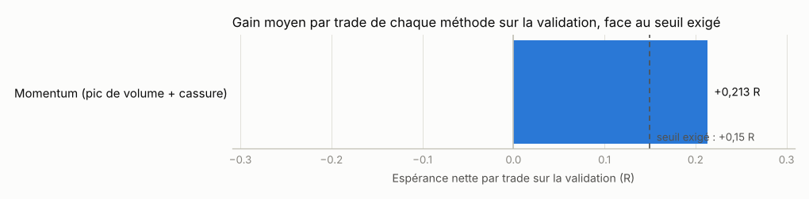
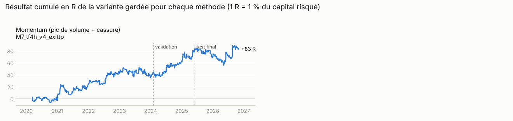

# Rapport : comparaison de sept méthodes sur les perpétuels crypto (15m et 1H)

## Verdict

**Aucune méthode n'est retenue.** Les finalistes ne remplissent pas tous les critères sur le test final.

> Avenant (voir `PROTOCOLE_ETUDE_6.md`, section 5) : la variante avait été rejetée sur la validation pour 174 trades au lieu de 200. À la demande de Gabriel, le seuil a été compté sur l'ensemble des périodes et le test final a été ouvert une fois. Le test ne confirme pas la validation.

- Données : 20 paires Binance USDT-M, bougies 15m, funding réel, du 2020-01-01 au 2026-10-31.
- Découpe : entraînement 2020-01-01 → 2024-01-31, validation 2024-02-01 → 2025-05-31, test final 2025-06-01 → 2026-10-31.
- Variantes testées dans cette étude : **8** (7 méthodes × 8), plus 6 variantes décalées pour le test de stabilité. Avec les 192 configurations des études précédentes sur les mêmes données : **206 au total**. Plus on en teste, plus un bon résultat isolé peut être dû au hasard.
- Tous les chiffres sont nets : frais 0,05 % par côté, slippage 0,02 %, funding payé ou reçu. Risque de 1 % du capital par trade, stop à 1,5 × ATR, 5 positions au plus.

## Tableau comparatif

Une ligne par méthode : la variante gardée est celle qui a la meilleure espérance sur l'entraînement (parmi celles d'au moins 200 trades). Elle est ensuite mesurée telle quelle sur la validation.

| Méthode | Variante gardée | Entraînement : E[R] (trades) | Validation : E[R] (trades) | Gagnants | Profit factor | Drawdown max | Paires positives | Critères | Test final | Verdict |
|---|---|---|---|---|---|---|---|---|---|---|
| **Momentum (pic de volume + cassure)** | `M7_tf4h_v4_exittp` | +0,118 R (373) | +0,213 R (174) | 35,6 % | 1,32 | 11,6 % | 75 % | 7 / 8 | +0,013 R (161) | **REJETÉE** |

E[R] = gain moyen par trade en multiples du risque, après tous les coûts. Colonnes « Gagnants » à « Critères » : sur la validation.



## Ce que montrent les chiffres

- **La méthode la plus proche est « Momentum (pic de volume + cassure) »** (`M7_tf4h_v4_exittp`) : +0,118 R par trade sur l'entraînement, +0,213 R sur la validation, profit factor 1,32, drawdown 11,6 %. Elle rate : ≥ 200 trades. En walk-forward elle est positive sur 4 fenêtres sur 5 (+0,114 R par trade).
- Aucune méthode n'a le droit d'être appelée rentable ici : les seuils ont été fixés avant le calcul et aucun n'est franchi en entier.

## Critères sur la validation

| Méthode | 1 | 2 | 3 | 4 | 5 | 6 | 7 | 8 | Stabilité ±20 % | Critères ratés |
|---|---|---|---|---|---|---|---|---|---|---|
| Momentum (pic de volume + cassure) | ❌ | ✅ | ✅ | ✅ | ✅ | ✅ | ✅ | ✅ | ✅ | ≥ 200 trades |

Critères : 1. ≥ 200 trades ; 2. espérance > 0,15 R ; 3. profit factor > 1,3 ; 4. drawdown < 25 % ; 5. ≥ 60 % des paires positives ; 6. Monte Carlo ≥ 95 % ; 7. mieux que le hasard ; 8. mieux que le buy & hold.
La stabilité n'est calculée que pour une méthode qui remplit les huit autres critères.

| Méthode | Monte Carlo : tirages positifs | Drawdown au 95e centile (ordre mélangé) | Hasard : médiane | Hasard : 95e centile | Centile de la méthode | Rendement | Rendement / drawdown |
|---|---|---|---|---|---|---|---|
| Momentum (pic de volume + cassure) | 95,3 % | 19,6 % | -0,024 R | +0,182 R | 98 | +40,0 % | +3,45 |

Buy & hold sur la validation (panier égal de 17 paires) : rendement +120,7 %, drawdown maximal 64,6 %, rapport +1,87.

## Walk-forward (entraînement + validation)

Pour chaque fenêtre de 8 mois, la variante est choisie sur tout ce qui précède, puis mesurée sur la fenêtre.

| Méthode | 2022-02 → 2022-09 | 2022-10 → 2023-05 | 2023-06 → 2024-01 | 2024-02 → 2024-09 | 2024-10 → 2025-05 | Ensemble | Fenêtres positives |
|---|---|---|---|---|---|---|---|
| Momentum (pic de volume + cassure) | +0,141 R (119) | +0,065 R (64) | -0,024 R (98) | +0,138 R (90) | +0,171 R (201) | +0,114 R (572) | 4 / 5 |

## Courbes de capital



Chaque panneau a sa propre échelle verticale. La ligne pointillée marque le début de la validation puis du test final.

## Test final

| Variante | Validation : E[R] (trades) | Test : E[R] (trades) | Profit factor | Drawdown max | Critères ratés sur le test | Verdict |
|---|---|---|---|---|---|---|
| `M7_tf4h_v4_exittp` | +0,213 R (174) | +0,013 R (161) | 1,02 | 25,4 % | ≥ 200 trades ; espérance > 0,15 R ; profit factor > 1,3 ; drawdown < 25 % ; ≥ 60 % des paires positives ; Monte Carlo ≥ 95 % ; mieux que le hasard ; mieux que le buy & hold | **REJETÉE** |

## Toutes les variantes

| Variante | Entr. : trades | Entr. : E[R] | Entr. : PF | Valid. : trades | Valid. : % gagnants | Valid. : E[R] | Valid. : PF | Valid. : DD % |
|---|---:|---:|---:|---:|---:|---:|---:|---:|
| `M7_tf1h_v3_exittp` | 3794 | +0,036 | 1,05 | 1830 | 34,2 | +0,137 | 1,20 | 30,9 |
| `M7_tf1h_v3_exittrail` | 3720 | +0,012 | 1,02 | 1751 | 34,2 | +0,164 | 1,28 | 48,2 |
| `M7_tf1h_v4_exittp` | 1854 | +0,029 | 1,04 | 944 | 32,7 | +0,086 | 1,12 | 31,6 |
| `M7_tf1h_v4_exittrail` | 1825 | +0,015 | 1,03 | 892 | 33,9 | +0,100 | 1,17 | 33,5 |
| `M7_tf4h_v3_exittp` | 840 | +0,108 | 1,16 | 397 | 35,0 | +0,188 | 1,28 | 22,6 |
| `M7_tf4h_v3_exittrail` | 800 | +0,073 | 1,13 | 376 | 36,7 | +0,129 | 1,24 | 16,7 |
| `M7_tf4h_v4_exittp` | 373 | +0,118 | 1,17 | 174 | 35,6 | +0,213 | 1,32 | 11,6 |
| `M7_tf4h_v4_exittrail` | 358 | +0,058 | 1,10 | 165 | 35,2 | +0,163 | 1,31 | 17,2 |

Variantes à espérance positive sur l'entraînement : 8 sur 8 ; sur la validation : 8 sur 8.

## Limites

- **Données déjà utilisées.** 192 configurations avaient été testées sur ces paires et ces années avant cette étude. La découpe entraînement / validation n'est donc pas neuve.
- **Test final.** La période 2025-2026 a été ouverte une fois, pour une configuration 4h, dans une étude précédente.
- **Biais de survie.** Les 20 paires sont les plus échangées fin 2026 ; les contrats disparus ne sont pas testés.
- **Exécution simulée.** Résolution 15 minutes, slippage fixe, pas de carnet d'ordres ni d'impact de marché. Stop prioritaire sur l'objectif dans la même bougie.
- **Règles mécaniques.** Chaque méthode est une traduction codée parmi d'autres possibles. Un rejet ne prouve pas qu'une lecture discrétionnaire de la même idée échoue ; il prouve que ces règles-là échouent.
- **Baseline aléatoire** : tirée d'un réservoir d'entrées au hasard, sans la limite de 5 positions simultanées.
- Aucune performance future n'est promise par ce document.

## Fichiers

`PROTOCOLE_ETUDE_6.md` (règles écrites avant le calcul), `config/etude6.yaml` (grille et seuils), `results_etude6/` (trades, tableaux, graphiques), `TRIALS_etude6.csv` (toutes les évaluations).

```bash
python -m src.etude4 --study etude6 run && python -m src.etude4 --study etude6 report
```
