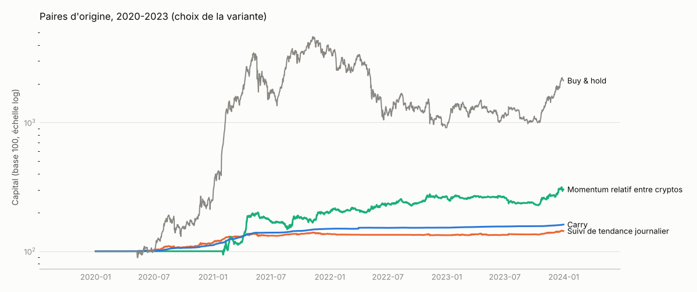
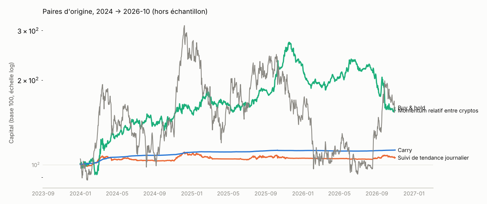
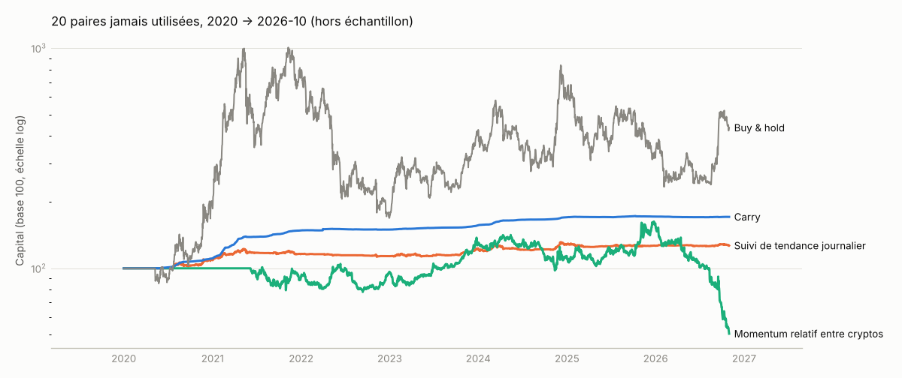

# Étude 7 : stratégies journalières issues de la recherche — résultats

Protocole : `PROTOCOLE_ETUDE_7.md` (écrit avant le calcul et avant le téléchargement des nouvelles paires). Code : `src/etude7*.py`. Résultats : `results_etude7/`.

## Verdict

**Une seule famille remplit tous les critères fixés à l'avance : le carry** (acheter le spot et vendre le perpétuel de la même crypto tant que le funding moyen des 14 derniers jours est positif). C'est la seule stratégie de toutes nos études qui montre un avantage statistique net sur des données hors échantillon, y compris sur 20 paires jamais utilisées.

**Mais je ne recommande pas de la mettre en place maintenant** : son rendement s'est effondré en 2025-2026 (de l'ordre de 0 à 1,5 % par an), en dessous de ce que rapporte un placement en stablecoin presque sans risque, et une partie du risque (liquidation de la jambe vendue, faillite de plateforme) n'apparaît pas dans un backtest journalier. Le suivi de tendance journalier et le momentum relatif échouent hors échantillon.

## Tableau comparatif (variante gardée dans chaque famille, choisie sur 2020-2023)

| Stratégie | Variante | 2020-2023 : Sharpe / rendement annuel / drawdown | 2024-2026 (mêmes paires) | 20 nouvelles paires 2020-2026 | Critères ratés | Verdict |
|---|---|---|---|---|---|---|
| **Suivi de tendance journalier** | `TSMOM_lookback120_sidelong_only` | 1,65 / +9,5 % / 5,3 % | 0,43 / +2,0 % / 6,1 % | 0,69 / +3,5 % / 7,8 % | Sharpe ≥ 1 ; IC du Sharpe > 0 ; ≥ 60 % des trimestres positifs ; positif dans 2 régimes sur 3 ; mieux que le buy & hold | **REJETÉE** |
| **Momentum relatif entre cryptos** | `XSMOM_lookback28_n_each_side5` | 1,29 / +31,8 % / 26,1 % | 0,70 / +16,9 % / 43,5 % | -0,25 / -9,5 % / 69,0 % | Sharpe ≥ 1 ; IC du Sharpe > 0 ; drawdown < 25 % ; positif avec coûts ×2 ; ≥ 60 % des trimestres positifs ; positif dans 2 régimes sur 3 ; mieux que le buy & hold | **REJETÉE** |
| **Carry (spot acheté, perpétuel vendu)** | `CARRY_window_days14_min_annual_funding0p0` | 7,10 / +12,7 % / 0,4 % | 7,09 / +4,3 % / 0,8 % | 5,84 / +8,2 % / 1,3 % | aucun | **RETENUE** |

Buy & hold du panier égal : Sharpe 1,34 (2020-2023), 0,59 (2024-2026), 0,67 (nouvelles paires) ; drawdowns de 80 %, 70 % et 83 %.

Rendements nets de frais (perpétuel 0,05 %, spot 0,10 % par côté), de slippage (0,02 %) et du funding réel. Sharpe calculé sans retrancher le taux sans risque.

## Toutes les variantes

| Variante | 2020-2023 : Sharpe | 2024-2026 : Sharpe | Nouvelles paires : Sharpe | 2020-2023 : drawdown | 2024-2026 : drawdown | Nouvelles paires : drawdown |
|---|---:|---:|---:|---:|---:|---:|
| `TSMOM_lookback20_sidelong_short` | 0,60 | 0,16 | -0,04 | 12,6 % | 11,5 % | 13,9 % |
| `TSMOM_lookback20_sidelong_only` | 1,20 | 0,74 | 0,57 | 10,2 % | 6,4 % | 8,0 % |
| `TSMOM_lookback60_sidelong_short` | 0,73 | 0,02 | 0,19 | 13,1 % | 8,9 % | 14,7 % |
| `TSMOM_lookback60_sidelong_only` | 1,24 | 0,62 | 0,69 | 8,6 % | 5,6 % | 10,4 % |
| `TSMOM_lookback120_sidelong_short` | 1,27 | -0,26 | 0,11 | 6,6 % | 11,5 % | 12,5 % |
| `TSMOM_lookback120_sidelong_only` | 1,65 | 0,43 | 0,69 | 5,3 % | 6,1 % | 7,8 % |
| `XSMOM_lookback7_n_each_side3` | 0,61 | 0,68 | -0,59 | 32,8 % | 56,8 % | 94,3 % |
| `XSMOM_lookback7_n_each_side5` | 0,44 | 0,79 | -0,35 | 29,2 % | 47,7 % | 68,7 % |
| `XSMOM_lookback28_n_each_side3` | 1,09 | 1,01 | -0,13 | 31,2 % | 38,8 % | 81,9 % |
| `XSMOM_lookback28_n_each_side5` | 1,29 | 0,70 | -0,25 | 26,1 % | 43,5 % | 69,0 % |
| `CARRY_window_days3_min_annual_funding0p0` | 5,96 | 0,63 | 3,81 | 2,5 % | 7,1 % | 8,1 % |
| `CARRY_window_days3_min_annual_funding0p1` | 5,22 | 1,49 | 4,02 | 3,9 % | 3,4 % | 3,8 % |
| `CARRY_window_days14_min_annual_funding0p0` | 7,10 | 7,09 | 5,84 | 0,4 % | 0,8 % | 1,3 % |
| `CARRY_window_days14_min_annual_funding0p1` | 6,37 | 4,88 | 5,51 | 0,5 % | 0,4 % | 0,6 % |

Stabilité (fenêtre de funding décalée de ±20 %, Sharpe 2020-2023) : `CARRY_window_days14_min_annual_funding0p0__window_days11` 7,04 ; `CARRY_window_days14_min_annual_funding0p0__window_days17` 6,91.

## Par régime de marché (somme des rendements journaliers, %)

Régime défini chaque jour par le rendement du BTC sur 90 jours : hausse au-delà de +20 %, baisse sous −20 %, range entre les deux.

| Stratégie | Jeu | Hausse | Baisse | Range |
|---|---|---:|---:|---:|
| Suivi de tendance journalier | 2024-2026 | +9,2 | +0,0 | -3,2 |
| Suivi de tendance journalier | nouvelles paires | +25,3 | -0,1 | -0,5 |
| Momentum relatif entre cryptos | 2024-2026 | +35,7 | -27,5 | +47,4 |
| Momentum relatif entre cryptos | nouvelles paires | -13,0 | -57,5 | +25,8 |
| Carry (spot acheté, perpétuel vendu) | 2024-2026 | +9,6 | -0,3 | +2,7 |
| Carry (spot acheté, perpétuel vendu) | nouvelles paires | +48,0 | -1,7 | +7,5 |

## Le carry en détail

### Rendement par année (levier 4 sur la jambe vendue, sans coût de liquidation)

| Année | Paires d'origine | Nouvelles paires |
|---|---:|---:|
| 2020 | +11,4 % | +10,9 % |
| 2021 | +34,1 % | +34,0 % |
| 2022 | +2,1 % | +0,9 % |
| 2023 | +5,7 % | +4,6 % |
| 2024 | +10,7 % | +8,8 % |
| 2025 | +1,4 % | +0,6 % |
| 2026 | +0,4 % | -0,3 % |

Le rendement vient presque entièrement du funding encaissé ; l'écart entre spot et perpétuel (basis) pèse peu. Le funding moyen a fortement baissé depuis 2025, comme le décrit la littérature (plus de capital d'arbitrage, écarts qui se réduisent). Pour comparaison, un placement en stablecoin rapportait de l'ordre de 4 % par an en 2024-2025 (ordre de grandeur, non vérifié dans ce projet).

### Risque de liquidation de la jambe vendue (paires d'origine, bougies 15m)

Avec des comptes de marge séparés et la marge remise à niveau chaque jour à la clôture, une hausse intraday suffisante pour liquider le perpétuel vendu se produit **225 fois** avec un levier 4 et **28 fois** avec un levier 2. Chaque liquidation coûte ici 1,5 % du notionnel de la paire (frais de liquidation, slippage, remise en place), estimation prudente.

| Année | Levier 4, avec liquidations | Levier 2, avec liquidations |
|---|---:|---:|
| 2020 | +10,4 % | +9,4 % |
| 2021 | +21,5 % | +26,1 % |
| 2022 | +1,5 % | +1,7 % |
| 2023 | +4,2 % | +4,5 % |
| 2024 | +6,8 % | +8,5 % |
| 2025 | +0,0 % | +0,9 % |
| 2026 | -1,1 % | +0,2 % |

| Version | 2020-2023 : Sharpe / rendement annuel / drawdown | 2024-2026 |
|---|---|---|
| Levier 4, sans liquidations (backtest du protocole) | 7,10 / +12,7 % / 0,4 % | 7,09 / +4,3 % / 0,8 % |
| Levier 4, avec liquidations | 5,16 / +9,1 % / 1,8 % | 2,80 / +1,9 % / 2,1 % |
| Levier 2, avec liquidations | 6,96 / +10,1 % / 0,3 % | 6,64 / +3,3 % / 0,7 % |

Un compte à marge unifiée (le spot sert de garantie au perpétuel, proposé par Binance et OKX) réduit fortement ce risque, sans le supprimer (décotes sur la garantie, auto-deleveraging).

## Faiblesses et risques

- **Rendement qui disparaît** : 0 à 1,5 % par an en 2025-2026, en dessous d'un placement sans risque.
- **Risque de plateforme** : tout le capital est sur l'exchange (exemple de FTX en 2022). Aucun backtest ne le mesure.
- **Liquidation et auto-deleveraging** de la jambe vendue lors des hausses violentes.
- **Taille minimale** : un notionnel minimum par ordre (souvent 5 à 100 USDT selon la paire et la plateforme) ; avec environ 1 900 USDT, seules quelques paires sont praticables, ce qui augmente le risque par paire.
- **Plateforme différente** : les calculs utilisent le funding de Binance ; celui d'OKX est proche mais pas identique.
- **Backtest journalier** : clôtures de 00:00 UTC, pas de carnet d'ordres, écart d'exécution entre les deux jambes ignoré.
- **Trous de données** de 5 jours en 2022 sur 11 paires, non comblés.

## Ce que ces résultats ne prouvent pas

- Ils ne prouvent pas que le carry redeviendra rentable ; il l'a été surtout en marché haussier (2021 : environ +29 %).
- Le suivi de tendance et le momentum relatif rejetés ici restent étudiés sur d'autres marchés ; ils n'ont simplement pas passé ces critères sur ces cryptos.

## Contrôles

- Variantes : 14 dans cette étude (+ 28 décalées pour la stabilité) ; environ 220 au total sur ces marchés avec les études 1 à 6.
- Tests : décisions identiques sur un historique tronqué (aucun regard vers le futur), calendrier des rééquilibrages, calcul du funding, des coûts et du résultat du carry vérifiés à la main (`tests/test_study7.py`).
- Données téléchargées depuis data.binance.vision avec vérification des sommes SHA-256.
