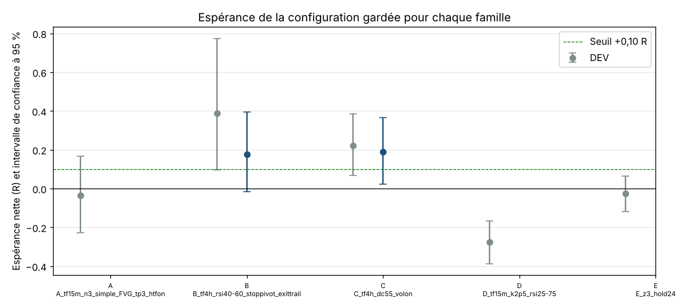
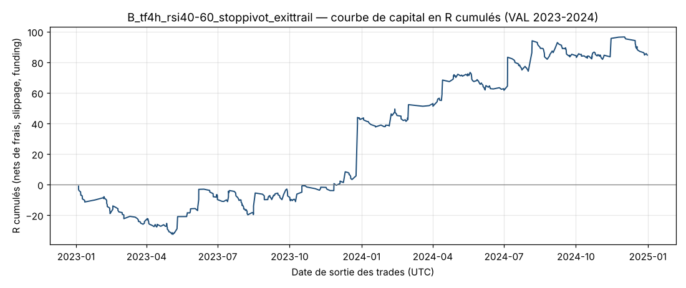
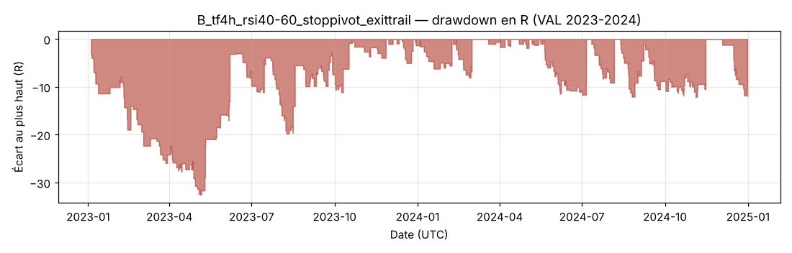
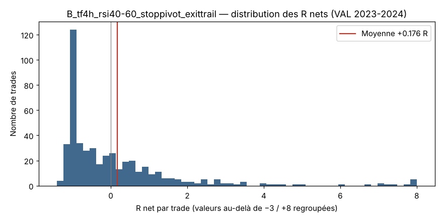
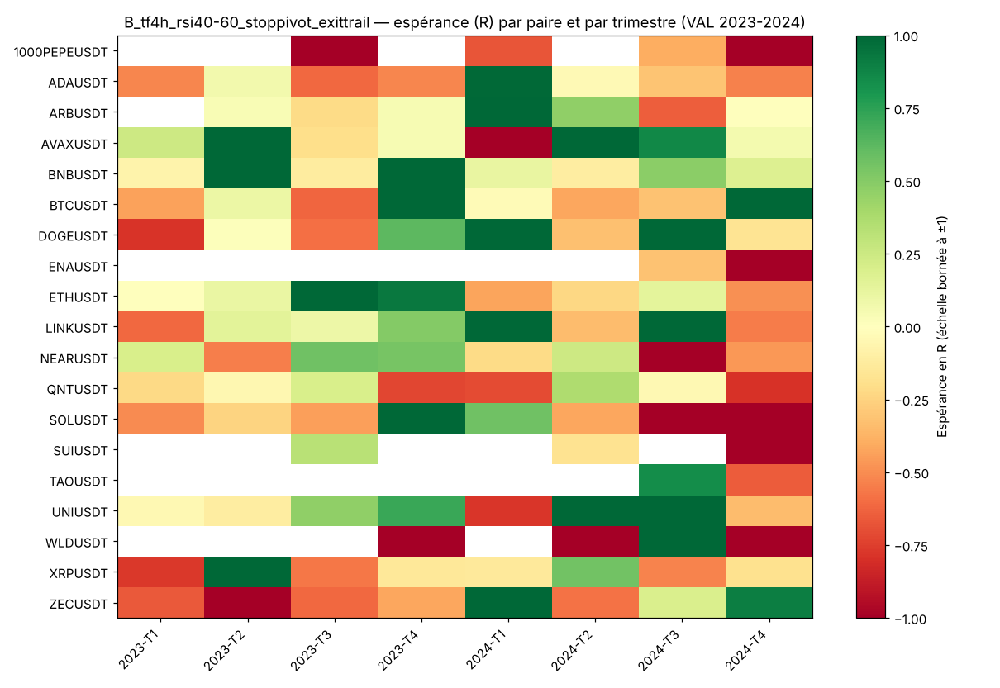
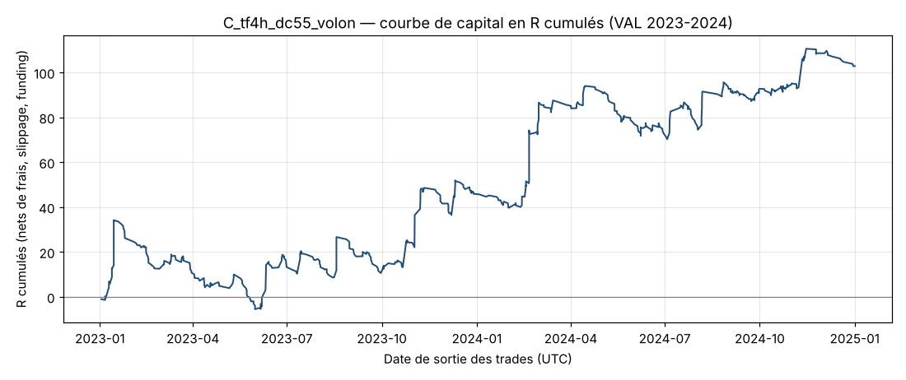
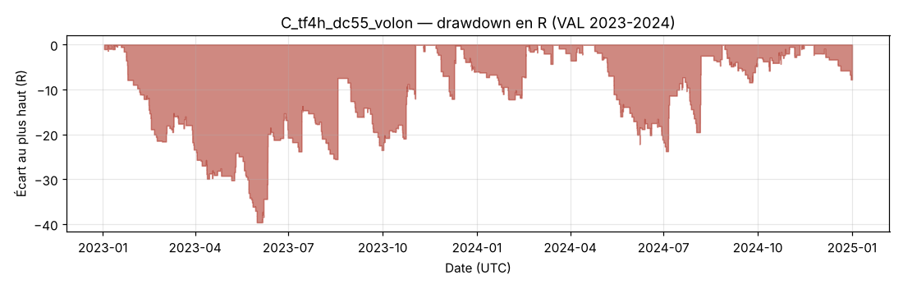
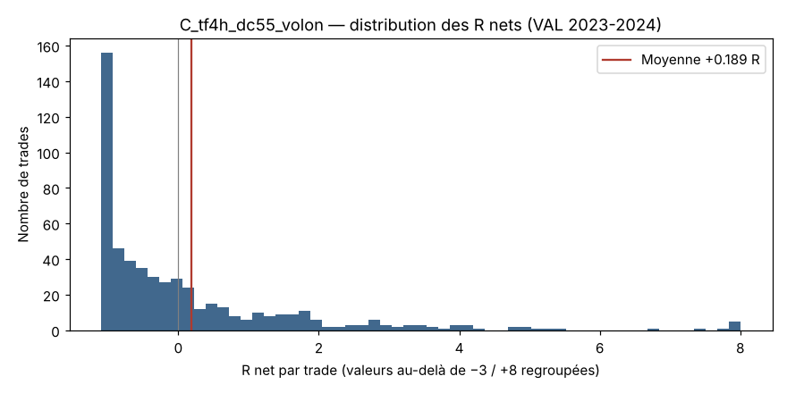
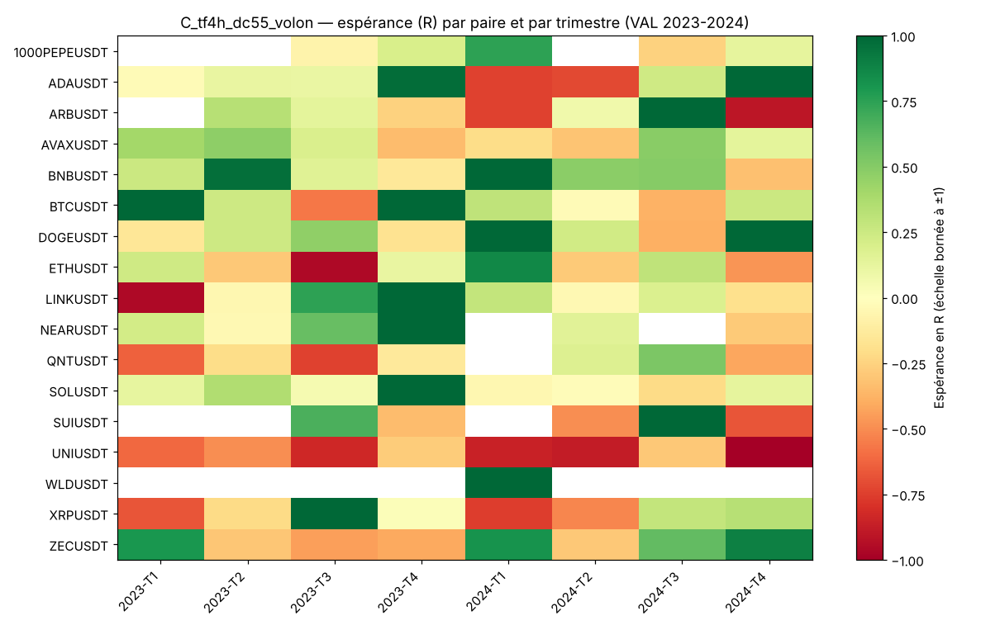

# Rapport : validation de setups sur perpétuels Binance USDT-M

## Résumé

- **100 configurations** testées sur DEV (5 familles : A 64, B 16, C 8, D 8, E 4), 20 paires, signaux 15m / 1h / 4h, moteur maison en résolution 15m.
- **21** passent DEV (≥ 100 trades, espérance > 0, PF > 1) ; **21** passent aussi le test de plateau.
- **21** évaluées telles quelles sur VAL ; une seule gardée par famille.
- **0** configuration(s) remplissent les 9 critères sur VAL : aucune.
- TEST : **verrouillé**, jamais ouvert : aucune configuration ne survit à VAL, il n'y a rien à y évaluer.
- Nombre total d'essais consignés dans `TRIALS.csv` : **142 lignes** pour **100 configurations** (DEV, VAL, coûts ×2, TEST).
- **Verdict global : Aucun setup validé, scanner non construit.** Aucune des familles testées ne montre un edge qui résiste aux 9 critères.
- Tous les chiffres sont nets de frais (maker 0,02 %, taker 0,05 %), de slippage (0,03 %) et de funding réel.

## Verdict par famille

| Famille | Configuration gardée | DEV : E[R] (trades) | VAL : E[R] (trades) | Critères 1 à 9 sur VAL | TEST : E[R] (trades) | Verdict |
|---|---|---|---|---|---|---|
| **A** SMC (sweep + MSS + retour sur zone) | `A_tf15m_n3_simple_FVG_tp3_htfon` | -0,034 R (309) | non évalué | — | non évalué | **REJETÉ** |
| **B** Continuation de tendance sur repli | `B_tf4h_rsi40-60_stoppivot_exittrail` | +0,390 R (319) | +0,176 R (481) | ✅ ✅ ❌ ✅ ✅ ✅ ❌ ❌ ✅ | non évalué | **REJETÉ** |
| **C** Cassure de range (Donchian) | `C_tf4h_dc55_volon` | +0,223 R (455) | +0,189 R (545) | ✅ ✅ ✅ ✅ ✅ ✅ ✅ ❌ ✅ | non évalué | **REJETÉ** |
| **D** Retour à la moyenne | `D_tf15m_k2p5_rsi25-75` | -0,277 R (590) | non évalué | — | non évalué | **REJETÉ** |
| **E** Extrêmes de funding (contrarien) | `E_z3_hold24` | -0,026 R (645) | non évalué | — | non évalué | **REJETÉ** |

Critères, dans l'ordre : 1. ≥ 100 trades ; 2. espérance ≥ +0,10 R et PF ≥ 1,15 ; 3. borne basse IC 95 % > 0 ; 4. espérance > 0 avec coûts ×2 ; 5. au-dessus du 95e centile de la baseline aléatoire ; 6. espérance > 0 sans la meilleure paire ; 7. ≥ 60 % des paires (≥ 10 trades) positives ; 8. drawdown ≤ 25 % ; 9. au plus 1 trimestre sur 3 sous −0,3 R.

- **A** : REJETÉ — aucune configuration ne passe DEV (≥ 100 trades, espérance > 0, PF > 1) avec le test de plateau.
- **B** : REJETÉ — critères ratés sur VAL : c3, c7, c8.
- **C** : REJETÉ — critères ratés sur VAL : c8.
- **D** : REJETÉ — aucune configuration ne passe DEV (≥ 100 trades, espérance > 0, PF > 1) avec le test de plateau.
- **E** : REJETÉ — aucune configuration ne passe DEV (≥ 100 trades, espérance > 0, PF > 1) avec le test de plateau.



## Famille A : SMC (sweep + MSS + retour sur zone)

### Règles testées

Sweep d'equal highs/lows (au moins 2 pivots à moins de 0.15 % l'un de l'autre parmi les pivots confirmés des 50 dernières bougies, niveau encore intact), puis cassure de structure (clôture au-delà du dernier pivot opposé confirmé) dans les 10 bougies, puis ordre **limite** au milieu de la zone (FVG ou order block), valable 10 bougies. Stop au-delà de la mèche du sweep (marge 0.1 × ATR). Objectif fixe en R.

Grille : timeframe {15m, 1h} × pivot_n {3, 5} × structure {deplacement, simple} × zone {FVG, OB} × tp_r {2, 3} × htf_filter {off, on} = **64 combinaisons**.

### Résultats DEV (2020-2022)

20 configuration(s) sur 64 ont au moins 100 trades ; 0 passent DEV ; 0 passent DEV et le plateau. Espérance médiane de la grille : -0,282 R ; 5 configuration(s) à espérance positive.

| Configuration | Trades | % gagnants | E[R] net | PF | DD max % | Centile baseline | Passe DEV | Voisines > 0 | DEV + plateau |
|---|---:|---:|---:|---:|---:|---:|:-:|---:|:-:|
| `A_tf15m_n3_deplacement_FVG_tp2_htfoff` | 198 | 25,8 | -0,302 R | 0,63 | 46,1 | 0 | non | 0,00 | non |
| `A_tf15m_n3_deplacement_FVG_tp2_htfon` | 115 | 28,7 | -0,214 R | 0,72 | 22,8 | 10 | non | 0,00 | non |
| `A_tf15m_n3_deplacement_FVG_tp3_htfoff` | 197 | 18,3 | -0,351 R | 0,61 | 51,3 | 1 | non | 0,00 | non |
| `A_tf15m_n3_deplacement_FVG_tp3_htfon` | 115 | 20,0 | -0,284 R | 0,68 | 29,2 | 8 | non | 0,00 | non |
| `A_tf15m_n3_deplacement_OB_tp2_htfoff` | 117 | 19,7 | -0,540 R | 0,41 | 47,5 | 0 | non | 0,17 | non |
| `A_tf15m_n3_deplacement_OB_tp2_htfon` | 62 | 19,4 | -0,542 R | 0,41 | 29,0 | 1 | non | 0,17 | non |
| `A_tf15m_n3_deplacement_OB_tp3_htfoff` | 117 | 14,5 | -0,553 R | 0,44 | 48,4 | 0 | non | 0,00 | non |
| `A_tf15m_n3_deplacement_OB_tp3_htfon` | 62 | 14,5 | -0,546 R | 0,44 | 31,2 | 2 | non | 0,00 | non |
| `A_tf15m_n3_simple_FVG_tp2_htfoff` | 562 | 34,3 | -0,040 R | 0,94 | 43,5 | 63 | non | 0,00 | non |
| `A_tf15m_n3_simple_FVG_tp2_htfon` | 310 | 34,5 | -0,039 R | 0,95 | 31,7 | 64 | non | 0,00 | non |
| `A_tf15m_n3_simple_FVG_tp3_htfoff` | 556 | 25,0 | -0,077 R | 0,91 | 46,7 | 48 | non | 0,00 | non |
| `A_tf15m_n3_simple_FVG_tp3_htfon` | 309 | 26,2 | -0,034 R | 0,96 | 32,6 | 62 | non | 0,00 | non |
| `A_tf15m_n3_simple_OB_tp2_htfoff` | 638 | 30,4 | -0,200 R | 0,75 | 76,9 | 2 | non | 0,00 | non |
| `A_tf15m_n3_simple_OB_tp2_htfon` | 351 | 31,6 | -0,165 R | 0,79 | 57,4 | 18 | non | 0,00 | non |
| `A_tf15m_n3_simple_OB_tp3_htfoff` | 635 | 22,7 | -0,212 R | 0,76 | 79,8 | 2 | non | 0,00 | non |
| `A_tf15m_n3_simple_OB_tp3_htfon` | 350 | 24,0 | -0,162 R | 0,81 | 58,5 | 21 | non | 0,00 | non |
| `A_tf15m_n5_deplacement_FVG_tp2_htfoff` | 68 | 22,1 | -0,402 R | 0,52 | 24,5 | 2 | non | 0,00 | non |
| `A_tf15m_n5_deplacement_FVG_tp2_htfon` | 45 | 22,2 | -0,403 R | 0,52 | 17,0 | 4 | non | 0,00 | non |
| `A_tf15m_n5_deplacement_FVG_tp3_htfoff` | 68 | 13,2 | -0,546 R | 0,42 | 31,6 | 1 | non | 0,17 | non |
| `A_tf15m_n5_deplacement_FVG_tp3_htfon` | 45 | 11,1 | -0,643 R | 0,34 | 26,9 | 0 | non | 0,00 | non |
| `A_tf15m_n5_deplacement_OB_tp2_htfoff` | 45 | 15,6 | -0,644 R | 0,32 | 25,5 | 0 | non | 0,17 | non |
| `A_tf15m_n5_deplacement_OB_tp2_htfon` | 30 | 23,3 | -0,406 R | 0,53 | 13,2 | 9 | non | 0,17 | non |
| `A_tf15m_n5_deplacement_OB_tp3_htfoff` | 45 | 11,1 | -0,671 R | 0,33 | 26,5 | 1 | non | 0,00 | non |
| `A_tf15m_n5_deplacement_OB_tp3_htfon` | 30 | 16,7 | -0,446 R | 0,52 | 16,0 | 11 | non | 0,00 | non |
| `A_tf15m_n5_simple_FVG_tp2_htfoff` | 173 | 30,6 | -0,143 R | 0,81 | 25,5 | 19 | non | 0,00 | non |
| `A_tf15m_n5_simple_FVG_tp2_htfon` | 97 | 29,9 | -0,170 R | 0,78 | 16,8 | 20 | non | 0,00 | non |
| `A_tf15m_n5_simple_FVG_tp3_htfoff` | 173 | 19,1 | -0,310 R | 0,65 | 45,7 | 3 | non | 0,00 | non |
| `A_tf15m_n5_simple_FVG_tp3_htfon` | 97 | 19,6 | -0,297 R | 0,66 | 28,8 | 8 | non | 0,00 | non |
| `A_tf15m_n5_simple_OB_tp2_htfoff` | 185 | 29,2 | -0,219 R | 0,72 | 38,2 | 9 | non | 0,00 | non |
| `A_tf15m_n5_simple_OB_tp2_htfon` | 103 | 27,2 | -0,283 R | 0,65 | 30,2 | 7 | non | 0,00 | non |
| `A_tf15m_n5_simple_OB_tp3_htfoff` | 185 | 18,9 | -0,344 R | 0,62 | 51,8 | 2 | non | 0,00 | non |
| `A_tf15m_n5_simple_OB_tp3_htfon` | 103 | 15,5 | -0,487 R | 0,48 | 42,3 | 1 | non | 0,00 | non |
| `A_tf1h_n3_deplacement_FVG_tp2_htfoff` | 23 | 30,4 | -0,123 R | 0,83 | 6,4 | 33 | non | 0,17 | non |
| `A_tf1h_n3_deplacement_FVG_tp2_htfon` | 10 | 30,0 | -0,142 R | 0,81 | 3,2 | 36 | non | 0,17 | non |
| `A_tf1h_n3_deplacement_FVG_tp3_htfoff` | 23 | 21,7 | -0,169 R | 0,79 | 11,1 | 29 | non | 0,17 | non |
| `A_tf1h_n3_deplacement_FVG_tp3_htfon` | 10 | 20,0 | -0,245 R | 0,71 | 4,3 | 28 | non | 0,00 | non |
| `A_tf1h_n3_deplacement_OB_tp2_htfoff` | 13 | 46,2 | +0,306 R | 1,52 | 5,4 | 77 | non | 0,33 | non |
| `A_tf1h_n3_deplacement_OB_tp2_htfon` | 5 | 40,0 | +0,110 R | 1,17 | 2,1 | 44 | non | 0,33 | non |
| `A_tf1h_n3_deplacement_OB_tp3_htfoff` | 13 | 23,1 | -0,168 R | 0,80 | 6,7 | 32 | non | 0,17 | non |
| `A_tf1h_n3_deplacement_OB_tp3_htfon` | 5 | 20,0 | -0,301 R | 0,66 | 2,3 | 24 | non | 0,17 | non |
| `A_tf1h_n3_simple_FVG_tp2_htfoff` | 72 | 27,8 | -0,212 R | 0,72 | 23,9 | 13 | non | 0,00 | non |
| `A_tf1h_n3_simple_FVG_tp2_htfon` | 37 | 24,3 | -0,325 R | 0,60 | 15,5 | 9 | non | 0,00 | non |
| `A_tf1h_n3_simple_FVG_tp3_htfoff` | 71 | 21,1 | -0,201 R | 0,76 | 23,4 | 17 | non | 0,00 | non |
| `A_tf1h_n3_simple_FVG_tp3_htfon` | 37 | 21,6 | -0,193 R | 0,77 | 14,7 | 25 | non | 0,00 | non |
| `A_tf1h_n3_simple_OB_tp2_htfoff` | 78 | 30,8 | -0,145 R | 0,81 | 16,8 | 26 | non | 0,17 | non |
| `A_tf1h_n3_simple_OB_tp2_htfon` | 34 | 23,5 | -0,369 R | 0,55 | 13,2 | 8 | non | 0,17 | non |
| `A_tf1h_n3_simple_OB_tp3_htfoff` | 78 | 23,1 | -0,148 R | 0,82 | 19,3 | 27 | non | 0,00 | non |
| `A_tf1h_n3_simple_OB_tp3_htfon` | 34 | 14,7 | -0,489 R | 0,47 | 17,2 | 5 | non | 0,00 | non |
| `A_tf1h_n5_deplacement_FVG_tp2_htfoff` | 7 | 28,6 | -0,200 R | 0,74 | 5,3 | 30 | non | 0,33 | non |
| `A_tf1h_n5_deplacement_FVG_tp2_htfon` | 2 | 0,0 | -1,126 R | 0,00 | 2,2 | 1 | non | 0,17 | non |
| `A_tf1h_n5_deplacement_FVG_tp3_htfoff` | 7 | 28,6 | +0,087 R | 1,11 | 5,3 | 48 | non | 0,00 | non |
| `A_tf1h_n5_deplacement_FVG_tp3_htfon` | 2 | 0,0 | -1,126 R | 0,00 | 2,2 | 2 | non | 0,17 | non |
| `A_tf1h_n5_deplacement_OB_tp2_htfoff` | 5 | 60,0 | +0,734 R | 2,74 | 2,1 | 79 | non | 0,33 | non |
| `A_tf1h_n5_deplacement_OB_tp2_htfon` | 1 | 100,0 | +1,830 R | n/d | 0,0 | 63 | non | 0,33 | non |
| `A_tf1h_n5_deplacement_OB_tp3_htfoff` | 5 | 20,0 | -0,280 R | 0,68 | 4,3 | 23 | non | 0,33 | non |
| `A_tf1h_n5_deplacement_OB_tp3_htfon` | 1 | 0,0 | -1,189 R | 0,00 | 1,2 | 1 | non | 0,17 | non |
| `A_tf1h_n5_simple_FVG_tp2_htfoff` | 19 | 26,3 | -0,257 R | 0,67 | 12,0 | 17 | non | 0,00 | non |
| `A_tf1h_n5_simple_FVG_tp2_htfon` | 7 | 14,3 | -0,652 R | 0,30 | 6,4 | 7 | non | 0,00 | non |
| `A_tf1h_n5_simple_FVG_tp3_htfoff` | 19 | 21,1 | -0,206 R | 0,75 | 12,9 | 27 | non | 0,17 | non |
| `A_tf1h_n5_simple_FVG_tp3_htfon` | 7 | 14,3 | -0,509 R | 0,45 | 6,4 | 12 | non | 0,00 | non |
| `A_tf1h_n5_simple_OB_tp2_htfoff` | 23 | 30,4 | -0,137 R | 0,81 | 6,3 | 36 | non | 0,17 | non |
| `A_tf1h_n5_simple_OB_tp2_htfon` | 9 | 22,2 | -0,408 R | 0,51 | 3,7 | 15 | non | 0,17 | non |
| `A_tf1h_n5_simple_OB_tp3_htfoff` | 23 | 17,4 | -0,360 R | 0,59 | 12,1 | 17 | non | 0,00 | non |
| `A_tf1h_n5_simple_OB_tp3_htfon` | 9 | 11,1 | -0,633 R | 0,34 | 6,4 | 10 | non | 0,00 | non |

### Résultats VAL (2023-2024)

Aucune configuration de cette famille n'a passé DEV : rien n'a été évalué sur VAL.

### Résultats TEST

Non évalué : aucune configuration de cette famille ne survit à VAL.

### Points forts et faiblesses chiffrés

Configuration `A_tf15m_n3_simple_FVG_tp3_htfon`, chiffres DEV :

- Par direction : long -0,220 R (137 trades) ; short +0,115 R (172 trades).
- Par type de sortie : stop -1,096 R (228 trades) ; tp +2,956 R (81 trades).
- Meilleure paire (≥ 10 trades) : DOGEUSDT +0,394 R (19 trades) ; pire paire : BTCUSDT -0,411 R (51 trades).
- Par trimestre : 2020-T1 -1,067 R (5) ; 2020-T2 -0,562 R (22) ; 2020-T3 -0,505 R (19) ; 2020-T4 -0,261 R (29) ; 2021-T1 +0,915 R (26) ; 2021-T2 -0,268 R (20) ; 2021-T3 +0,147 R (33) ; 2021-T4 +0,628 R (33) ; 2022-T1 -0,162 R (31) ; 2022-T2 -0,606 R (17) ; 2022-T3 -0,207 R (37) ; 2022-T4 +0,091 R (37).
- Taux de réussite 26,2 %, R médian -1,061 R, plus longue série de pertes 24, drawdown max 32,6 % (38,4 R), Sharpe -0,20, Calmar -0,16.
- 8,6 trades par mois, détention moyenne 12,3 h, 12,8 % du temps en position.
- Coûts (frais + slippage + funding) : 2 174 USDT pour un PnL brut de 714 USDT, soit 304 % du brut.
- Baseline aléatoire : l'espérance observée est au 62e centile des 1000 simulations (médiane -0,064 R, 95e centile +0,091 R).

## Famille B : Continuation de tendance sur repli

### Règles testées

Tendance EMA50/EMA200 du timeframe, repli sur l'EMA20 dans les 5 dernières bougies avec clôture revenue du bon côté, RSI(14) repassé au-delà du seuil après l'avoir franchi dans les 5 bougies précédentes. Entrée au marché à l'ouverture suivante. Stop 1.5 × ATR ou dernier pivot (n = 3). Sortie objectif 2 R ou stop suiveur chandelier 3.0 × ATR.

Grille : timeframe {1h, 4h} × rsi_thresholds {40/60, 45/55} × stop {atr, pivot} × exit {tp2r, trail} = **16 combinaisons**.

### Résultats DEV (2020-2022)

16 configuration(s) sur 16 ont au moins 100 trades ; 14 passent DEV ; 14 passent DEV et le plateau. Espérance médiane de la grille : +0,089 R ; 14 configuration(s) à espérance positive.

| Configuration | Trades | % gagnants | E[R] net | PF | DD max % | Centile baseline | Passe DEV | Voisines > 0 | DEV + plateau |
|---|---:|---:|---:|---:|---:|---:|:-:|---:|:-:|
| `B_tf1h_rsi40-60_stopatr_exittp2r` | 2553 | 35,4 | -0,001 R | 1,00 | 78,4 | 99 | non | 0,75 | non |
| `B_tf1h_rsi40-60_stopatr_exittrail` | 2656 | 32,3 | +0,050 R | 1,08 | 71,0 | 100 | oui | 0,75 | oui |
| `B_tf1h_rsi40-60_stoppivot_exittp2r` | 1827 | 35,7 | +0,013 R | 1,02 | 57,6 | 97 | oui | 0,75 | oui |
| `B_tf1h_rsi40-60_stoppivot_exittrail` | 2308 | 34,4 | +0,050 R | 1,10 | 62,6 | 99 | oui | 1,00 | oui |
| `B_tf1h_rsi45-55_stopatr_exittp2r` | 4204 | 34,9 | -0,014 R | 0,98 | 86,9 | 100 | non | 0,75 | non |
| `B_tf1h_rsi45-55_stopatr_exittrail` | 4494 | 31,9 | +0,036 R | 1,06 | 81,1 | 100 | oui | 0,75 | oui |
| `B_tf1h_rsi45-55_stoppivot_exittp2r` | 2921 | 35,9 | +0,016 R | 1,02 | 68,7 | 100 | oui | 0,75 | oui |
| `B_tf1h_rsi45-55_stoppivot_exittrail` | 4082 | 32,7 | +0,026 R | 1,05 | 80,5 | 100 | oui | 1,00 | oui |
| `B_tf4h_rsi40-60_stopatr_exittp2r` | 493 | 41,0 | +0,190 R | 1,31 | 17,4 | 100 | oui | 0,75 | oui |
| `B_tf4h_rsi40-60_stopatr_exittrail` | 502 | 39,0 | +0,387 R | 1,75 | 14,9 | 100 | oui | 1,00 | oui |
| `B_tf4h_rsi40-60_stoppivot_exittp2r` | 298 | 42,3 | +0,218 R | 1,36 | 17,7 | 99 | oui | 1,00 | oui |
| `B_tf4h_rsi40-60_stoppivot_exittrail` | 319 | 39,2 | +0,390 R | 1,76 | 15,7 | 99 | oui | 1,00 | oui |
| `B_tf4h_rsi45-55_stopatr_exittp2r` | 794 | 39,7 | +0,145 R | 1,23 | 25,1 | 100 | oui | 0,75 | oui |
| `B_tf4h_rsi45-55_stopatr_exittrail` | 832 | 38,2 | +0,356 R | 1,68 | 23,3 | 100 | oui | 1,00 | oui |
| `B_tf4h_rsi45-55_stoppivot_exittp2r` | 639 | 39,3 | +0,129 R | 1,20 | 20,4 | 100 | oui | 1,00 | oui |
| `B_tf4h_rsi45-55_stoppivot_exittrail` | 726 | 34,8 | +0,308 R | 1,54 | 33,9 | 100 | oui | 1,00 | oui |

### Résultats VAL (2023-2024)

| Configuration | Trades | % gagnants | E[R] net | IC 95 % | PF | DD max % | E[R] coûts ×2 | 95e centile baseline | Plateau | 9 critères | Critères ratés |
|---|---:|---:|---:|---|---:|---:|---:|---:|:-:|---|---|
| `B_tf4h_rsi40-60_stoppivot_exittrail` | 481 | 37,4 | +0,176 R | [-0,017 R ; +0,394 R] | 1,36 | 28,4 | +0,120 R | +0,134 R | oui | REJETE | c3,c7,c8 |
| `B_tf4h_rsi45-55_stoppivot_exittrail` | 806 | 34,5 | +0,124 R | [-0,024 R ; +0,289 R] | 1,22 | 38,3 | +0,065 R | +0,076 R | oui | REJETE | c3,c8 |
| `B_tf4h_rsi45-55_stopatr_exittrail` | 915 | 34,3 | +0,085 R | [-0,034 R ; +0,211 R] | 1,15 | 55,9 | +0,030 R | +0,073 R | oui | REJETE | c2,c3,c7,c8 |
| `B_tf4h_rsi45-55_stoppivot_exittp2r` | 642 | 37,7 | +0,085 R | [-0,027 R ; +0,196 R] | 1,13 | 24,7 | +0,039 R | +0,033 R | oui | REJETE | c2,c3 |
| `B_tf4h_rsi40-60_stopatr_exittrail` | 622 | 34,1 | +0,075 R | [-0,067 R ; +0,226 R] | 1,13 | 46,2 | +0,012 R | +0,099 R | oui | REJETE | c2,c3,c5,c7,c8 |
| `B_tf4h_rsi45-55_stopatr_exittp2r` | 859 | 37,1 | +0,073 R | [-0,021 R ; +0,172 R] | 1,11 | 31,2 | +0,019 R | +0,021 R | oui | REJETE | c2,c3,c8 |
| `B_tf4h_rsi40-60_stoppivot_exittp2r` | 404 | 36,6 | +0,063 R | [-0,078 R ; +0,208 R] | 1,09 | 23,1 | +0,003 R | +0,073 R | oui | REJETE | c2,c3,c5 |
| `B_tf4h_rsi40-60_stopatr_exittp2r` | 592 | 36,0 | +0,044 R | [-0,071 R ; +0,159 R] | 1,07 | 33,7 | -0,012 R | +0,041 R | oui | REJETE | c2,c3,c4,c7,c8 |
| `B_tf1h_rsi45-55_stoppivot_exittp2r` | 2521 | 34,9 | -0,023 R | [-0,079 R ; +0,034 R] | 0,97 | 76,2 | -0,116 R | -0,035 R | oui | REJETE | c2,c3,c4,c6,c7,c8 |
| `B_tf1h_rsi45-55_stopatr_exittrail` | 4063 | 31,2 | -0,028 R | [-0,083 R ; +0,028 R] | 0,95 | 97,1 | -0,131 R | -0,063 R | oui | REJETE | c2,c3,c4,c6,c7,c8 |
| `B_tf1h_rsi45-55_stoppivot_exittrail` | 3820 | 31,6 | -0,052 R | [-0,111 R ; +0,010 R] | 0,91 | 97,6 | -0,155 R | -0,056 R | oui | REJETE | c2,c3,c4,c6,c7,c8 |
| `B_tf1h_rsi40-60_stoppivot_exittp2r` | 1793 | 33,6 | -0,058 R | [-0,122 R ; +0,009 R] | 0,92 | 85,2 | -0,134 R | -0,010 R | oui | REJETE | c2,c3,c4,c5,c6,c7,c8 |
| `B_tf1h_rsi40-60_stoppivot_exittrail` | 2474 | 31,2 | -0,060 R | [-0,131 R ; +0,018 R] | 0,89 | 94,2 | -0,158 R | -0,039 R | oui | REJETE | c2,c3,c4,c5,c6,c7,c8 |
| `B_tf1h_rsi40-60_stopatr_exittrail` | 2712 | 30,2 | -0,065 R | [-0,131 R ; +0,002 R] | 0,90 | 96,0 | -0,168 R | -0,046 R | oui | REJETE | c2,c3,c4,c5,c6,c7,c8 |

« PASSE » = les 9 critères sont remplis sur VAL (condition nécessaire, pas suffisante : il faut aussi TEST).

### Résultats TEST

Non évalué : aucune configuration de cette famille ne survit à VAL.

### Points forts et faiblesses chiffrés

Configuration `B_tf4h_rsi40-60_stoppivot_exittrail`, chiffres VAL :

- Par direction : long +0,151 R (221 trades) ; short +0,197 R (260 trades).
- Par type de sortie : stop -1,064 R (139 trades) ; trail +0,680 R (342 trades).
- Meilleure paire (≥ 10 trades) : SOLUSDT +1,199 R (22 trades) ; pire paire : QNTUSDT -0,272 R (36 trades).
- Par trimestre : 2023-T1 -0,375 R (60) ; 2023-T2 +0,187 R (68) ; 2023-T3 +0,015 R (80) ; 2023-T4 +1,045 R (50) ; 2024-T1 +0,286 R (43) ; 2024-T2 +0,098 R (59) ; 2024-T3 +0,388 R (67) ; 2024-T4 -0,055 R (54).
- Taux de réussite 37,4 %, R médian -0,462 R, plus longue série de pertes 13, drawdown max 28,4 % (32,6 R), Sharpe 0,97, Calmar 1,37.
- 20,0 trades par mois, détention moyenne 65,7 h, 72,5 % du temps en position.
- Coûts (frais + slippage + funding) : 3 630 USDT pour un PnL brut de 12 947 USDT, soit 28 % du brut.
- Baseline aléatoire : l'espérance observée est au 97e centile des 1000 simulations (médiane -0,026 R, 95e centile +0,134 R).
- Stabilité DEV → VAL : +0,390 R → +0,176 R.









## Famille C : Cassure de range (Donchian)

### Règles testées

Clôture au-delà du plus haut / plus bas des N bougies précédentes (Donchian), filtre optionnel volume > 1.5 × moyenne des 20 bougies précédentes. Entrée au marché à l'ouverture suivante, stop initial 2.0 × ATR, stop suiveur chandelier 3.0 × ATR.

Grille : timeframe {1h, 4h} × donchian_n {20, 55} × volume_filter {off, on} = **8 combinaisons**.

### Résultats DEV (2020-2022)

8 configuration(s) sur 8 ont au moins 100 trades ; 7 passent DEV ; 7 passent DEV et le plateau. Espérance médiane de la grille : +0,097 R ; 7 configuration(s) à espérance positive.

| Configuration | Trades | % gagnants | E[R] net | PF | DD max % | Centile baseline | Passe DEV | Voisines > 0 | DEV + plateau |
|---|---:|---:|---:|---:|---:|---:|:-:|---:|:-:|
| `C_tf1h_dc20_voloff` | 5199 | 34,8 | +0,005 R | 1,01 | 87,1 | 99 | oui | 0,67 | oui |
| `C_tf1h_dc20_volon` | 4656 | 33,7 | -0,007 R | 0,99 | 91,2 | 94 | non | 1,00 | non |
| `C_tf1h_dc55_voloff` | 3352 | 34,6 | +0,012 R | 1,02 | 80,2 | 98 | oui | 1,00 | oui |
| `C_tf1h_dc55_volon` | 3095 | 34,8 | +0,016 R | 1,03 | 77,4 | 99 | oui | 0,67 | oui |
| `C_tf4h_dc20_voloff` | 861 | 38,7 | +0,177 R | 1,39 | 29,3 | 98 | oui | 1,00 | oui |
| `C_tf4h_dc20_volon` | 706 | 39,2 | +0,200 R | 1,44 | 27,0 | 99 | oui | 0,67 | oui |
| `C_tf4h_dc55_voloff` | 521 | 38,4 | +0,177 R | 1,38 | 26,6 | 93 | oui | 1,00 | oui |
| `C_tf4h_dc55_volon` | 455 | 39,6 | +0,223 R | 1,50 | 18,8 | 97 | oui | 1,00 | oui |

### Résultats VAL (2023-2024)

| Configuration | Trades | % gagnants | E[R] net | IC 95 % | PF | DD max % | E[R] coûts ×2 | 95e centile baseline | Plateau | 9 critères | Critères ratés |
|---|---:|---:|---:|---|---:|---:|---:|---:|:-:|---|---|
| `C_tf4h_dc55_volon` | 545 | 35,4 | +0,189 R | [+0,024 R ; +0,366 R] | 1,40 | 33,4 | +0,147 R | +0,124 R | oui | REJETE | c8 |
| `C_tf4h_dc55_voloff` | 610 | 33,8 | +0,112 R | [-0,026 R ; +0,259 R] | 1,22 | 39,0 | +0,071 R | +0,115 R | oui | REJETE | c3,c5,c8 |
| `C_tf4h_dc20_volon` | 822 | 34,4 | +0,072 R | [-0,038 R ; +0,188 R] | 1,15 | 54,6 | +0,033 R | +0,100 R | oui | REJETE | c2,c3,c5,c8 |
| `C_tf4h_dc20_voloff` | 922 | 34,9 | +0,062 R | [-0,038 R ; +0,168 R] | 1,13 | 53,8 | +0,020 R | +0,086 R | oui | REJETE | c2,c3,c5,c8 |
| `C_tf1h_dc20_voloff` | 4347 | 33,2 | -0,052 R | [-0,097 R ; -0,006 R] | 0,90 | 97,5 | -0,128 R | -0,034 R | oui | REJETE | c2,c3,c4,c5,c6,c7,c8 |
| `C_tf1h_dc55_volon` | 2917 | 31,9 | -0,061 R | [-0,115 R ; -0,007 R] | 0,89 | 93,3 | -0,134 R | -0,039 R | oui | REJETE | c2,c3,c4,c5,c6,c7,c8 |
| `C_tf1h_dc55_voloff` | 3156 | 31,6 | -0,072 R | [-0,122 R ; -0,022 R] | 0,87 | 96,0 | -0,146 R | -0,042 R | oui | REJETE | c2,c3,c4,c5,c6,c7,c8 |

« PASSE » = les 9 critères sont remplis sur VAL (condition nécessaire, pas suffisante : il faut aussi TEST).

### Résultats TEST

Non évalué : aucune configuration de cette famille ne survit à VAL.

### Points forts et faiblesses chiffrés

Configuration `C_tf4h_dc55_volon`, chiffres VAL :

- Par direction : long +0,260 R (326 trades) ; short +0,082 R (219 trades).
- Par type de sortie : stop -1,040 R (122 trades) ; time +0,067 R (1 trades) ; trail +0,544 R (422 trades).
- Meilleure paire (≥ 10 trades) : SOLUSDT +0,558 R (29 trades) ; pire paire : UNIUSDT -0,571 R (28 trades).
- Par trimestre : 2023-T1 +0,118 R (77) ; 2023-T2 +0,057 R (75) ; 2023-T3 +0,024 R (68) ; 2023-T4 +0,455 R (68) ; 2024-T1 +0,733 R (52) ; 2024-T2 -0,166 R (71) ; 2024-T3 +0,267 R (77) ; 2024-T4 +0,178 R (57).
- Taux de réussite 35,4 %, R médian -0,463 R, plus longue série de pertes 16, drawdown max 33,4 % (39,6 R), Sharpe 1,18, Calmar 1,45.
- 22,7 trades par mois, détention moyenne 58,9 h, 68,2 % du temps en position.
- Coûts (frais + slippage + funding) : 3 963 USDT pour un PnL brut de 16 002 USDT, soit 25 % du brut.
- Baseline aléatoire : l'espérance observée est au 100e centile des 1000 simulations (médiane +0,004 R, 95e centile +0,124 R).
- Stabilité DEV → VAL : +0,223 R → +0,189 R.









## Famille D : Retour à la moyenne

### Règles testées

ADX(14) < 20, clôture hors des bandes de Bollinger(20, k) et RSI(14) extrême. Entrée au marché à l'ouverture suivante, stop 1.5 × ATR, objectif = moyenne mobile 20 figée à l'entrée, sortie au marché après 24 bougies.

Grille : timeframe {15m, 1h} × bb_k {2.0, 2.5} × rsi_thresholds {25/75, 20/80} = **8 combinaisons**.

### Résultats DEV (2020-2022)

4 configuration(s) sur 8 ont au moins 100 trades ; 0 passent DEV ; 0 passent DEV et le plateau. Espérance médiane de la grille : -0,391 R ; 0 configuration(s) à espérance positive.

| Configuration | Trades | % gagnants | E[R] net | PF | DD max % | Centile baseline | Passe DEV | Voisines > 0 | DEV + plateau |
|---|---:|---:|---:|---:|---:|---:|:-:|---:|:-:|
| `D_tf15m_k2p0_rsi25-75` | 615 | 28,8 | -0,279 R | 0,65 | 84,9 | 1 | non | 0,00 | non |
| `D_tf15m_k2p0_rsi20-80` | 68 | 19,1 | -0,585 R | 0,36 | 34,2 | 1 | non | 0,00 | non |
| `D_tf15m_k2p5_rsi25-75` | 590 | 28,8 | -0,277 R | 0,65 | 83,6 | 2 | non | 0,00 | non |
| `D_tf15m_k2p5_rsi20-80` | 66 | 18,2 | -0,615 R | 0,33 | 34,7 | 0 | non | 0,00 | non |
| `D_tf1h_k2p0_rsi25-75` | 154 | 23,4 | -0,375 R | 0,53 | 45,9 | 0 | non | 0,00 | non |
| `D_tf1h_k2p0_rsi20-80` | 28 | 21,4 | -0,401 R | 0,53 | 14,5 | 10 | non | 0,00 | non |
| `D_tf1h_k2p5_rsi25-75` | 148 | 23,0 | -0,380 R | 0,53 | 45,0 | 0 | non | 0,00 | non |
| `D_tf1h_k2p5_rsi20-80` | 28 | 21,4 | -0,401 R | 0,53 | 14,5 | 12 | non | 0,00 | non |

### Résultats VAL (2023-2024)

Aucune configuration de cette famille n'a passé DEV : rien n'a été évalué sur VAL.

### Résultats TEST

Non évalué : aucune configuration de cette famille ne survit à VAL.

### Points forts et faiblesses chiffrés

Configuration `D_tf15m_k2p5_rsi25-75`, chiffres DEV :

- Par direction : long -0,389 R (212 trades) ; short -0,214 R (378 trades).
- Par type de sortie : stop -1,134 R (406 trades) ; time +0,701 R (80 trades) ; tp +2,316 R (104 trades).
- Meilleure paire (≥ 10 trades) : NEARUSDT -0,038 R (29 trades) ; pire paire : ETHUSDT -0,509 R (70 trades).
- Par trimestre : 2020-T1 +0,215 R (24) ; 2020-T2 -0,692 R (39) ; 2020-T3 -0,595 R (62) ; 2020-T4 -0,053 R (59) ; 2021-T1 +0,050 R (52) ; 2021-T2 -0,359 R (47) ; 2021-T3 -0,257 R (52) ; 2021-T4 -0,303 R (53) ; 2022-T1 -0,290 R (43) ; 2022-T2 -0,213 R (49) ; 2022-T3 -0,380 R (61) ; 2022-T4 -0,241 R (49).
- Taux de réussite 28,8 %, R médian -1,095 R, plus longue série de pertes 17, drawdown max 83,6 % (174,0 R), Sharpe -2,38, Calmar -0,52.
- 16,4 trades par mois, détention moyenne 1,9 h, 4,1 % du temps en position.
- Coûts (frais + slippage + funding) : 4 210 USDT pour un PnL brut de -3 981 USDT (brut négatif ou nul : les coûts s'ajoutent à la perte).
- Baseline aléatoire : l'espérance observée est au 2e centile des 1000 simulations (médiane -0,154 R, 95e centile -0,060 R).

## Famille E : Extrêmes de funding (contrarien)

### Règles testées

z-score du dernier funding (sur les 90 règlements précédents) au-delà de ±z : position contraire, après confirmation 1h (clôture au-delà de l'extrême de la bougie précédente) dans les 8 h. Entrée au marché, stop 2.0 × ATR, objectif 2 R, durée maximale de détention.

Grille : z {2, 3} × max_hold_hours {24, 48} = **4 combinaisons**.

### Résultats DEV (2020-2022)

4 configuration(s) sur 4 ont au moins 100 trades ; 0 passent DEV ; 0 passent DEV et le plateau. Espérance médiane de la grille : -0,053 R ; 0 configuration(s) à espérance positive.

| Configuration | Trades | % gagnants | E[R] net | PF | DD max % | Centile baseline | Passe DEV | Voisines > 0 | DEV + plateau |
|---|---:|---:|---:|---:|---:|---:|:-:|---:|:-:|
| `E_z2_hold24` | 1234 | 41,3 | -0,058 R | 0,89 | 68,3 | 35 | non | 0,00 | non |
| `E_z2_hold48` | 1126 | 36,0 | -0,047 R | 0,92 | 64,2 | 49 | non | 0,00 | non |
| `E_z3_hold24` | 645 | 42,2 | -0,026 R | 0,95 | 40,8 | 68 | non | 0,00 | non |
| `E_z3_hold48` | 617 | 35,8 | -0,069 R | 0,89 | 53,8 | 34 | non | 0,00 | non |

### Résultats VAL (2023-2024)

Aucune configuration de cette famille n'a passé DEV : rien n'a été évalué sur VAL.

### Résultats TEST

Non évalué : aucune configuration de cette famille ne survit à VAL.

### Points forts et faiblesses chiffrés

Configuration `E_z3_hold24`, chiffres DEV :

- Par direction : long -0,004 R (335 trades) ; short -0,050 R (310 trades).
- Par type de sortie : stop -1,031 R (318 trades) ; time +0,401 R (214 trades) ; tp +1,993 R (113 trades).
- Meilleure paire (≥ 10 trades) : ADAUSDT +0,148 R (60 trades) ; pire paire : ETHUSDT -0,345 R (70 trades).
- Par trimestre : 2020-T1 -0,122 R (11) ; 2020-T2 +0,431 R (34) ; 2020-T3 -0,233 R (51) ; 2020-T4 -0,054 R (82) ; 2021-T1 -0,068 R (36) ; 2021-T2 -0,237 R (43) ; 2021-T3 +0,097 R (98) ; 2021-T4 +0,081 R (70) ; 2022-T1 -0,007 R (62) ; 2022-T2 -0,167 R (58) ; 2022-T3 -0,090 R (61) ; 2022-T4 -0,021 R (39).
- Taux de réussite 42,2 %, R médian -0,691 R, plus longue série de pertes 13, drawdown max 40,8 % (46,0 R), Sharpe -0,25, Calmar -0,19.
- 17,9 trades par mois, détention moyenne 14,3 h, 21,5 % du temps en position.
- Coûts (frais + slippage + funding) : 1 799 USDT pour un PnL brut de -393 USDT (brut négatif ou nul : les coûts s'ajoutent à la perte).
- Baseline aléatoire : l'espérance observée est au 68e centile des 1000 simulations (médiane -0,046 R, 95e centile +0,029 R).

## Contexte : buy & hold des paires (hors frais, à titre indicatif)

| Paire | DEV : rendement / drawdown max | VAL : rendement / drawdown max |
|---|---|---|
| 1000PEPEUSDT | pas de données | 362 % / −86 % |
| ADAUSDT | 356 % / −92 % | 245 % / −65 % |
| ARBUSDT | pas de données | -46 % / −82 % |
| AVAXUSDT | 161 % / −93 % | 228 % / −73 % |
| BNBUSDT | 868 % / −77 % | 186 % / −43 % |
| BTCUSDT | 130 % / −77 % | 466 % / −33 % |
| DOGEUSDT | 1 751 % / −93 % | 352 % / −64 % |
| ENAUSDT | pas de données | 49 % / −87 % |
| ETHUSDT | 828 % / −82 % | 179 % / −47 % |
| LINKUSDT | 97 % / −90 % | 260 % / −63 % |
| NEARUSDT | 7 % / −94 % | 293 % / −66 % |
| QNTUSDT | -39 % / −50 % | 0 % / −69 % |
| SOLUSDT | 199 % / −97 % | 1 805 % / −49 % |
| SUIUSDT | pas de données | 209 % / −79 % |
| TAOUSDT | pas de données | -38 % / −76 % |
| UNIUSDT | 2 % / −92 % | 156 % / −72 % |
| WLDUSDT | pas de données | -17 % / −89 % |
| XRPUSDT | 72 % / −85 % | 515 % / −54 % |
| ZECUSDT | -43 % / −91 % | 51 % / −69 % |

## Paires étudiées

| Paire | Mise en service (UTC) | Volume moyen 90 j (USDT/jour) |
|---|---|---|
| BTCUSDT | 2019-09-08 | 11 742 985 318 |
| ETHUSDT | 2019-11-27 | 8 737 285 823 |
| ZECUSDT | 2020-02-05 | 1 920 052 382 |
| SOLUSDT | 2020-09-14 | 1 909 043 756 |
| XRPUSDT | 2020-01-06 | 1 055 815 299 |
| NEARUSDT | 2020-10-15 | 526 509 578 |
| DOGEUSDT | 2020-07-10 | 451 446 502 |
| BNBUSDT | 2020-02-10 | 381 219 658 |
| 1000PEPEUSDT | 2023-05-05 | 323 486 030 |
| ENAUSDT | 2024-04-02 | 308 807 109 |
| SUIUSDT | 2023-05-03 | 295 227 858 |
| UNIUSDT | 2020-09-18 | 284 410 330 |
| WLDUSDT | 2023-07-24 | 222 609 763 |
| TRUMPUSDT | 2025-01-18 | 191 071 371 |
| ADAUSDT | 2020-01-31 | 184 999 448 |
| LINKUSDT | 2020-01-17 | 167 608 506 |
| QNTUSDT | 2022-10-18 | 164 582 950 |
| AVAXUSDT | 2020-09-23 | 147 600 787 |
| TAOUSDT | 2024-04-11 | 143 578 389 |
| ARBUSDT | 2023-03-23 | 136 342 616 |

Paires exclues pour données manquantes (> 1 %) : aucune. Détail dans `results/data_quality.md`.

## Limites

- **Biais de survie** : les 20 paires sont celles qui sont encore cotées et les plus échangées sur les 90 jours précédant le 2026-11-15. Les contrats disparus ou tombés dans l'oubli ne sont pas testés. Le classement par volume récent favorise des actifs devenus populaires **après** les périodes DEV et VAL : c'est une information du futur dans le choix de l'univers.
- **Historiques inégaux** : chaque paire démarre à sa mise en service + 30 jours ; plusieurs paires n'existent pas en 2020-2021. DEV est donc dominé par les paires anciennes.
- **Hypothèses de remplissage** : résolution 15m. Un ordre limite n'est rempli que si le prix traverse le niveau ; stop prioritaire sur l'objectif dans la même bougie ; pas d'objectif sur la bougie de remplissage d'un ordre limite. Ces choix sont prudents mais restent des hypothèses : pas de carnet d'ordres, pas de file d'attente, pas d'impact de marché, slippage fixe de 0,03 % même pendant les mouvements violents.
- **Funding approximé** : appliqué sur le notionnel d'entrée (et non sur le prix de marque au moment du règlement), aux horodatages réels des archives Binance.
- **Open interest non utilisé** (historique public limité à 30 jours).
- **Fin des données** : 2026-10-31 23:45 UTC. L'API Binance étant inaccessible depuis le serveur de recherche (HTTP 451), le mois en cours n'a pas pu être complété.
- **Nombre de configurations testées** : 100 configurations, 142 évaluations au total. Avec autant d'essais, le hasard seul produit des résultats positifs sur DEV ; c'est la raison du plateau, de VAL et du TEST.
- **Risque de sur-optimisation** : limité par des grilles fermées fixées avant tout résultat et par l'absence de réglage entre DEV, VAL et TEST, mais pas nul : les règles elles-mêmes (seuils 0,15 %, 1,5 ATR, etc.) sont des choix.
- **Baseline aléatoire** : construite par tirage dans un réservoir d'entrées aléatoires, sans la contrainte des 5 positions simultanées.
- **Corrélation entre paires** : les trades simultanés sur plusieurs altcoins ne sont pas indépendants ; les intervalles de confiance par bootstrap des trades sont donc plus étroits que la réalité.
- **Frais** : barème sans remise. Un compte avec remises ferait un peu mieux, un compte avec plus de slippage ferait pire.

## Ce que ces résultats ne prouvent pas

- Ils ne prouvent pas qu'un setup rejeté ne peut jamais fonctionner : seules les règles mécaniques écrites ici ont été testées. Le SMC discrétionnaire (lecture du contexte, sélection manuelle des niveaux) n'est pas reproduit par un algorithme de 64 variantes.
- Ils ne prouvent pas qu'un setup retenu continuera de fonctionner : un edge mesuré sur le passé peut disparaître.
- Ils ne disent rien des paires, timeframes, périodes ou marchés non testés.
- Ils ne valident pas l'exécution réelle : latence, rejets d'ordres, liquidations en cascade, pannes d'exchange.
- Un résultat positif sur DEV seul, ou sur une seule paire, ne vaut rien : c'est exactement ce que le hasard produit.

Aucune performance future n'est promise ni suggérée par ce document.

## Contrôles

### 1. Tests unitaires

Sortie de `python -m pytest -q` (exécutée après la dernière modification du code) :

```
...................................................................      [100%]
67 passed, 4 warnings in 21.05s
```

### 2. Aucun accès au jeu TEST

- `final_test_unlocked: false` dans `config/config.yaml` ; `results/summary_test.csv` n’existe pas.
- Toutes les exécutions consignées dans `results/run_log.txt` (4 lignes) portent `final_test_unlocked=False` et une limite de lecture au 2025-01-01 : True.
- Sortie de trade la plus tardive dans tous les fichiers `trades_*.csv` : 2024-12-31 23:45:00+00:00 (avant 2025-01-01).
- La lecture des fichiers parquet filtre `open_time < 2025-01-01` tant que le verrou est fermé (test `test_lock_and_causality.py`).
- Réserves, déjà notées dans `DECISIONS.md` : (a) en vérifiant le format des CSV j'ai vu l'en-tête et 2 bougies BTC d'octobre 2026 (D4) ; (b) le classement des paires utilise, comme l'impose la mission, le volume journalier des 90 derniers jours (août-novembre 2026), sans aucun prix de backtest.

### 3. Essais consignés

- `TRIALS.csv` : 142 lignes, 100 configurations distinctes (100 DEV, 21 VAL, 21 VAL coûts ×2, 0 TEST).
- Grille de `config.yaml` : 100 combinaisons. Configurations hors grille dans `TRIALS.csv` : 0. Combinaisons de la grille absentes : 0.

### 4. Deux exécutions identiques

- `backtest --set dev,val` lancé deux fois (cache de signaux effacé entre les deux) : 142 fichiers `trades_*.csv`, empreintes SHA-256 identiques fichier par fichier : **True**.
- Empreinte de la liste complète des empreintes : `4e853cdaf859f38eaeac0ed125f03c7e09eb57719e23970800ff1685a88b7f53` ; fichiers actuellement dans `results/` identiques à ces deux exécutions : **True**.
- `TRIALS.csv` et `selection.json` sont identiques entre les deux exécutions. Les tableaux `summary_*.csv` ne diffèrent que par la colonne `seconds` (temps de calcul).

### 5. Trois valeurs recalculées à la main

Tirage au hasard (graine 42) de 3 lignes parmi les configurations d'au moins 100 trades, puis recalcul direct à partir du fichier `trades_<config>_<jeu>.csv` (moyenne, somme et comptage simples, sans passer par `src/metrics.py`).

| Configuration | Jeu | Grandeur | Valeur du rapport | Recalcul | Écart |
|---|---|---|---:|---:|---:|
| `D_tf1h_k2p5_rsi25-75` | DEV | expectancy_r | -0.380091 | -0.380091 | 1.2e-07 |
| `A_tf15m_n3_simple_FVG_tp2_htfoff` | DEV | profit_factor | 0.943466 | 0.943466 | 4.3e-07 |
| `B_tf1h_rsi45-55_stopatr_exittrail` | VAL | win_rate | 0.312085 | 0.312085 | 3.3e-07 |

Vérification d'un trade (premier trade de `C_tf4h_dc55_volon` sur VAL, XRPUSDT short) : PnL = sens × (sortie − entrée) × taille − frais − funding = -104.1020 USDT (fichier : -104.1020) ; frais = (entrée + sortie) × taille × 0,05 % = 2.4128 (fichier : 2.4128) ; R = PnL / (|entrée − stop| × taille) = -1.0410 (fichier : -1.0410).

Écarts tous inférieurs à 1e-5 (arrondi des CSV) : **True**.

### 6. Liste de contrôle (section 15)

- [x] Tests unitaires tous au vert, sortie collée ci-dessus.
- [x] Aucun accès au TEST : il n'a jamais été ouvert (aucune configuration ne survit à VAL).
- [x] 100 configurations dans `TRIALS.csv`, aucune hors grille.
- [x] Deux exécutions donnent les mêmes fichiers de trades (mêmes empreintes).
- [x] Les chiffres du rapport correspondent aux CSV (3 valeurs tirées au hasard + 1 trade recalculés).
- [x] Section « Limites » complète, verdict rendu tel quel : aucun setup validé.

