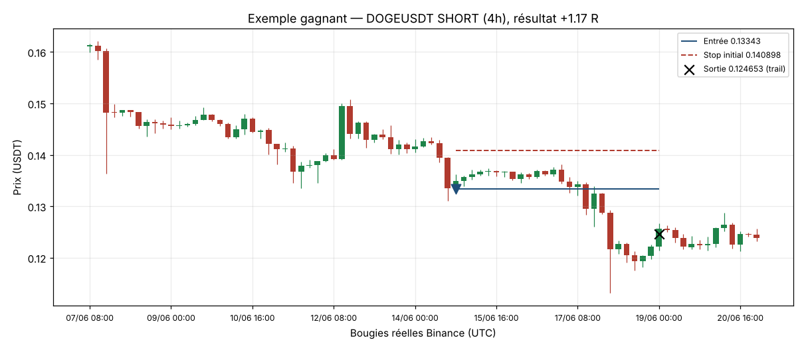
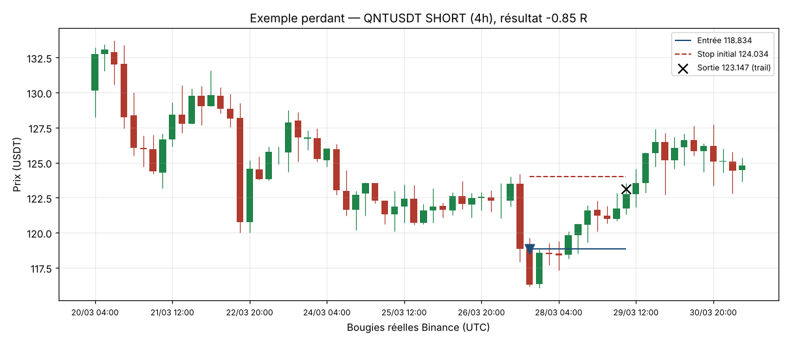
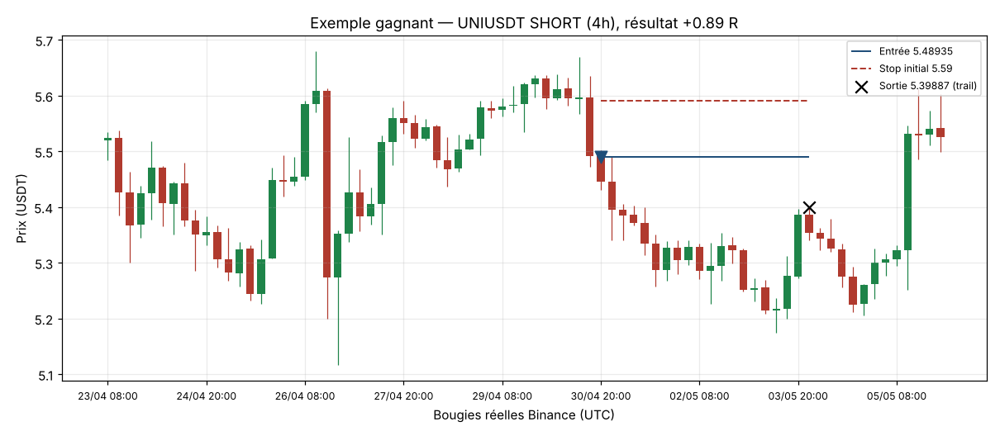
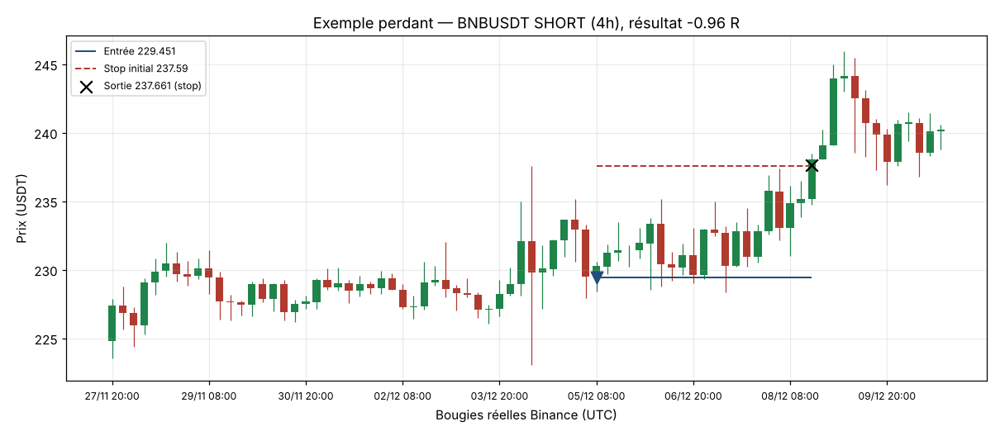
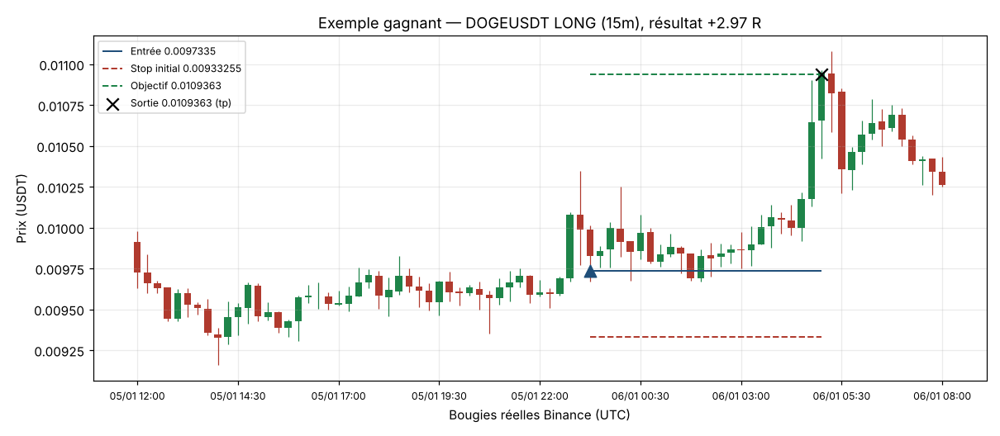
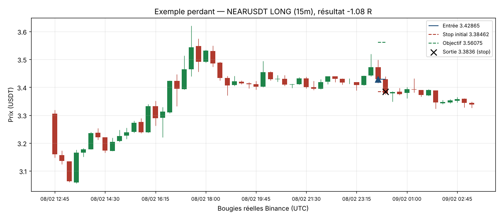
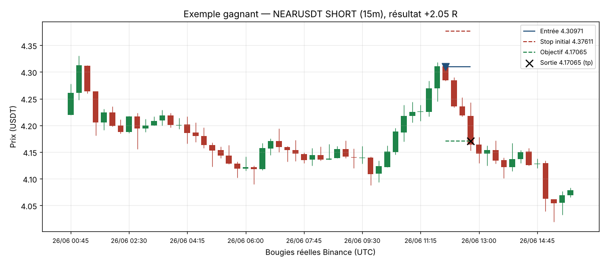
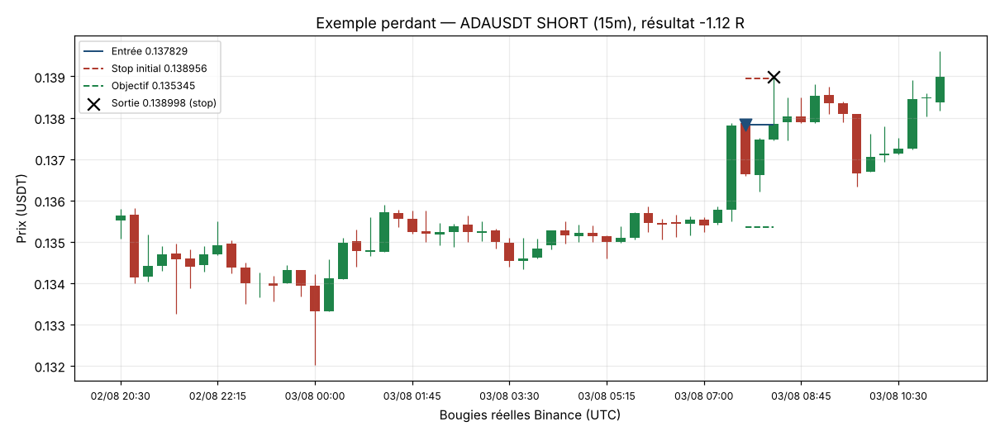
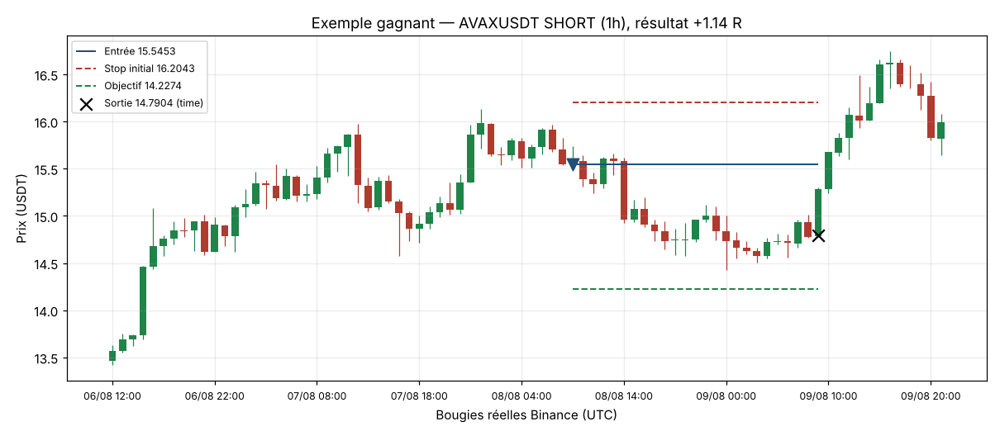
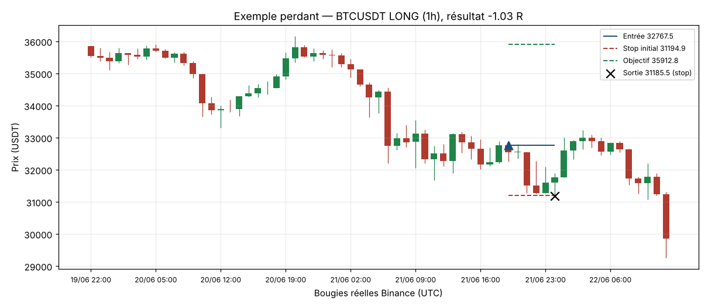

# Setups retenus

**Aucun setup n'a le verdict RETENU.** Aucune configuration ne remplit les 9 critères sur VAL puis sur TEST. Les fiches ci-dessous décrivent la meilleure configuration de chaque famille **à titre d'information uniquement** : elles portent toutes la mention **NON VALIDÉ** et ne doivent pas être tradées sur la base de ce rapport.

## Cassure de range (Donchian) — `C_tf4h_dc55_volon` — NON VALIDÉ (REJETÉ)

Famille C. Motif du verdict : critères ratés sur VAL : c8.

### Règles

1. Graphique **4h**, bougies closes uniquement.
2. **Signal** : clôture au-dessus du plus haut des 55 bougies précédentes (achat) ou sous leur plus bas (vente).
3. **Volume** : volume de la bougie de cassure > 1.5 × moyenne des 20 bougies précédentes.
4. **Entrée** : au marché à l'ouverture de la bougie suivante.
5. **Stop initial** : 2.0 × ATR(14) du prix d'entrée.
6. **Sortie** : stop suiveur chandelier à 3.0 × ATR(14) (plus haut/bas des bougies closes depuis l'entrée), jamais reculé.
7. **Filtre 4h** : aucun.

Dans tous les cas : signal ignoré si la distance au stop est inférieure à 0,3 % ou supérieure à 6 % du prix d'entrée ; 1 % du capital risqué par trade ; une seule position par paire, 5 au total.

### Résultats (nets de frais, slippage et funding)

| Jeu | Trades | Espérance nette [IC 95 %] | PF | % gagnants | Drawdown max | Rendement (info) |
|---|---|---|---|---|---|---|
| DEV | 455 | +0,223 R [+0,067 R ; +0,385 R] | 1,50 | 39,6 % | 18,8 % | 140,6 % |
| VAL | 545 | +0,189 R [+0,024 R ; +0,366 R] | 1,40 | 35,4 % | 33,4 % | 120,4 % |
| TEST | — | non évalué | — | — | — | — |

### Paires (VAL, au moins 10 trades)

- Espérance positive : SOLUSDT (+0,558 R, 29 trades), BTCUSDT (+0,394 R, 61 trades), NEARUSDT (+0,364 R, 18 trades), BNBUSDT (+0,336 R, 52 trades), ADAUSDT (+0,271 R, 53 trades), SUIUSDT (+0,247 R, 13 trades), ARBUSDT (+0,239 R, 27 trades), DOGEUSDT (+0,230 R, 32 trades), ZECUSDT (+0,135 R, 24 trades), LINKUSDT (+0,118 R, 36 trades), AVAXUSDT (+0,099 R, 39 trades).
- Espérance négative ou nulle : UNIUSDT (-0,571 R, 28 trades), QNTUSDT (-0,263 R, 28 trades), XRPUSDT (-0,055 R, 41 trades), ETHUSDT (-0,028 R, 55 trades).

### Exemples de trades (bougies réelles)

Exemple gagnant (trade médian parmi les gagnants de VAL) : DOGEUSDT short, entrée 2024-06-14 20:00 UTC à 0.13343, stop 0.140898, sortie 2024-06-19 01:15 UTC à 0.124653 (trail), résultat +1,168 R.

Exemple perdant (trade médian parmi les perdants de VAL) : QNTUSDT short, entrée 2023-03-27 16:00 UTC à 118.834, stop 124.034, sortie 2023-03-29 08:15 UTC à 123.147 (trail), résultat -0,847 R.

### Limites

- Pire trimestre : 2022-T3 (DEV), -0,295 R sur 47 trades.
- Sensibilité aux frais : sur VAL l'espérance passe de +0,189 R à +0,147 R avec frais et slippage doublés.
- Coûts sur VAL : 3 963 USDT pour 16 002 USDT de PnL brut (25 % du brut).
- Critères ratés sur VAL : drawdown ≤ 25 %.

Signal issu d'un backtest, aucune garantie de résultat.

## Continuation de tendance sur repli — `B_tf4h_rsi40-60_stoppivot_exittrail` — NON VALIDÉ (REJETÉ)

Famille B. Motif du verdict : critères ratés sur VAL : c3, c7, c8.

### Règles

1. Graphique **4h**, bougies closes uniquement.
2. **Tendance** : EMA50 > EMA200 pour acheter, EMA50 < EMA200 pour vendre.
3. **Repli** : le prix a touché ou traversé l'EMA20 sur l'une des 5 dernières bougies et la bougie courante clôture du bon côté de l'EMA20.
4. **RSI(14)** : repassé au-dessus de 40 (achat) ou en dessous de 60 (vente) après avoir été de l'autre côté sur l'une des 5 bougies précédentes.
5. **Entrée** : au marché à l'ouverture de la bougie suivante.
6. **Stop** : sur le dernier pivot confirmé (période 3) : plus bas pour un achat, plus haut pour une vente.
7. **Sortie** : **stop suiveur chandelier** : plus haut (plus bas) des bougies closes depuis l'entrée ∓ 3.0 × ATR(14), jamais reculé.
8. **Filtre 4h** : aucun.

Dans tous les cas : signal ignoré si la distance au stop est inférieure à 0,3 % ou supérieure à 6 % du prix d'entrée ; 1 % du capital risqué par trade ; une seule position par paire, 5 au total.

### Résultats (nets de frais, slippage et funding)

| Jeu | Trades | Espérance nette [IC 95 %] | PF | % gagnants | Drawdown max | Rendement (info) |
|---|---|---|---|---|---|---|
| DEV | 319 | +0,390 R [+0,096 R ; +0,775 R] | 1,76 | 39,2 % | 15,7 % | 176,0 % |
| VAL | 481 | +0,176 R [-0,017 R ; +0,394 R] | 1,36 | 37,4 % | 28,4 % | 93,2 % |
| TEST | — | non évalué | — | — | — | — |

### Paires (VAL, au moins 10 trades)

- Espérance positive : SOLUSDT (+1,199 R, 22 trades), UNIUSDT (+0,660 R, 35 trades), AVAXUSDT (+0,424 R, 23 trades), BNBUSDT (+0,395 R, 45 trades), ETHUSDT (+0,376 R, 35 trades), DOGEUSDT (+0,355 R, 24 trades), BTCUSDT (+0,303 R, 47 trades), LINKUSDT (+0,237 R, 41 trades).
- Espérance négative ou nulle : QNTUSDT (-0,272 R, 36 trades), ADAUSDT (-0,251 R, 41 trades), XRPUSDT (-0,186 R, 30 trades), NEARUSDT (-0,063 R, 23 trades), ZECUSDT (-0,045 R, 25 trades), ARBUSDT (-0,021 R, 24 trades).

### Exemples de trades (bougies réelles)

Exemple gagnant (trade médian parmi les gagnants de VAL) : UNIUSDT short, entrée 2023-04-30 20:00 UTC à 5.48935, stop 5.59, sortie 2023-05-04 00:00 UTC à 5.39887 (trail), résultat +0,890 R.

Exemple perdant (trade médian parmi les perdants de VAL) : BNBUSDT short, entrée 2023-12-05 08:00 UTC à 229.451, stop 237.59, sortie 2023-12-08 18:15 UTC à 237.661 (stop), résultat -0,960 R.

### Limites

- Pire trimestre : 2021-T1 (DEV), -0,518 R sur 11 trades.
- Sensibilité aux frais : sur VAL l'espérance passe de +0,176 R à +0,120 R avec frais et slippage doublés.
- Coûts sur VAL : 3 630 USDT pour 12 947 USDT de PnL brut (28 % du brut).
- Critères ratés sur VAL : borne basse IC 95 % > 0 ; ≥ 60 % des paires (≥ 10 trades) positives ; drawdown ≤ 25 %.

Signal issu d'un backtest, aucune garantie de résultat.

## SMC (sweep + MSS + retour sur zone) — `A_tf15m_n3_simple_FVG_tp3_htfon` — NON VALIDÉ (REJETÉ)

Famille A. Motif du verdict : aucune configuration ne passe DEV (≥ 100 trades, espérance > 0, PF > 1) avec le test de plateau.

### Règles

1. Graphique **15m**, bougies closes uniquement.
2. Repérer des **equal highs** (pour vendre) ou **equal lows** (pour acheter) : au moins 2 pivots de période 3 (plus haut/bas strict sur 3 bougies de chaque côté) dans les 50 dernières bougies, à moins de 0.15 % l'un de l'autre, niveau jamais dépassé depuis.
3. **Sweep** : une bougie dépasse ce niveau avec sa mèche mais clôture de l'autre côté.
4. **Cassure de structure** dans les 10 bougies suivantes : première clôture au-delà du dernier pivot opposé confirmé au moment du sweep ; sans condition de taille sur la bougie de cassure.
5. **Entrée** : ordre limite au **milieu du fair value gap** laissé par la bougie de cassure (écart entre la bougie d'avant et celle d'après). L'ordre est valable 10 bougies 15m, puis annulé.
6. **Stop** : au-delà de l'extrême de la mèche du sweep, avec une marge de 0.1 × ATR(14).
7. **Sortie** : objectif fixe à **3 R** (ordre limite).
8. **Filtre 4h** : achat seulement si EMA50(4h) > EMA200(4h), vente seulement si EMA50(4h) < EMA200(4h) (dernière bougie 4h close).

Dans tous les cas : signal ignoré si la distance au stop est inférieure à 0,3 % ou supérieure à 6 % du prix d'entrée ; 1 % du capital risqué par trade ; une seule position par paire, 5 au total.

### Résultats (nets de frais, slippage et funding)

| Jeu | Trades | Espérance nette [IC 95 %] | PF | % gagnants | Drawdown max | Rendement (info) |
|---|---|---|---|---|---|---|
| DEV | 309 | -0,034 R [-0,228 R ; +0,167 R] | 0,96 | 26,2 % | 32,6 % | -14,6 % |
| VAL | — | non évalué | — | — | — | — |
| TEST | — | non évalué | — | — | — | — |

### Paires (DEV, au moins 10 trades)

- Espérance positive : DOGEUSDT (+0,394 R, 19 trades), ETHUSDT (+0,273 R, 41 trades), SOLUSDT (+0,179 R, 13 trades), LINKUSDT (+0,059 R, 25 trades), XRPUSDT (+0,019 R, 22 trades).
- Espérance négative ou nulle : BTCUSDT (-0,411 R, 51 trades), ADAUSDT (-0,372 R, 23 trades), AVAXUSDT (-0,341 R, 17 trades), UNIUSDT (-0,136 R, 21 trades), BNBUSDT (-0,107 R, 40 trades), ZECUSDT (-0,020 R, 27 trades).

### Exemples de trades (bougies réelles)

Exemple gagnant (trade médian parmi les gagnants de DEV) : DOGEUSDT long, entrée 2021-01-05 23:15 UTC à 0.0097335, stop 0.00933255, sortie 2021-01-06 05:00 UTC à 0.0109363 (tp), résultat +2,972 R.

Exemple perdant (trade médian parmi les perdants de DEV) : NEARUSDT long, entrée 2021-02-09 00:00 UTC à 3.42865, stop 3.38462, sortie 2021-02-09 00:15 UTC à 3.3836 (stop), résultat -1,077 R.

### Limites

- Pire trimestre : 2020-T1 (DEV), -1,067 R sur 5 trades.
- Coûts sur DEV : 2 174 USDT pour 714 USDT de PnL brut (304 % du brut).

Signal issu d'un backtest, aucune garantie de résultat.

## Retour à la moyenne — `D_tf15m_k2p5_rsi25-75` — NON VALIDÉ (REJETÉ)

Famille D. Motif du verdict : aucune configuration ne passe DEV (≥ 100 trades, espérance > 0, PF > 1) avec le test de plateau.

### Règles

1. Graphique **15m**, bougies closes uniquement.
2. **Régime** : ADX(14) < 20.
3. **Signal** : clôture sous la bande basse de Bollinger(20, 2.5) avec RSI(14) ≤ 25 (achat), ou au-dessus de la bande haute avec RSI(14) ≥ 75 (vente).
4. **Entrée** : au marché à l'ouverture de la bougie suivante.
5. **Stop** : 1.5 × ATR(14) du prix d'entrée.
6. **Objectif** : la moyenne mobile 20 (milieu de Bollinger) relevée à la bougie du signal, figée.
7. **Sortie temporelle** : au marché après 24 bougies 15m si ni stop ni objectif.
8. **Filtre 4h** : aucun.

Dans tous les cas : signal ignoré si la distance au stop est inférieure à 0,3 % ou supérieure à 6 % du prix d'entrée ; 1 % du capital risqué par trade ; une seule position par paire, 5 au total.

### Résultats (nets de frais, slippage et funding)

| Jeu | Trades | Espérance nette [IC 95 %] | PF | % gagnants | Drawdown max | Rendement (info) |
|---|---|---|---|---|---|---|
| DEV | 590 | -0,277 R [-0,387 R ; -0,165 R] | 0,65 | 28,8 % | 83,6 % | -81,9 % |
| VAL | — | non évalué | — | — | — | — |
| TEST | — | non évalué | — | — | — | — |

### Paires (DEV, au moins 10 trades)

- Espérance positive : aucune.
- Espérance négative ou nulle : ETHUSDT (-0,509 R, 70 trades), LINKUSDT (-0,474 R, 43 trades), ADAUSDT (-0,411 R, 50 trades), SOLUSDT (-0,397 R, 31 trades), DOGEUSDT (-0,309 R, 64 trades), BNBUSDT (-0,246 R, 68 trades), XRPUSDT (-0,205 R, 66 trades), UNIUSDT (-0,204 R, 29 trades), ZECUSDT (-0,145 R, 40 trades), AVAXUSDT (-0,136 R, 37 trades), BTCUSDT (-0,073 R, 61 trades), NEARUSDT (-0,038 R, 29 trades).

### Exemples de trades (bougies réelles)

Exemple gagnant (trade médian parmi les gagnants de DEV) : NEARUSDT short, entrée 2022-06-26 12:00 UTC à 4.30971, stop 4.37611, sortie 2022-06-26 12:45 UTC à 4.17065 (tp), résultat +2,049 R.

Exemple perdant (trade médian parmi les perdants de DEV) : ADAUSDT short, entrée 2020-08-03 07:45 UTC à 0.137829, stop 0.138956, sortie 2020-08-03 08:15 UTC à 0.138998 (stop), résultat -1,121 R.

### Limites

- Pire trimestre : 2020-T2 (DEV), -0,692 R sur 39 trades.
- Coûts sur DEV : 4 210 USDT pour -3 981 USDT de PnL brut.

Signal issu d'un backtest, aucune garantie de résultat.

## Extrêmes de funding (contrarien) — `E_z3_hold24` — NON VALIDÉ (REJETÉ)

Famille E. Motif du verdict : aucune configuration ne passe DEV (≥ 100 trades, espérance > 0, PF > 1) avec le test de plateau.

### Règles

1. Graphique **1h**, bougies closes uniquement.
2. **Signal** : z-score du dernier funding (moyenne et écart-type des 90 règlements précédents) ≥ +3 (vente) ou ≤ −3 (achat).
3. **Confirmation** dans les 8 h suivant le règlement : une bougie 1h clôture sous le plus bas de la précédente (vente) ou au-dessus de son plus haut (achat).
4. **Entrée** : au marché à l'ouverture de la bougie suivante.
5. **Stop** : 2.0 × ATR(14) du prix d'entrée. **Objectif** : 2 R.
6. **Sortie temporelle** : au marché après 24 h de détention.
7. **Filtre 4h** : aucun.

Dans tous les cas : signal ignoré si la distance au stop est inférieure à 0,3 % ou supérieure à 6 % du prix d'entrée ; 1 % du capital risqué par trade ; une seule position par paire, 5 au total.

### Résultats (nets de frais, slippage et funding)

| Jeu | Trades | Espérance nette [IC 95 %] | PF | % gagnants | Drawdown max | Rendement (info) |
|---|---|---|---|---|---|---|
| DEV | 645 | -0,026 R [-0,118 R ; +0,065 R] | 0,95 | 42,2 % | 40,8 % | -21,9 % |
| VAL | — | non évalué | — | — | — | — |
| TEST | — | non évalué | — | — | — | — |

### Paires (DEV, au moins 10 trades)

- Espérance positive : ADAUSDT (+0,148 R, 60 trades), SOLUSDT (+0,140 R, 26 trades), BNBUSDT (+0,139 R, 60 trades), AVAXUSDT (+0,107 R, 37 trades), DOGEUSDT (+0,086 R, 50 trades), XRPUSDT (+0,033 R, 57 trades), UNIUSDT (+0,014 R, 49 trades).
- Espérance négative ou nulle : ETHUSDT (-0,345 R, 70 trades), ZECUSDT (-0,160 R, 76 trades), LINKUSDT (-0,095 R, 57 trades), NEARUSDT (-0,087 R, 42 trades), BTCUSDT (-0,053 R, 61 trades).

### Exemples de trades (bougies réelles)

Exemple gagnant (trade médian parmi les gagnants de DEV) : AVAXUSDT short, entrée 2021-08-08 09:00 UTC à 15.5453, stop 16.2043, sortie 2021-08-09 09:00 UTC à 14.7904 (time), résultat +1,137 R.

Exemple perdant (trade médian parmi les perdants de DEV) : BTCUSDT long, entrée 2021-06-21 19:00 UTC à 32767.5, stop 31194.9, sortie 2021-06-22 00:15 UTC à 31185.5 (stop), résultat -1,028 R.

### Limites

- Pire trimestre : 2021-T2 (DEV), -0,237 R sur 43 trades.
- Coûts sur DEV : 1 799 USDT pour -393 USDT de PnL brut.

Signal issu d'un backtest, aucune garantie de résultat.
