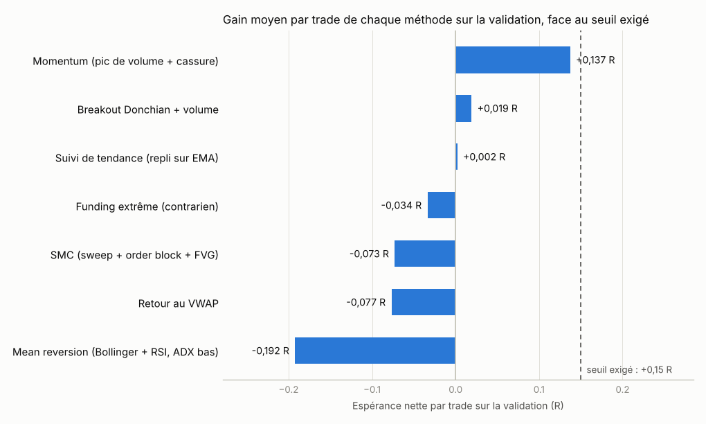
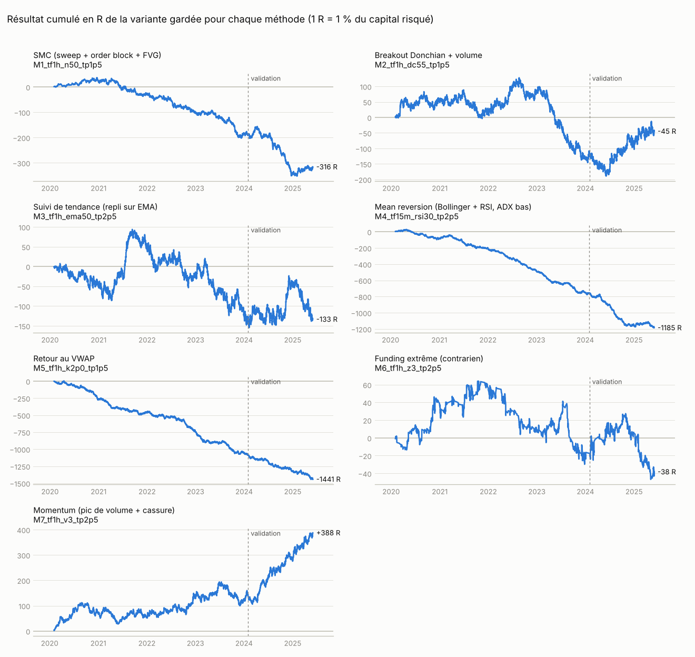

# Rapport : comparaison de sept méthodes sur les perpétuels crypto (15m et 1H)

## Verdict

**Aucune méthode n'est retenue.** Aucune ne remplit tous les critères sur la validation ; le test final n'a donc pas été ouvert.

- Données : 20 paires Binance USDT-M, bougies 15m, funding réel, du 2020-01-01 au 2026-10-31.
- Découpe : entraînement 2020-01-01 → 2024-01-31, validation 2024-02-01 → 2025-05-31, test final 2025-06-01 → 2026-10-31.
- Variantes testées dans cette étude : **56** (7 méthodes × 8). Avec les 133 configurations des études précédentes sur les mêmes données : **189 au total**. Plus on en teste, plus un bon résultat isolé peut être dû au hasard.
- Tous les chiffres sont nets : frais 0,05 % par côté, slippage 0,02 %, funding payé ou reçu. Risque de 1 % du capital par trade, stop à 1,5 × ATR, 5 positions au plus.

## Tableau comparatif

Une ligne par méthode : la variante gardée est celle qui a la meilleure espérance sur l'entraînement (parmi celles d'au moins 200 trades). Elle est ensuite mesurée telle quelle sur la validation.

| Méthode | Variante gardée | Entraînement : E[R] (trades) | Validation : E[R] (trades) | Gagnants | Profit factor | Drawdown max | Paires positives | Critères | Test final | Verdict |
|---|---|---|---|---|---|---|---|---|---|---|
| **SMC (sweep + order block + FVG)** | `M1_tf1h_n50_tp1p5` | -0,062 R (3049) | -0,073 R (1744) | 39,3 % | 0,89 | 87,8 % | 25 % | 1 / 8 | non ouvert | **REJETÉE** |
| **Breakout Donchian + volume** | `M2_tf1h_dc55_tp1p5` | -0,014 R (8155) | +0,019 R (3567) | 43,1 % | 1,03 | 58,9 % | 55 % | 2 / 8 | non ouvert | **REJETÉE** |
| **Suivi de tendance (repli sur EMA)** | `M3_tf1h_ema50_tp2p5` | -0,025 R (5541) | +0,002 R (2320) | 30,4 % | 1,00 | 73,1 % | 60 % | 3 / 8 | non ouvert | **REJETÉE** |
| **Mean reversion (Bollinger + RSI, ADX bas)** | `M4_tf15m_rsi30_tp2p5` | -0,164 R (4641) | -0,192 R (2206) | 26,7 % | 0,77 | 99,1 % | 10 % | 1 / 8 | non ouvert | **REJETÉE** |
| **Retour au VWAP** | `M5_tf1h_k2p0_tp1p5` | -0,093 R (11726) | -0,077 R (4616) | 39,2 % | 0,88 | 98,4 % | 0 % | 1 / 8 | non ouvert | **REJETÉE** |
| **Funding extrême (contrarien)** | `M6_tf1h_z3_tp2p5` | -0,013 R (1242) | -0,034 R (648) | 29,0 % | 0,95 | 54,5 % | 40 % | 1 / 8 | non ouvert | **REJETÉE** |
| **Momentum (pic de volume + cassure)** | `M7_tf1h_v3_tp2p5` | +0,036 R (3794) | +0,137 R (1830) | 34,2 % | 1,20 | 30,9 % | 80 % | 5 / 8 | non ouvert | **REJETÉE** |

E[R] = gain moyen par trade en multiples du risque, après tous les coûts. Colonnes « Gagnants » à « Critères » : sur la validation.



## Ce que montrent les chiffres

- **En 15m, tout perd.** Les 28 variantes en 15m sont négatives sur l'entraînement (0 positive) et sur la validation (0 positive). Une entrée tirée au hasard y perd déjà 0,15 R par trade en médiane : c'est le poids des frais quand le stop est proche du prix.
- **En 1H, les frais pèsent moitié moins** (hasard : -0,08 R par trade), mais 3 variantes sur 28 seulement sont positives sur l'entraînement et 7 sur la validation.
- **La méthode la plus proche est « Momentum (pic de volume + cassure) »** (`M7_tf1h_v3_tp2p5`) : +0,036 R par trade sur l'entraînement, +0,137 R sur la validation, profit factor 1,20, drawdown 30,9 %. Elle rate : espérance > 0,15 R ; profit factor > 1,3 ; drawdown < 25 %. En walk-forward elle est positive sur 4 fenêtres sur 5 (+0,081 R par trade).
- Aucune méthode n'a le droit d'être appelée rentable ici : les seuils ont été fixés avant le calcul et aucun n'est franchi en entier.

## Critères sur la validation

| Méthode | 1 | 2 | 3 | 4 | 5 | 6 | 7 | 8 | Stabilité ±20 % | Critères ratés |
|---|---|---|---|---|---|---|---|---|---|---|
| SMC (sweep + order block + FVG) | ✅ | ❌ | ❌ | ❌ | ❌ | ❌ | ❌ | ❌ | non calculée | espérance > 0,15 R ; profit factor > 1,3 ; drawdown < 25 % ; ≥ 60 % des paires positives ; Monte Carlo ≥ 95 % ; mieux que le hasard ; mieux que le buy & hold |
| Breakout Donchian + volume | ✅ | ❌ | ❌ | ❌ | ❌ | ❌ | ✅ | ❌ | non calculée | espérance > 0,15 R ; profit factor > 1,3 ; drawdown < 25 % ; ≥ 60 % des paires positives ; Monte Carlo ≥ 95 % ; mieux que le buy & hold |
| Suivi de tendance (repli sur EMA) | ✅ | ❌ | ❌ | ❌ | ✅ | ❌ | ✅ | ❌ | non calculée | espérance > 0,15 R ; profit factor > 1,3 ; drawdown < 25 % ; Monte Carlo ≥ 95 % ; mieux que le buy & hold |
| Mean reversion (Bollinger + RSI, ADX bas) | ✅ | ❌ | ❌ | ❌ | ❌ | ❌ | ❌ | ❌ | non calculée | espérance > 0,15 R ; profit factor > 1,3 ; drawdown < 25 % ; ≥ 60 % des paires positives ; Monte Carlo ≥ 95 % ; mieux que le hasard ; mieux que le buy & hold |
| Retour au VWAP | ✅ | ❌ | ❌ | ❌ | ❌ | ❌ | ❌ | ❌ | non calculée | espérance > 0,15 R ; profit factor > 1,3 ; drawdown < 25 % ; ≥ 60 % des paires positives ; Monte Carlo ≥ 95 % ; mieux que le hasard ; mieux que le buy & hold |
| Funding extrême (contrarien) | ✅ | ❌ | ❌ | ❌ | ❌ | ❌ | ❌ | ❌ | non calculée | espérance > 0,15 R ; profit factor > 1,3 ; drawdown < 25 % ; ≥ 60 % des paires positives ; Monte Carlo ≥ 95 % ; mieux que le hasard ; mieux que le buy & hold |
| Momentum (pic de volume + cassure) | ✅ | ❌ | ❌ | ❌ | ✅ | ✅ | ✅ | ✅ | non calculée | espérance > 0,15 R ; profit factor > 1,3 ; drawdown < 25 % |

Critères : 1. ≥ 200 trades ; 2. espérance > 0,15 R ; 3. profit factor > 1,3 ; 4. drawdown < 25 % ; 5. ≥ 60 % des paires positives ; 6. Monte Carlo ≥ 95 % ; 7. mieux que le hasard ; 8. mieux que le buy & hold.
La stabilité n'est calculée que pour une méthode qui remplit les huit autres critères.

| Méthode | Monte Carlo : tirages positifs | Drawdown au 95e centile (ordre mélangé) | Hasard : médiane | Hasard : 95e centile | Centile de la méthode | Rendement | Rendement / drawdown |
|---|---|---|---|---|---|---|---|
| SMC (sweep + order block + FVG) | 0,8 % | 83,0 % | -0,075 R | -0,028 R | 53 | -77,8 % | -0,89 |
| Breakout Donchian + volume | 82,4 % | 65,3 % | -0,063 R | -0,031 R | 100 | +4,7 % | +0,08 |
| Suivi de tendance (repli sur EMA) | 52,6 % | 75,2 % | -0,074 R | -0,020 R | 99 | -42,9 % | -0,59 |
| Mean reversion (Bollinger + RSI, ADX bas) | 0,0 % | 99,2 % | -0,151 R | -0,093 R | 10 | -99,1 % | -1,00 |
| Retour au VWAP | 0,0 % | 98,6 % | -0,071 R | -0,043 R | 39 | -98,4 % | -1,00 |
| Funding extrême (contrarien) | 29,4 % | 55,9 % | -0,068 R | +0,033 R | 72 | -31,0 % | -0,57 |
| Momentum (pic de volume + cassure) | 100,0 % | 42,2 % | -0,070 R | -0,004 R | 100 | +661,6 % | +21,39 |

Buy & hold sur la validation (panier égal de 17 paires) : rendement +120,7 %, drawdown maximal 64,6 %, rapport +1,87.

## Walk-forward (entraînement + validation)

Pour chaque fenêtre de 8 mois, la variante est choisie sur tout ce qui précède, puis mesurée sur la fenêtre.

| Méthode | 2022-02 → 2022-09 | 2022-10 → 2023-05 | 2023-06 → 2024-01 | 2024-02 → 2024-09 | 2024-10 → 2025-05 | Ensemble | Fenêtres positives |
|---|---|---|---|---|---|---|---|
| SMC (sweep + order block + FVG) | -0,217 R (697) | -0,068 R (884) | -0,181 R (902) | -0,074 R (868) | -0,120 R (910) | -0,129 R (4261) | 0 / 5 |
| Breakout Donchian + volume | +0,041 R (1195) | -0,062 R (1362) | -0,059 R (1644) | -0,005 R (1757) | -0,000 R (1597) | -0,019 R (7555) | 1 / 5 |
| Suivi de tendance (repli sur EMA) | -0,053 R (829) | -0,056 R (969) | -0,058 R (1180) | +0,019 R (1185) | -0,015 R (1135) | -0,031 R (5298) | 1 / 5 |
| Mean reversion (Bollinger + RSI, ADX bas) | -0,251 R (698) | -0,321 R (711) | -0,135 R (965) | -0,285 R (1146) | -0,114 R (1069) | -0,214 R (4589) | 0 / 5 |
| Retour au VWAP | -0,046 R (1994) | -0,170 R (1970) | -0,092 R (2050) | -0,082 R (2274) | -0,072 R (2342) | -0,091 R (10630) | 0 / 5 |
| Funding extrême (contrarien) | -0,213 R (177) | -0,028 R (189) | -0,093 R (259) | +0,101 R (321) | -0,166 R (327) | -0,070 R (1273) | 1 / 5 |
| Momentum (pic de volume + cassure) | +0,032 R (510) | +0,090 R (721) | -0,017 R (871) | +0,116 R (911) | +0,158 R (919) | +0,081 R (3932) | 4 / 5 |

## Courbes de capital



Chaque panneau a sa propre échelle verticale. La ligne pointillée marque le début de la validation.

## Test final

Non ouvert : aucune méthode ne remplit tous les critères sur la validation. Les données du 2025-06-01 au 2026-10-31 n'ont pas été lues dans cette étude.

## Toutes les variantes

| Variante | Entr. : trades | Entr. : E[R] | Entr. : PF | Valid. : trades | Valid. : % gagnants | Valid. : E[R] | Valid. : PF | Valid. : DD % |
|---|---:|---:|---:|---:|---:|---:|---:|---:|
| `M1_tf15m_n20_tp1p5` | 19305 | -0,147 | 0,79 | 9838 | 39,5 | -0,132 | 0,81 | 100,0 |
| `M1_tf15m_n20_tp2p5` | 16369 | -0,136 | 0,83 | 7682 | 28,5 | -0,124 | 0,85 | 100,0 |
| `M1_tf15m_n50_tp1p5` | 12386 | -0,152 | 0,78 | 7013 | 38,1 | -0,164 | 0,76 | 100,0 |
| `M1_tf15m_n50_tp2p5` | 11504 | -0,145 | 0,82 | 6091 | 27,7 | -0,148 | 0,82 | 100,0 |
| `M1_tf1h_n20_tp1p5` | 4865 | -0,066 | 0,90 | 2498 | 39,8 | -0,062 | 0,90 | 90,2 |
| `M1_tf1h_n20_tp2p5` | 4143 | -0,070 | 0,91 | 1895 | 28,9 | -0,048 | 0,94 | 83,3 |
| `M1_tf1h_n50_tp1p5` | 3049 | -0,062 | 0,90 | 1744 | 39,3 | -0,073 | 0,89 | 87,8 |
| `M1_tf1h_n50_tp2p5` | 2862 | -0,066 | 0,91 | 1491 | 28,6 | -0,059 | 0,92 | 83,2 |
| `M2_tf15m_dc20_tp1p5` | 46984 | -0,156 | 0,78 | 19310 | 39,7 | -0,126 | 0,81 | 100,0 |
| `M2_tf15m_dc20_tp2p5` | 34433 | -0,140 | 0,83 | 13186 | 28,7 | -0,118 | 0,85 | 100,0 |
| `M2_tf15m_dc55_tp1p5` | 32194 | -0,143 | 0,79 | 14546 | 39,3 | -0,135 | 0,80 | 100,0 |
| `M2_tf15m_dc55_tp2p5` | 25329 | -0,135 | 0,83 | 10794 | 28,3 | -0,130 | 0,84 | 100,0 |
| `M2_tf1h_dc20_tp1p5` | 11877 | -0,029 | 0,95 | 4643 | 41,8 | -0,014 | 0,98 | 80,0 |
| `M2_tf1h_dc20_tp2p5` | 8527 | -0,014 | 0,98 | 3228 | 30,7 | +0,013 | 1,02 | 66,0 |
| `M2_tf1h_dc55_tp1p5` | 8155 | -0,014 | 0,98 | 3567 | 43,1 | +0,019 | 1,03 | 58,9 |
| `M2_tf1h_dc55_tp2p5` | 6399 | -0,021 | 0,97 | 2600 | 31,7 | +0,049 | 1,07 | 49,1 |
| `M3_tf15m_ema20_tp1p5` | 40167 | -0,141 | 0,80 | 16668 | 40,8 | -0,100 | 0,85 | 100,0 |
| `M3_tf15m_ema20_tp2p5` | 28850 | -0,117 | 0,86 | 11154 | 29,7 | -0,079 | 0,90 | 100,0 |
| `M3_tf15m_ema50_tp1p5` | 29240 | -0,150 | 0,78 | 13151 | 40,1 | -0,121 | 0,82 | 100,0 |
| `M3_tf15m_ema50_tp2p5` | 22772 | -0,121 | 0,85 | 9511 | 29,0 | -0,109 | 0,86 | 100,0 |
| `M3_tf1h_ema20_tp1p5` | 10075 | -0,069 | 0,89 | 4386 | 41,3 | -0,026 | 0,96 | 87,7 |
| `M3_tf1h_ema20_tp2p5` | 7337 | -0,032 | 0,96 | 2891 | 30,2 | -0,003 | 1,00 | 77,8 |
| `M3_tf1h_ema50_tp1p5` | 7220 | -0,071 | 0,89 | 3320 | 40,8 | -0,042 | 0,93 | 88,2 |
| `M3_tf1h_ema50_tp2p5` | 5541 | -0,025 | 0,97 | 2320 | 30,4 | +0,002 | 1,00 | 73,1 |
| `M4_tf15m_rsi30_tp1p5` | 4681 | -0,172 | 0,75 | 2235 | 37,6 | -0,183 | 0,74 | 98,8 |
| `M4_tf15m_rsi30_tp2p5` | 4641 | -0,164 | 0,80 | 2206 | 26,7 | -0,192 | 0,77 | 99,1 |
| `M4_tf15m_rsi25_tp1p5` | 892 | -0,301 | 0,60 | 332 | 36,7 | -0,201 | 0,72 | 58,2 |
| `M4_tf15m_rsi25_tp2p5` | 892 | -0,235 | 0,72 | 332 | 25,0 | -0,247 | 0,71 | 70,9 |
| `M4_tf1h_rsi30_tp1p5` | 1256 | -0,255 | 0,65 | 575 | 35,3 | -0,180 | 0,74 | 76,5 |
| `M4_tf1h_rsi30_tp2p5` | 1248 | -0,251 | 0,69 | 567 | 23,3 | -0,249 | 0,70 | 80,5 |
| `M4_tf1h_rsi25_tp1p5` | 287 | -0,242 | 0,66 | 115 | 33,9 | -0,213 | 0,70 | 36,8 |
| `M4_tf1h_rsi25_tp2p5` | 287 | -0,297 | 0,65 | 115 | 19,1 | -0,390 | 0,54 | 41,7 |
| `M5_tf15m_k2p0_tp1p5` | 32644 | -0,188 | 0,73 | 14182 | 38,8 | -0,148 | 0,79 | 100,0 |
| `M5_tf15m_k2p0_tp2p5` | 24798 | -0,179 | 0,78 | 9947 | 27,3 | -0,161 | 0,80 | 100,0 |
| `M5_tf15m_k2p5_tp1p5` | 14186 | -0,181 | 0,74 | 7044 | 39,1 | -0,140 | 0,80 | 100,0 |
| `M5_tf15m_k2p5_tp2p5` | 12797 | -0,189 | 0,77 | 6041 | 28,0 | -0,138 | 0,83 | 100,0 |
| `M5_tf1h_k2p0_tp1p5` | 11726 | -0,093 | 0,86 | 4616 | 39,2 | -0,077 | 0,88 | 98,4 |
| `M5_tf1h_k2p0_tp2p5` | 7695 | -0,098 | 0,87 | 3015 | 27,3 | -0,103 | 0,87 | 97,6 |
| `M5_tf1h_k2p5_tp1p5` | 7786 | -0,104 | 0,84 | 3312 | 40,5 | -0,043 | 0,93 | 86,6 |
| `M5_tf1h_k2p5_tp2p5` | 5833 | -0,105 | 0,86 | 2343 | 28,1 | -0,074 | 0,90 | 92,0 |
| `M6_tf15m_z2_tp1p5` | 3254 | -0,121 | 0,82 | 1894 | 38,6 | -0,140 | 0,79 | 95,4 |
| `M6_tf15m_z2_tp2p5` | 3019 | -0,095 | 0,88 | 1762 | 26,9 | -0,164 | 0,80 | 97,0 |
| `M6_tf15m_z3_tp1p5` | 1680 | -0,131 | 0,81 | 937 | 37,1 | -0,170 | 0,75 | 84,0 |
| `M6_tf15m_z3_tp2p5` | 1607 | -0,103 | 0,87 | 887 | 26,2 | -0,184 | 0,77 | 86,2 |
| `M6_tf1h_z2_tp1p5` | 2535 | -0,032 | 0,95 | 1440 | 39,4 | -0,062 | 0,90 | 80,7 |
| `M6_tf1h_z2_tp2p5` | 2142 | -0,042 | 0,94 | 1162 | 27,6 | -0,081 | 0,89 | 81,8 |
| `M6_tf1h_z3_tp1p5` | 1395 | -0,042 | 0,93 | 775 | 39,2 | -0,064 | 0,90 | 60,4 |
| `M6_tf1h_z3_tp2p5` | 1242 | -0,013 | 0,98 | 648 | 29,0 | -0,034 | 0,95 | 54,5 |
| `M7_tf15m_v2_tp1p5` | 42112 | -0,153 | 0,78 | 18452 | 39,3 | -0,136 | 0,80 | 100,0 |
| `M7_tf15m_v2_tp2p5` | 30481 | -0,145 | 0,82 | 12304 | 29,4 | -0,088 | 0,89 | 100,0 |
| `M7_tf15m_v3_tp1p5` | 21000 | -0,133 | 0,81 | 10623 | 39,5 | -0,132 | 0,81 | 100,0 |
| `M7_tf15m_v3_tp2p5` | 17898 | -0,123 | 0,85 | 8621 | 29,0 | -0,106 | 0,87 | 100,0 |
| `M7_tf1h_v2_tp1p5` | 9825 | -0,006 | 0,99 | 4311 | 41,2 | -0,028 | 0,95 | 86,3 |
| `M7_tf1h_v2_tp2p5` | 7124 | +0,019 | 1,03 | 2866 | 31,1 | +0,030 | 1,04 | 53,3 |
| `M7_tf1h_v3_tp1p5` | 4353 | +0,006 | 1,01 | 2220 | 44,7 | +0,058 | 1,10 | 38,7 |
| `M7_tf1h_v3_tp2p5` | 3794 | +0,036 | 1,05 | 1830 | 34,2 | +0,137 | 1,20 | 30,9 |

Variantes à espérance positive sur l'entraînement : 3 sur 56 ; sur la validation : 7 sur 56.

## Limites

- **Données déjà utilisées.** 133 configurations avaient été testées sur ces paires et ces années avant cette étude. La découpe entraînement / validation n'est donc pas neuve.
- **Test final.** La période 2025-2026 a été ouverte une fois, pour une configuration 4h, dans une étude précédente.
- **Biais de survie.** Les 20 paires sont les plus échangées fin 2026 ; les contrats disparus ne sont pas testés.
- **Exécution simulée.** Résolution 15 minutes, slippage fixe, pas de carnet d'ordres ni d'impact de marché. Stop prioritaire sur l'objectif dans la même bougie.
- **Règles mécaniques.** Chaque méthode est une traduction codée parmi d'autres possibles. Un rejet ne prouve pas qu'une lecture discrétionnaire de la même idée échoue ; il prouve que ces règles-là échouent.
- **Baseline aléatoire** : tirée d'un réservoir d'entrées au hasard, sans la limite de 5 positions simultanées.
- Aucune performance future n'est promise par ce document.

## Fichiers

`PROTOCOLE_ETUDE_4.md` (règles écrites avant le calcul), `config/etude4.yaml` (grille et seuils), `results_etude4/` (trades, tableaux, graphiques), `TRIALS_etude4.csv` (toutes les évaluations).

```bash
python -m src.etude4 run && python -m src.etude4 report
```

## Contrôles

### 1. Tests

Sortie de `python -m pytest -q` (après la dernière modification du code) :

```
........................................................................ [ 85%]
............                                                             [100%]
84 passed, 36 warnings in 34.62s
```

### 2. Le test final n'a pas été lu

- `final_test_unlocked: false` dans `config/etude4.yaml` ; `results_etude4/summary_test.csv` n’existe pas.
- 2 exécutions consignées dans `results_etude4/run_log.txt`, toutes avec `final_test_unlocked=False` et une dernière bougie en mémoire au 2025-05-31 23:45 : True.
- Sortie de trade la plus tardive dans tous les fichiers de trades : 2025-05-31 23:45:00+00:00 (avant le 2025-06-01).

### 3. Variantes consignées

- `TRIALS_etude4.csv` : 112 lignes, 56 variantes distinctes (56 sur l'entraînement, 56 sur la validation, 0 sur le test).
- Grille de `config/etude4.yaml` : 56 combinaisons. Hors grille : 0. Absentes : 0.

### 4. Deux exécutions identiques

- `python -m src.etude4 run` lancé deux fois (cache de signaux effacé entre les deux) : 112 fichiers de trades, empreintes SHA-256 identiques fichier par fichier : **True**. Fichiers actuels identiques à ces exécutions : **True**.
- Empreinte de la liste des empreintes : `7bdf0f804c2b2e8210c14a4499487901d77d47823d6aa442e7f7f6185da2ca10`.
- Entre les deux exécutions, seul le calcul du walk-forward a été corrigé (une erreur d'unité de temps rendait toutes les fenêtres vides) ; les trades, la sélection et les critères sont inchangés.

### 5. Trois valeurs recalculées à la main

Trois lignes tirées au hasard (graine 42), recalculées directement à partir du fichier de trades, sans passer par le code de l'étude.

| Variante | Jeu | Grandeur | Rapport | Recalcul | Écart |
|---|---|---|---:|---:|---:|
| `M3_tf15m_ema20_tp2p5` | validation | expectancy_r | -0.0788337 | -0.0788337 | 1.1e-08 |
| `M2_tf15m_dc20_tp2p5` | entraînement | profit_factor | 0.827698 | 0.827698 | 1.3e-07 |
| `M4_tf1h_rsi30_tp2p5` | validation | win_rate | 0.232804 | 0.232804 | 2.3e-07 |

Un trade vérifié (premier trade de `M7_tf1h_v3_tp2p5` sur la validation, BNBUSDT short, sortie « stop ») : PnL = sens × (sortie − entrée) × taille − frais − funding = -114.7960 USDT (fichier : -114.7960) ; frais = (entrée + sortie) × taille × 0,05 % = 12.3218 (fichier : 12.3218).

Écarts tous inférieurs à 1e-5 : **True**.
